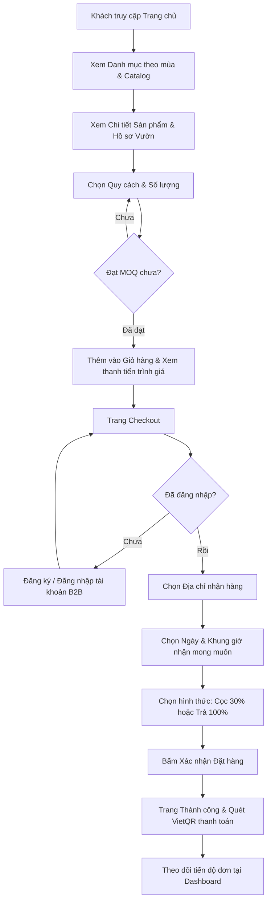
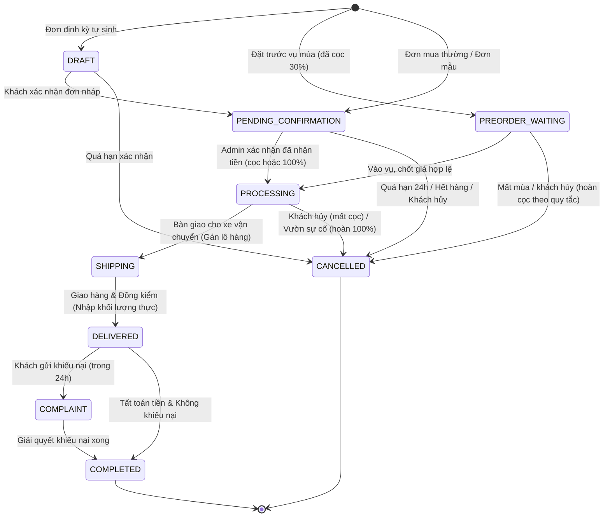
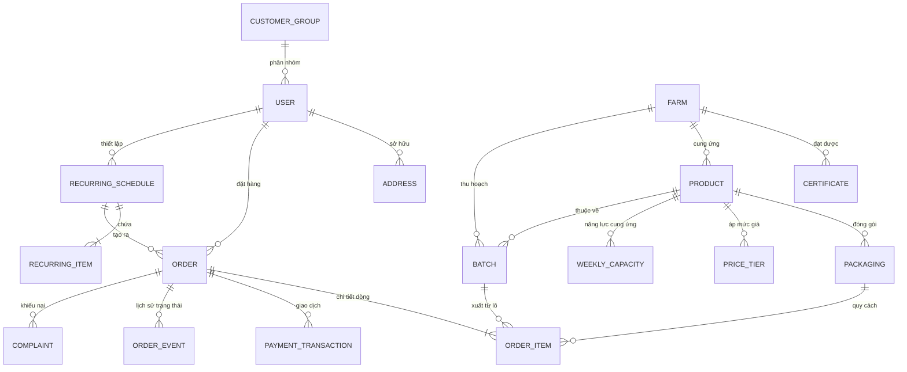

# ĐẶC TẢ YÊU CẦU NGHIỆP VỤ (PRD)
# WEBSITE THƯƠNG MẠI ĐIỆN TỬ B2B NÔNG SẢN – TRÁI CÂY (BẢN V2 ĐÃ HIỆU CHỈNH)

> **Bối cảnh dự án:** Đồ án môn học Thương mại Điện tử.
> **Mục tiêu tài liệu:** Bản đặc tả nghiệp vụ hoàn chỉnh, thống nhất, giải quyết toàn bộ các mâu thuẫn trong bản thảo ban đầu và chuẩn hóa các luồng xử lý thực tế cho mô hình kinh doanh trái cây tươi số lượng lớn.

---

## 1. TỔNG QUAN & ĐỊNH VỊ SẢN PHẨM

### 1.1 Mô hình kinh doanh
- **Định vị:** Mô hình **Nhà phân phối B2B (B2B Distributor / Merchant Model)**.
- **Bên bán:** Doanh nghiệp vận hành hệ thống website (1 người bán duy nhất). Doanh nghiệp trực tiếp ký kết hợp đồng thu mua, bao tiêu và quản lý chất lượng với các nhà vườn liên kết tại các vùng nguyên liệu (ĐBSCL, Tây Nguyên, Đông Nam Bộ).
- **Bên mua (Khách sỉ):** Chuỗi siêu thị mini, đại lý cấp 1, cửa hàng trái cây sạch, bếp ăn công nghiệp, chuỗi F&B (quán nước ép, nhà hàng).
- **Lưu ý kiến trúc:** Nhà vườn **không phải là người bán độc lập** (không phải sàn đa người bán C2C/B2C). Nhà vườn là đối tượng đối tác nguồn hàng do Ban quản trị (Admin) quản lý và gắn với từng lô hàng thu hoạch.

### 1.2 Ba bài toán cốt lõi của khách sỉ trái cây
1. **Niềm tin (Quality & Origin):** Minh bạch nguồn gốc thông qua tab "Hồ sơ vườn" chi tiết (vị trí tọa độ, chứng nhận VietGAP/GlobalGAP) và hệ thống mã QR gắn theo từng lô hàng thu hoạch (`Batch`).
2. **Giá cả (Tiered Pricing & Volume Discount):** Bảng giá bậc tuyệt đối theo sản lượng (mua càng nhiều giá càng giảm), kết hợp cơ chế chiết khấu theo phân hạng đối tác dài hạn.
3. **Vận chuyển & Bảo quản tươi sống (Cold-chain Logistics):** Chọn ngày giao theo chu kỳ thu hoạch, điều phối xe tải chuyên dụng/xe lạnh, kiểm soát hao hụt và chốt khối lượng thực giao tại điểm nhận hàng.

---

## 2. QUY TẮC NGHIỆP VỤ NỀN TẢNG (CORE BUSINESS RULES)

### 2.1 Tài khoản & Phân hạng khách hàng (CRM)
- **Xem giá:** Khách vãng lai truy cập website **được xem toàn bộ danh mục sản phẩm và bảng giá bậc cơ bản** (bảo đảm tính mở và minh bạch).
- **Đăng ký:** Yêu cầu: Họ tên, Email, Mật khẩu, Số điện thoại, **Tên doanh nghiệp / Cửa hàng** (bắt buộc), Mã số thuế (tùy chọn).
- **Phê duyệt:** Khách đăng ký xong **được quyền đặt hàng ngay lập tức** (không bắt buộc Admin duyệt trước, nhằm tối ưu tốc độ chuyển đổi).
- **Hạng thành viên & Chiết khấu:**
  - `Cửa hàng nhỏ` (`SMALL_SHOP`): Mặc định khi mới đăng ký. Chiết khấu thêm: **0%**.
  - `Siêu thị` (`SUPERMARKET`): Admin nâng hạng dựa trên lịch sử mua. Chiết khấu thêm: **3%**.
  - `Đại lý cấp 1` (`TIER1_AGENT`): Admin nâng hạng cho đối tác chiến lược. Chiết khấu thêm: **5%**.
- Khách hàng đã đăng nhập sẽ thấy đồng thời: Giá gốc theo bậc và **Giá ưu đãi của riêng bạn** (sau khi đã trừ % chiết khấu nhóm).

### 2.2 Công thức tính giá & Quy cách đóng gói
- **Đơn vị chuẩn:** Toàn bộ giá niêm yết tính theo **VND / kg**. Khối lượng tính toán chuẩn là **gram**.
- **Quy cách đóng gói (`Packaging`):** Khách chọn mua theo các đơn vị chuẩn (ví dụ: Thùng 10kg = 10.000g, Rổ 20kg = 20.000g, Pallet 500kg = 500.000g).
- **Mức đặt tối thiểu (MOQ):** Quy định riêng cho từng sản phẩm theo tổng số kg (ví dụ: Sầu riêng Ri6 có MOQ = 50 kg).
- **Công thức tính:**
  $$\text{Tổng khối lượng (SP)} = \sum (\text{Số lượng đóng gói} \times \text{Khối lượng gói})$$
  $$\text{Điều kiện hợp lệ:} \quad \text{Tổng khối lượng (SP)} \ge \text{MOQ (SP)}$$
  $$\text{Đơn giá thực tế/kg} = \text{Giá bậc tương ứng} \times (1 - \%\text{Chiết khấu hạng khách})$$
  $$\text{Thành tiền dòng} = \text{Đơn giá thực tế/kg} \times \text{Tổng khối lượng của dòng} / 1000$$

> **Ví dụ thực tế:**
> Sản phẩm: Sầu riêng Ri6. MOQ = 50 kg.
> - Bậc 1: 50 kg – 199 kg $\rightarrow$ 80.000 đ/kg.
> - Bậc 2: $\ge$ 200 kg $\rightarrow$ 75.000 đ/kg.
>
> Khách hàng thuộc nhóm `Siêu thị` (giảm 3%) đặt mua:
> - 15 thùng 10kg + 3 rổ 20kg = 150kg + 60kg = **210 kg**.
> - Vì 210 kg $\ge$ 200 kg nên hưởng Bậc 2: 75.000 đ/kg.
> - Đơn giá sau chiết khấu nhóm: $75.000 \times (1 - 0{,}03) = \mathbf{72.750\text{ đ/kg}}$.
> - Tổng thành tiền: $210 \times 72.750 = \mathbf{15.277.500\text{ đ}}$.

### 2.3 Thanh toán & Đặt cọc
- **Thời điểm thanh toán:** Khách thực hiện thanh toán ngay tại trang Checkout.
- **Phương thức thanh toán:**
  1. `Thanh toán 100%`: Chuyển khoản toàn bộ giá trị đơn hàng.
  2. `Đặt cọc 30%`: Thanh toán trước 30% giá trị đơn tạm tính (làm tròn lên nghìn đồng gần nhất). 70% còn lại thanh toán khi nhận hàng và đối soát khối lượng thực tế.
- **Cơ chế chuyển khoản:** Quét mã VietQR động có sẵn số tiền và nội dung chuyển khoản là `Mã đơn hàng`. Admin kiểm tra sao kê và bấm "Xác nhận đã nhận tiền" trên hệ thống quản trị.
- **Thời hạn thanh toán (Payment Window):** 24 giờ kể từ lúc tạo đơn. Sau 24 giờ không thanh toán, hệ thống tự động hủy đơn (`CANCELLED`).

### 2.4 Cân & Chốt khối lượng thực giao (Weight Settlement)
Do đặc thù trái cây tươi bị hao hụt bay hơi hoặc chênh lệch trọng lượng theo trái:
1. Khi tài xế giao hàng, hai bên tiến hành đồng kiểm và cân lại toàn bộ.
2. Tài xế/Admin cập nhật **Khối lượng thực giao** (`actualGrams`) vào hệ thống (không được vượt quá 105% lượng đặt).
3. Hệ thống giữ nguyên đơn giá/kg đã chốt ban đầu và tính lại **Hóa đơn cuối cùng (`Final Total`)**:
   - Nếu khách đã **cọc 30%**: Khách thanh toán phần còn lại = $\text{Final Total} - \text{Tiền đã cọc}$.
   - Nếu khách đã **trả 100%**: Nếu số cân thực tế nhẹ hơn lúc đặt, hệ thống ghi nhận khoản hoàn tiền phần chênh lệch cho khách.

### 2.5 Chính sách hủy đơn & Khiếu nại hao hụt
- **Chính sách hủy đơn:**
  - *Khách hủy khi đơn ở trạng thái "Chờ xác nhận":* Hoàn trả **100%** số tiền đã chuyển/cọc.
  - *Khách hủy khi đơn ở trạng thái "Đang xử lý / Thu hoạch":* Khách **mất toàn bộ tiền cọc 30%** (bù đắp chi phí công hái và bao gói tại vườn). Nếu khách đã trả 100%, hệ thống hoàn lại 70%.
  - *Bên bán hủy (hết hàng tại vườn, thiên tai, hỏng xe):* Hoàn trả **100%** tiền cọc/tiền hàng cho khách.
- **Khiếu nại hao hụt / dập nát:**
  - Khách gửi khiếu nại qua hệ thống trong vòng **24 giờ** kể từ lúc ký nhận hàng, đính kèm từ 1 đến 5 hình ảnh thực tế.
  - **Tỷ lệ hao hụt tự nhiên cho phép:** $\le 3\%$ tổng khối lượng giao. Mức này nằm trong ngưỡng quy chuẩn thương mại nông sản tươi, bên bán không bồi thường.
  - **Hao hụt vượt mức 3%:** Bên bán bồi hoàn tiền tương ứng cho phần khối lượng hư hại vượt quá 3%, hoặc xuất bù hàng vào chuyến giao tiếp theo.

---

## 3. CÁC TÍNH NĂNG ĐIỂM NHẤN (USP)

### 3.1 Bảng giá theo bậc (Tiered Pricing) & Thanh tiến trình MOQ
- Hiển thị trực quan ngay trên trang sản phẩm: Khách biết rõ mua mốc bao nhiêu thì giá hạ xuống bao nhiêu.
- **Thanh tiến trình thông minh:** Khi khách thêm sản phẩm vào giỏ, hệ thống hiển thị dòng nhắc nhở kích thích gom đơn: *"Bạn đang mua 160kg (giá 77.600 đ/kg). Chỉ cần thêm 40kg nữa để được giá ưu đãi 72.750 đ/kg!"*

### 3.2 Hồ sơ nhà vườn (Farm Profile) & Truy xuất nguồn gốc QR theo lô
- Mỗi sản phẩm liên kết với một trang **Hồ sơ nhà vườn**: giới thiệu câu chuyện vườn, diện tích, hình ảnh thực tế, định vị bản đồ Google Maps, danh sách chứng nhận VietGAP / GlobalGAP kèm ảnh chụp giấy chứng nhận và ngày hết hạn.
- Mỗi lần thu hoạch tạo một bản ghi **Lô hàng (`Batch`)**. Mỗi lô hàng có mã QR định danh duy nhất. Tem QR được in dán trên thùng hàng. Bất kỳ ai quét QR đều truy cập trang web công khai hiển thị: Ngày cắt, tên vườn, tiêu chuẩn chất lượng.

### 3.3 Đặt hàng mẫu (Sample Order)
- Dành riêng cho đối tác mới muốn thẩm định độ ngọt, độ tươi trước khi nhập vài tấn.
- Mỗi sản phẩm có quy cách đặc thù: "Thùng mẫu thử (1 - 2kg)".
- Quy tắc: Không áp dụng MOQ, không áp dụng chiết khấu nhóm. Mỗi khách hàng chỉ được đặt mua hàng mẫu **tối đa 1 lần / sản phẩm**.

### 3.4 Đơn hàng định kỳ (Recurring Schedule)
- Giải quyết bài toán nhập hàng quen của quán juice, nhà hàng: giao cố định vào các ngày trong tuần (ví dụ: Thứ 2 và Thứ 5 hàng tuần).
- Cho phép khách tạo lịch định kỳ từ một đơn hàng đã mua thành công chỉ với 1 click.
- **Cơ chế:** Đến chu kỳ, hệ thống **tự động tạo đơn hàng nháp (Draft)** theo giá thị trường cập nhật mới nhất và gửi thông báo cho khách. Khách bấm duyệt và thanh toán để kích hoạt đơn. Hệ thống tuyệt đối không tự động trừ tiền âm thầm.

### 3.5 Đặt trước vụ mùa (Pre-order)
- Áp dụng cho các loại trái cây sắp vào mùa thu hoạch rộ (ví dụ: Măng cụt Lái Thiêu, Sầu riêng Đắk Lắk).
- Khách đặt cọc 30% trước 1–2 tháng để giữ nguồn cung với mức giá dự kiến.
- Quy định biên độ giá chốt vụ: Nếu giá chốt thực tế dao động trong phạm vi $\pm 10\%$, đơn hàng tự động kích hoạt. Nếu biến động vượt quá biên độ do thị trường, khách hàng có toàn quyền hủy đơn và nhận lại 100% tiền cọc. Trường hợp vườn mất mùa không đủ sản lượng, hoàn cọc tương ứng phần thiếu hụt.

---

## 4. CHI TIẾT LUỒNG NGƯỜI DÙNG (USER FLOWS)

### 4.1 Luồng Khách hàng B2B (Buyer Flow)

### 4.2 Luồng Quản trị Đơn hàng & Vận hành (Admin Flow)

---

## 5. CÁC TÍNH NĂNG QUY HOẠCH Ở PHASE CUỐI

Để đảm bảo việc lập trình diễn ra mạch lạc, không bị tắc nghẽn bởi các bên tích hợp thứ ba, hai tính năng lớn sau được quy hoạch thực hiện ở các Phase cuối:

### 5.1 Phân hệ Vận chuyển chuyên sâu (Phase 8)
- **Tính phí ship tự động:** Tích hợp Google Routes API (Compute Route Matrix) tính khoảng cách từ Tổng kho trung tâm đến tọa độ giao hàng.
- **Phân loại xe:** Tự động đề xuất Xe lạnh (`COLD`) khi giỏ hàng có trái cây nhạy cảm nhiệt độ hoặc theo yêu cầu của khách; ngược lại dùng Xe tiêu chuẩn (`NORMAL`).
- **Quản lý chuyến giao:** Tạo phiếu vận chuyển (`Shipment`), điều phối tài xế, biển số xe, in phiếu giao hàng đồng kiểm.

### 5.2 Phân hệ Thông báo đa kênh (Phase 9)
- **Nodemailer (Email):** Gửi tự động hóa đơn tạm tính kèm mã QR thanh toán, hóa đơn quyết toán cuối cùng, thông báo thay đổi ngày giao.
- **Zalo ZNS (Zalo Notification Service):** Gửi tin nhắn chăm sóc khách hàng tự động theo mẫu template được cấp phép của Zalo OA khi đơn hàng được xác nhận hoặc xuất kho giao.

---

## 6. MÔ HÌNH THỰC THỂ DỮ LIỆU (ERD)

---

## 7. ĐỐI THỦ THAM KHẢO & ĐÍNH CHÍNH MÔ HÌNH (FIRST MOVERS)

Bản đặc tả đã rà soát và chuẩn hóa lại bài học từ các mô hình tiên phong tại Việt Nam:

1. **Kamereo (kamereo.vn):**
   - *Đánh giá:* Nền tảng B2B chuẩn mực nhất cho ngành thực phẩm/F&B tại Việt Nam.
   - *Điểm học hỏi đưa vào hệ thống:* Quy trình tái đặt hàng nhanh (Quick Reorder), cơ chế chọn ngày nhận hàng theo lịch trình bếp ăn, và giao diện bảng kê minh bạch phục vụ đối soát kế toán doanh nghiệp.

2. **Foodmap.asia:**
   - *Đánh giá:* Tiên phong trong mô hình kết nối nhà vườn minh bạch nguồn gốc (Farm-to-Table).
   - *Điểm học hỏi đưa vào hệ thống:* Cách xây dựng trang "Hồ sơ nhà vườn" giàu cảm xúc, số hóa giấy chứng nhận VietGAP/GlobalGAP, và giải pháp gắn tem QR truy xuất nguồn gốc đến từng lô nông sản.

3. **Mio App (mioapp.vn):**
   - *Đính chính:* Mô hình thực tế của Mio là Social Commerce (mua chung nông sản theo khu dân cư thông qua mạng lưới đại lý phụ nữ), không phải bán sỉ B2B thuần túy.
   - *Điểm học hỏi đưa vào hệ thống:* Cơ chế hiển thị UI trực quan về thanh tiến trình gom sản lượng để giảm giá (*"Mua thêm X kg để được giảm giá"*).

4. **Thủy Anh Fruits & Mia Fruit:**
   - *Đính chính:* Đây là hai doanh nghiệp hoạt động độc lập. Mia Fruit chuyên về bán lẻ quà tặng trái cây cao cấp. Thủy Anh Fruits có hệ thống phân phối và bán buôn nông sản quy mô lớn.
   - *Điểm học hỏi đưa vào hệ thống:* Tham khảo Thủy Anh Fruits về bảng quy cách phân loại thùng/rổ xuất buôn; học hỏi quy chuẩn thương mại về tỷ lệ hao hụt tự nhiên cho phép (3%) và quy trình đồng kiểm bắt buộc tại điểm giao.
