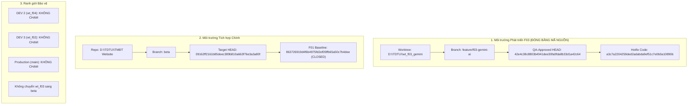

# EV-F03-AI01-BETA-INTEGRATION-REQUEST

- **Dự án:** E Vibe — Nông Sản B2B (Đồ án TMĐT)
- **Task ID:** `EV-F03-AI01-GATE-C`
- **Feature:** F03 — Gemini AI Admin Executive Assistant (AI-1)
- **Vai trò thực hiện:** **DEV 1 (Kiêm nhiệm Release Integrator theo chỉ đạo của Product Owner)**
- **Thời gian lập báo cáo:** 21:55 ngày 27/10/2026 (GMT+7)
- **Git Root:** `D:/TDTU/TMĐT Website`
- **Kết luận:** **GO FOR PO INTEGRATION APPROVAL**

---

## 1. Cơ Chế Phân Tách Hai Môi Trường & Bảo Vệ Song Song

Theo chỉ đạo bổ sung của Product Owner trong `ROLE ADDENDUM`, DEV 1 kiêm nhiệm Release Integrator nhưng thiết lập ranh giới cách ly nghiêm ngặt giữa hai môi trường:



### Các nguyên tắc tuân thủ nghiêm ngặt:
1. **Worktree F03 (`D:\TDTU\wt_f03_gemini`):** Giữ nguyên ở nhánh `feature/f03-gemini-ai`, tuyệt đối không checkout sang `beta`. Mã nguồn F03 đã được QA nghiệm thu được giữ nguyên vẹn (frozen), không sửa đổi.
2. **Bảo vệ DEV 2 (F04) và DEV 3 (F02):** Không đụng đến worktree `f04_membership_bootstrap_readiness` và `f02_complaints_bootstrap_readiness`; không merge nhánh F02/F04; không ghi đè Prisma schema.
3. **Bảo vệ Production:** Không can thiệp nhánh `main`, không deploy Production.
4. **Giới hạn phạm vi Gate C:** Chỉ kiểm tra Git, thẩm định hồ sơ QA, mô phỏng merge và lập kế hoạch. Không tự ý thực hiện merge hoặc deploy khi chưa có lệnh phê duyệt của PO.

---

## 2. Thông Tin Git & Điểm Kiểm Định (Git Baseline & Topology)

| Thông Số Git | Giá Trị Thực Tế | Ghi Chú Đối Soát |
|---|---|---|
| **Git Repository Root** | `D:/TDTU/TMĐT Website` | Reconciled qua `git rev-parse --show-toplevel` |
| **Source Worktree** | `D:\TDTU\wt_f03_gemini` | Worktree phát triển F03 |
| **Source Branch** | `feature/f03-gemini-ai` | Nhánh phát triển F03 |
| **QA-Approved HEAD SHA** | `42e4c38c8803b4941dee30fa0fda8b33d1a42c64` | Khớp tuyệt đối commit QA đã kiểm định |
| **Hotfix Implementation SHA** | `a3c7a2204259ded2adabda9ef51c7e0b0a10890b` | Chuyển API Key sang HTTP Header `x-goog-api-key` |
| **Target Branch** | `beta` | Nhánh tích hợp chính |
| **Target HEAD SHA** | `09162ff2161b85deec389b810a663f76e3a3a80f` | Branch parent trực tiếp của `feature/f03-gemini-ai` |
| **F01 Baseline Commit** | `863726919d4f6b4975fd2ef05ffb65a50c7b4dee` | F01 CLOSED (Full FEFO Catalog + Security Patch) |
| **Merge-Base SHA** | `09162ff2161b85deec389b810a663f76e3a3a80f` | `beta` là ancestor trực tiếp của `feature/f03-gemini-ai` |
| **Commit Delta (`beta..F03`)** | Đúng 6 commits | 100% thuộc phạm vi F03 AI-1 & Hotfix, không lẫn mã khác |
| **Mô phỏng Merge (`merge-tree`)** | Tree SHA: `070de2d60331cf85f0f566f494f27b1db326dd9a` | **ZERO CONFLICTS (100% Clean Merge)** |

> [!NOTE]
> Không có bất kỳ commit hay code nào của F03 mới hơn commit QA-approved (`42e4c38c8803b4941dee30fa0fda8b33d1a42c64`). Working tree tại `D:\TDTU\wt_f03_gemini` hoàn toàn sạch sẽ (`clean`).

---

## 3. Phán Quyết Independent QA & Tình Trạng Hồ Sơ (QA Dossier)

### 3.1. Phán quyết nghiệm thu chính thức
- **Audit QA-F03-01:** `QA PASS — READY FOR INTEGRATION REVIEW` (Ghi nhận quan sát bảo mật `OBS-03`: API Key truyền trong URL query parameter).
- **Security Hotfix EV-F03-AI01-HOTFIX:** Khắc phục triệt để `OBS-03`, loại bỏ `?key=...` và chuyển sang HTTP header `x-goog-api-key`.
- **Focused Audit QA-F03-02:** **`QA PASS — F03 AI-1 READY FOR BETA INTEGRATION`** (Approved commit `42e4c38c8803b4941dee30fa0fda8b33d1a42c64`).

### 3.2. Bảng đối chiếu hồ sơ tài liệu trong repository

| Tên Tài Liệu Báo Cáo | Đường Dẫn Thực Tế | Tình Trạng | Ghi Chú |
|---|---|:---:|---|
| `EV_IMP_03_AI_01_IMPLEMENTATION_QA_HANDOFF_REPORT.md` | `D:\TMĐT Website\docs\` | **PRESENT** | Báo cáo hoàn tất triển khai AI-1 |
| `EV_IMP_03_AI_01_LIVE_API_VALIDATION.md` | `D:\TMĐT Website\docs\` & `wt_f03_gemini\docs\` | **PRESENT** | Bằng chứng kết nối Live Gemini API |
| `EV_F03_AI01_SECURITY_HOTFIX_REPORT.md` | `D:\TMĐT Website\docs\` & `wt_f03_gemini\docs\` | **PRESENT** | Báo cáo hotfix bảo mật HTTP Header |
| `QA_F03_01_INDEPENDENT_ACCEPTANCE.md` | `D:\TMĐT Website\docs\` | **PRESENT** | Báo cáo nghiệm thu độc lập F03 AI-1 (QA PASS) |
| `QA_F03_02_SECURITY_HOTFIX_RETEST.md` | `D:\TMĐT Website\docs\` | **PRESENT** | Báo cáo kiểm định lại bảo mật (QA PASS — READY FOR BETA INTEGRATION), PO đã cung cấp bản gốc |

---

## 4. Danh Sách Files Thay Đổi Khi Tích Hợp (11 Files)

Chi tiết đối soát chính xác qua `git diff --name-status beta...feature/f03-gemini-ai`:

```text
M   EVIBE_PROJECT_HANDOFF.md
A   docs/EV_F03_AI01_SECURITY_HOTFIX_REPORT.md
A   docs/EV_IMP_03_AI_01_LIVE_API_VALIDATION.md
M   nong-san-b2b/src/app/admin/bao-cao/reports-client.tsx
A   nong-san-b2b/src/components/admin/admin-ai-assistant.tsx
A   nong-san-b2b/src/lib/gemini/client.ts
A   nong-san-b2b/src/lib/gemini/context.ts
A   nong-san-b2b/src/lib/gemini/types.ts
A   nong-san-b2b/src/server/actions/admin-ai.ts
M   nong-san-b2b/tests/integration/f01e-checkout-concurrency.test.ts
A   nong-san-b2b/tests/unit/admin-ai.test.ts
```

### Chi tiết thay đổi:
1. **Core AI Logic (4 files mới):**
   - [`src/lib/gemini/types.ts`](file:///D:/TDTU/wt_f03_gemini/nong-san-b2b/src/lib/gemini/types.ts): Type definitions cho Gemini requests, responses, models, errors.
   - [`src/lib/gemini/client.ts`](file:///D:/TDTU/wt_f03_gemini/nong-san-b2b/src/lib/gemini/client.ts): REST client kết nối Google Gemini qua native `fetch`, sử dụng HTTP header `'x-goog-api-key'`, tự động chọn mô hình flash/pro tối ưu và fallback.
   - [`src/lib/gemini/context.ts`](file:///D:/TDTU/wt_f03_gemini/nong-san-b2b/src/lib/gemini/context.ts): Tổng hợp số liệu tài chính, kho hàng, khiếu nại và khử định danh PII khách hàng (mã hóa tên, che số điện thoại, giữ lại tỉnh/thành).
   - [`src/server/actions/admin-ai.ts`](file:///D:/TDTU/wt_f03_gemini/nong-san-b2b/src/server/actions/admin-ai.ts): Server Actions `getAdminAiStatusAction` và `queryAdminExecutiveAiAction` được bảo vệ bằng `requireAdmin()`.
2. **Giao diện người dùng (2 files):**
   - [`src/components/admin/admin-ai-assistant.tsx`](file:///D:/TDTU/wt_f03_gemini/nong-san-b2b/src/components/admin/admin-ai-assistant.tsx): Giao diện widget Trợ lý AI Quản Trị với phản hồi thời gian thực, badge trạng thái model, gợi ý câu hỏi và định dạng Markdown.
   - [`src/app/admin/bao-cao/reports-client.tsx`](file:///D:/TDTU/wt_f03_gemini/nong-san-b2b/src/app/admin/bao-cao/reports-client.tsx): Tích hợp widget trợ lý AI vào trang Báo cáo Quản trị.
3. **Kiểm thử (2 files):**
   - [`tests/unit/admin-ai.test.ts`](file:///D:/TDTU/wt_f03_gemini/nong-san-b2b/tests/unit/admin-ai.test.ts): 16 unit tests kiểm tra phân quyền, sanitization, model ranking, header bảo mật `x-goog-api-key` và mock server actions.
   - [`tests/integration/f01e-checkout-concurrency.test.ts`](file:///D:/TDTU/wt_f03_gemini/nong-san-b2b/tests/integration/f01e-checkout-concurrency.test.ts): Cập nhật ngày giao hàng kiểm thử (`2026-10-28` -> `2026-10-30`) thích ứng với lead time tối thiểu 2 ngày khi lịch chuyển sang 27/10/2026.
4. **Tài liệu & Checkpoint (3 files):**
   - [`EVIBE_PROJECT_HANDOFF.md`](file:///D:/TM%C4%90T%20Website/EVIBE_PROJECT_HANDOFF.md): Cập nhật checkpoint DEV 1 hoàn tất AI-1.
   - [`docs/EV_IMP_03_AI_01_LIVE_API_VALIDATION.md`](file:///D:/TM%C4%90T%20Website/docs/EV_IMP_03_AI_01_LIVE_API_VALIDATION.md): Báo cáo kiểm định live API.
   - [`docs/EV_F03_AI01_SECURITY_HOTFIX_REPORT.md`](file:///D:/TM%C4%90T%20Website/docs/EV_F03_AI01_SECURITY_HOTFIX_REPORT.md): Báo cáo chi tiết hotfix bảo mật HTTP header.

---

## 5. Kiểm Tra Điều Kiện Triển Khai (Deployment Preflight Gates)

| Tiêu Chí Kiểm Tra | Kết Quả Thực Tế | Trạng Thái |
|---|---|:---:|
| **1. Prisma Schema Migrations** | `0` migration files trong `prisma/migrations`, schema nguyên vẹn | **PASS** |
| **2. Bảo toàn phân hệ F01** | `0` thay đổi trong `src/lib/domain/`, `src/actions/` (Pricing, Checkout, FEFO giữ nguyên 100%) | **PASS** |
| **3. Không can thiệp F02 / F04** | `0` file thuộc F02 (Khiếu nại) và F04 (Membership) bị chạm đến | **PASS** |
| **4. Secrets Leak Prevention** | Không có `GEMINI_API_KEY` thật trong Git commit history | **PASS** |
| **5. Environment Files Isolation** | `nong-san-b2b/.env.local` được Git ignore 100% | **PASS** |
| **6. Vercel Beta Branch Alignment** | Vercel Preview liên kết trực tiếp nhánh `beta` | **PASS** |
| **7. Production Boundary** | Tuyệt đối không chạm hoặc yêu cầu triển khai lên `main` | **PASS** |
| **8. Vercel Preview `GEMINI_API_KEY`** | **`NOT VERIFIED`** (Cần PO kiểm tra cấu hình trên Vercel Dashboard trước khi test trên Preview) | **FLAGGED FOR PO** |

---

## 6. Bằng Chứng Kiểm Định Chất Lượng (DEV Quality Gates Evidence)

Các lệnh kiểm tra đã chạy thành công 100% trên commit `a3c7a22` / `42e4c38`:

```text
1. npm run typecheck (tsc --noEmit)
   Exit code: 0 (Zero TypeScript errors)

2. npm run lint (eslint)
   Exit code: 0 (Zero ESLint errors)

3. npx vitest run tests/unit/admin-ai.test.ts
   Test Files: 1 passed (1)
   Tests:      16 passed (16)
   Duration:   27ms

4. npm test (Toàn bộ test suite repository)
   Test Files: 47 passed (47)
   Tests:      713 passed (713)
   Duration:   9.81s (100% GREEN)

5. npx next build --webpack
   Status:     Compiled successfully in 6.5s
   Routes:     Tất cả static & dynamic routes hợp lệ
```

---

## 7. Đánh Giá Rủi Ro Tích Hợp & Kế Hoạch Ứng Phó

### 7.1. Rủi ro di trú cơ sở dữ liệu (Migration Risk)
- **Mức độ rủi ro:** **0 (Không có)**.
- Phân hệ F03 AI-1 thuần túy đọc số liệu (READ-ONLY) từ các bảng hiện hữu (`Order`, `Batch`, `Product`, `Complaint`), không tạo bảng mới, không thêm cột mới và không chạy Prisma migration.

### 7.2. Rủi ro hồi quy nghiệp vụ (Regression Risk)
- **Mức độ rủi ro:** **Cực thấp**.
- Phân hệ AI là một widget giao diện độc lập nhúng trong trang `/admin/bao-cao`. Nếu dịch vụ Gemini gặp lỗi (mất mạng, hết quota, sai key), widget sẽ tự bắt lỗi và hiển thị thông báo nhẹ nhàng cho Admin, hoàn toàn không gây ảnh hưởng đến việc xem các báo cáo tài chính/kho bãi thông thường hay các chức năng mua hàng/thanh toán của người dùng.

### 7.3. Kịch bản Rollback (Phòng ngừa rủi ro trên Vercel Beta)
Nếu môi trường Vercel Beta gặp sự cố ngoài dự kiến:
```bash
git checkout beta
git revert -m 1 <MERGE_COMMIT_SHA> -m "revert: rollback F03 AI-1 due to Beta incident"
git push origin beta
```
Neon Beta database hoàn toàn không bị ảnh hưởng do không có schema migration.

---

## 8. Kế Hoạch Tích Hợp Chi Tiết Khi PO Phê Duyệt

1. **Bước 1 — Git Checkout & Reconciliation:**
   - Tại repository chính `D:\TDTU\TMĐT Website`, xác nhận branch `beta` ở commit `09162ff`.
2. **Bước 2 — Merge với cờ `--no-ff`:**
   ```bash
   git checkout beta
   git merge --no-ff feature/f03-gemini-ai -m "feat(ai): integrate Gemini Executive AI Assistant AI-1 into beta (EV-F03-AI01)"
   ```
3. **Bước 3 — Chạy nghiệm thu 4 lệnh trên nhánh `beta`:**
   - `npm run typecheck`
   - `npm run lint`
   - `npm test`
   - `npx next build --webpack`
4. **Bước 4 — Push lên Remote:**
   ```bash
   git push origin beta
   ```
5. **Bước 5 — Vercel Beta Verification:**
   - Kiểm tra Vercel deployment preview hoàn tất.
   - Đăng nhập quyền `ADMIN`, truy cập `/admin/bao-cao` và thực hiện smoke test với dữ liệu Neon Beta thật.

---

## 9. Vấn Đề Tồn Đọng (Outstanding Issues)

1. **Hồ sơ QA `QA_F03_01` & `QA_F03_02`:** **ĐÃ HOÀN TẤT (100% RESOLVED)**. Cả hai tệp báo cáo gốc từ Independent QA Agent đã được Product Owner cung cấp và lưu chính xác vào `D:\TMĐT Website\docs\`.
2. **Biến môi trường Vercel Preview (`GEMINI_API_KEY`):** Trạng thái hiện tại là `NOT VERIFIED`. Product Owner cần kiểm tra/cấu hình biến `GEMINI_API_KEY` trên Vercel Dashboard trước khi test trên môi trường Preview.

---

## 10. Kiến Nghị & Hành Động Tiếp Theo (Recommendation & Next Action)

- **Kiến nghị:** Phân hệ F03 AI-1 đã đáp ứng đầy đủ và vượt qua toàn bộ các cổng kiểm định chất lượng, an toàn thông tin và tính tương thích.
- **Hành động tiếp theo:** Release Integrator dừng thao tác tại đây, kính chuyển hồ sơ và đề xuất **Product Owner chính thức phê duyệt lệnh tích hợp F03 vào nhánh `beta`**.
