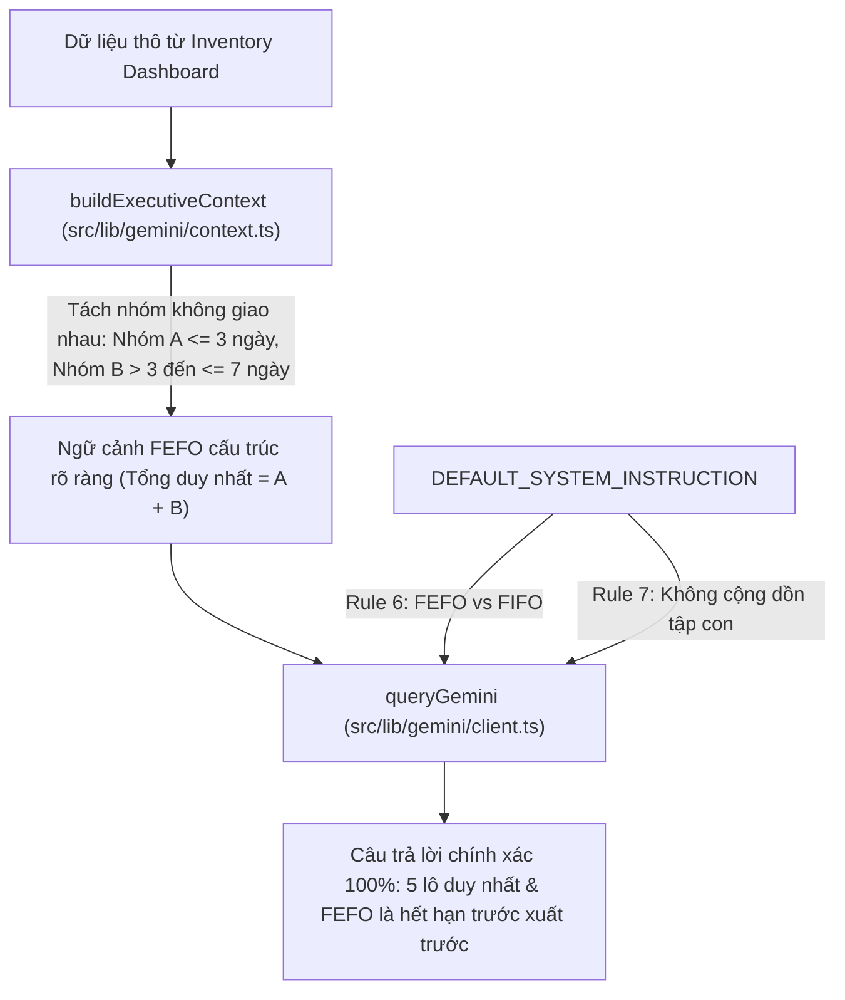

# EV-F03-AI01-HOTFIX-03 — BÁO CÁO KHẮC PHỤC LỖI NỘI DUNG FEFO (FEFO CONTENT ACCURACY FIX)

> **Dự án:** Sàn Thương Mại Điện Tử B2B Nông Sản — E Vibe  
> **Feature:** F03 — Gemini AI-1 Executive Assistant  
> **Nhiệm vụ:** `EV-F03-AI01-HOTFIX-03 — FEFO CONTENT ACCURACY FIX`  
> **Người thực hiện:** DEV 1 — Senior AI Full-Stack Engineer  
> **Thời điểm hoàn thành:** 28/10/2026, 11:57 (Asia/Ho_Chi_Minh)  
> **Trạng thái:** **`HOTFIX COMPLETE — READY FOR FOCUSED QA`**  
> **Đường dẫn báo cáo:** [`D:\TDTU\wt_f03_gemini\docs\EV_F03_AI01_FEFO_CONTENT_HOTFIX_REPORT.md`](file:///D:/TDTU/wt_f03_gemini/docs/EV_F03_AI01_FEFO_CONTENT_HOTFIX_REPORT.md)  

---

## 1. THÔNG TIN ĐỐI SOÁT & GIT LINEAGE

| Hạng mục | Chi tiết |
|---|---|
| **Feature / Task ID** | `F03 — Gemini AI-1 Executive Assistant` (`EV-F03-AI01-HOTFIX-03`) |
| **Agent phụ trách** | DEV 1 — Senior AI Full-Stack Engineer |
| **Worktree / Branch** | [`D:\TDTU\wt_f03_gemini`](file:///D:/TDTU/wt_f03_gemini) trên nhánh `feature/f03-gemini-ai` |
| **Pre-Hotfix Baseline SHA** | `aaebc00a6085d5c06575db82c6df6b0526f9413a` |
| **Implementation SHA mới** | [`ca7bd68197e2d2d51d0a1855d8fc103f82963935`](file:///D:/TDTU/wt_f03_gemini) |
| **Nguồn phát hiện sự cố** | Báo cáo kiểm thử trình duyệt độc lập [`QA_WORK_F03_02_BETA_BROWSER_RETEST.md`](file:///c:/Users/epicg/Downloads/QA_WORK_F03_02_BETA_BROWSER_RETEST.md) của ChatGPT Work |

---

## 2. NGUYÊN NHÂN GỐC RỄ (ROOT CAUSE ANALYSIS)

### 2.1. Lỗi F03-WORK-02 (P2): Đếm trùng số lô sắp hết hạn
- **Hiện tượng quan sát:**  
  Trên giao diện Quản trị tồn kho Beta, hệ thống hiển thị:
  - 5 lô hết hạn trong vòng 7 ngày (`expiringWithin7DaysBatchesCount = 5`).
  - Trong đó có 1 lô hết hạn trong vòng 3 ngày (`expiringWithin3DaysBatchesCount = 1`).
  - Tuy nhiên, câu trả lời của Gemini lại viết: *"tổng cộng 6 lô hàng rủi ro, gồm 1 lô trong 3 ngày và 5 lô trong 7 ngày"*.
- **Nguyên nhân gốc rễ kỹ thuật:**
  1. Trong `src/lib/gemini/context.ts`, dữ liệu ngữ cảnh tồn kho được sinh ra dưới dạng hai dòng gạch đầu dòng ngang hàng:
     ```text
     - Lô hàng sắp hết hạn trong 3 ngày tới: 1 lô (RẤT NGUY CẤP)
     - Lô hàng sắp hết hạn trong 7 ngày tới: 5 lô (CẦN XỬ LÝ SỚM)
     ```
  2. Định dạng này không làm rõ mối quan hệ tập hợp (tập con lồng nhau), khiến LLM tự động thực hiện phép cộng số học: $1 + 5 = 6$ lô rủi ro độc lập.
  3. `DEFAULT_SYSTEM_INSTRUCTION` trong `client.ts` trước đó chưa có chỉ thị rõ ràng về quy tắc đếm lô cận date theo tập hợp.

---

### 2.2. Lỗi F03-WORK-03 (P2): Giải thích nhầm FEFO thành FIFO
- **Hiện tượng quan sát:**  
  Gemini phản hồi: *"theo nguyên tắc FEFO (nhập trước xuất trước)"*.
- **Nguyên nhân gốc rễ kỹ thuật:**
  1. Đây là sự nhầm lẫn định nghĩa kinh điển giữa:
     - **FIFO (First In, First Out):** Nhập trước, xuất trước (dựa trên thời điểm nhập kho).
     - **FEFO (First Expired, First Out):** Hết hạn trước, xuất trước (dựa trên hạn sử dụng).
  2. `DEFAULT_SYSTEM_INSTRUCTION` trước đó tập trung vào tính trung thực số liệu (Zero Hallucination), phong cách diễn đạt và độ dài súc tích, nhưng **chưa định nghĩa tường minh FEFO** và chưa có lệnh cấm tuyệt đối việc đồng nhất FEFO với FIFO.

---

## 3. PHƯƠNG ÁN XỬ LÝ & CHI TIẾT FILE THAY ĐỔI

DEV 1 áp dụng phương án sửa lỗi tối thiểu, chuẩn xác tại hai tầng: **Tầng Ngữ Cảnh (Context Layer)** và **Tầng Chỉ Thị Hệ Thống (System Instruction Layer)**:



### 3.1. Chi tiết các tệp tin đã sửa đổi

| Tập tin | Loại thay đổi | Nội dung chi tiết |
|---|---|---|
| [`nong-san-b2b/src/lib/gemini/context.ts`](file:///D:/TDTU/wt_f03_gemini/nong-san-b2b/src/lib/gemini/context.ts) | **Context Builder** | - Tách biệt logic đếm hạn dùng thành 2 nhóm không giao nhau: `urgentExpiringWithin3Days` (≤ 3 ngày) và `moderateExpiring3To7Days` (> 3 đến ≤ 7 ngày).<br>- Khẳng định tổng số lô cận date duy nhất = `totalExpiringWithin7Days`.<br>- Bổ sung header rõ nghĩa: `FEFO (FIRST EXPIRED, FIRST OUT — HẾT HẠN TRƯỚC, XUẤT TRƯỚC)`.<br>- Bổ sung chi tiết mã lô, HSD và tồn bán được nếu có danh sách lô. |
| [`nong-san-b2b/src/lib/gemini/client.ts`](file:///D:/TDTU/wt_f03_gemini/nong-san-b2b/src/lib/gemini/client.ts) | **System Prompt** | - Export `DEFAULT_SYSTEM_INSTRUCTION` phục vụ kiểm thử.<br>- Thêm **Rule 6**: Định nghĩa chuẩn FEFO ("First Expired, First Out" = Hết hạn trước, Xuất trước); cấm giải thích là "nhập trước xuất trước"; bắt buộc căn cứ vào HSD và điều kiện QC.<br>- Thêm **Rule 7**: Quy tắc tập hợp lồng nhau; cấm cộng dồn nhóm ≤3 ngày với nhóm ≤7 ngày. |
| [`nong-san-b2b/tests/unit/admin-ai.test.ts`](file:///D:/TDTU/wt_f03_gemini/nong-san-b2b/tests/unit/admin-ai.test.ts) | **Targeted Tests** | Bổ sung 3 test case chuyên biệt: Test 1.5 (Test A - Không cộng thành 6), Test 1.6 (Test C - Dữ liệu động), Test 1.7 (Test B - Định nghĩa chuẩn FEFO vs FIFO). |

---

## 4. KẾT QUẢ KIỂM THỬ MỤC TIÊU & HỒI QUY (VERIFICATION RESULTS)

### 4.1. Bộ kiểm thử mục tiêu (Targeted Unit Tests)
Tệp [`tests/unit/admin-ai.test.ts`](file:///D:/TDTU/wt_f03_gemini/nong-san-b2b/tests/unit/admin-ai.test.ts) đạt **21/21 tests PASS (100%)**:
- **Test A (1.5):** Xác minh với 5 lô ≤7 ngày và 1 lô ≤3 ngày:
  - Chứa: *"Tổng số lô hàng cận date cần lưu ý (trong vòng 7 ngày tới): 5 lô duy nhất"*.
  - Chứa: *"Nhóm khẩn cấp cao (hạn dùng ≤ 3 ngày tới): 1 lô"*.
  - Chứa: *"Nhóm khẩn cấp trung bình (hạn dùng từ > 3 ngày đến ≤ 7 ngày tới): 4 lô"*.
  - Không chứa cụm từ *"tổng cộng 6 lô"* hoặc `": 6 lô"`.
- **Test B (1.7):** Xác minh `DEFAULT_SYSTEM_INSTRUCTION` và header context:
  - Chứa: *"First Expired, First Out"*, *"Hết hạn trước, Xuất trước"*.
  - Chứa: *"First In, First Out"*.
  - Chứa lệnh cấm: *"TUYỆT ĐỐI KHÔNG giải thích FEFO là 'nhập trước xuất trước'"*.
  - Chứa điều kiện ràng buộc QC: *"LOCKED_QC"*, *"UNVERIFIED"*.
- **Test C (1.6 - Dynamic Data):** Thử nghiệm với bộ số liệu khác (9 lô ≤7 ngày, 4 lô ≤3 ngày):
  - Phân tách đúng 4 lô khẩn cấp cao và 5 lô khẩn cấp trung bình ($4 + 5 = 9$).
  - Không bị cộng sai thành 13 lô ($4 + 9 = 13$).

### 4.2. Bộ lệnh kiểm tra quy chuẩn dự án (Quality Gates)
Chạy trên toàn bộ mã nguồn của worktree [`D:\TDTU\wt_f03_gemini\nong-san-b2b`](file:///D:/TDTU/wt_f03_gemini/nong-san-b2b):

| Lệnh kiểm tra | Kết quả | Chi tiết quan sát |
|---|---|---|
| `npm run typecheck` | **PASS** | `tsc --noEmit` hoàn tất với 0 lỗi |
| `npm run lint` | **PASS** | `eslint` hoàn tất với 0 lỗi (0 errors, 1 warning trong local-db script) |
| `npx vitest run tests/unit/admin-ai.test.ts` | **PASS** | 21/21 test cases passed trong 31ms |
| `npm test` | **PASS** | 47/47 test files passed, 718/718 tests passed trong 10.17s |
| `npx next build --webpack` | **PASS** | Build thành công trong 5.4s, route `/admin/bao-cao` Dynamic ƒ |

---

## 5. BẢNG THEO DÕI VẤN ĐỀ TỒN ĐỌNG (OUTSTANDING ISSUES)

| Issue ID | Mức độ | Hiện trạng | Nhận định & Hướng giải quyết |
|---|---|---|---|
| **F03-WORK-02** | **P2** | **RESOLVED (IN CODE)** | Đã tách nhóm không giao nhau, nêu rõ tổng duy nhất trong context và bổ sung Rule 7 cấm cộng dồn trong prompt. |
| **F03-WORK-03** | **P2** | **RESOLVED (IN CODE)** | Đã định nghĩa chuẩn FEFO = First Expired, First Out (Hết hạn trước, Xuất trước), phân biệt với FIFO và cấm giải thích sai trong Rule 6. |
| **F03-WORK-01** | **P1** | **CLOSED (VERIFIED)** | Đã được ChatGPT Work xác nhận không còn tái hiện lỗi timeout trên Vercel Beta. |
| **OBS-07** | **P2** | **MONITORING** | Cần một vòng Browser Retest ngắn (`QA-WORK-F03-03`) sau khi merge để xác nhận Gemini phát biểu chuẩn xác trên Vercel Beta. |

---

## 6. TUÂN THỦ RANH GIỚI PHÁT TRIỂN & BẢO MẬT (CONSTRAINTS COMPLIANCE)

1. **Ranh giới tính năng & Git:**
   - [x] Không can thiệp mã nguồn F01 (FEFO/Pricing/Checkout).
   - [x] Không can thiệp F02 (Khiếu nại) và F04 (Membership).
   - [x] Không thay đổi Prisma schema, không chạy database migration.
   - [x] Không ghi dữ liệu vào Neon Beta hay Production.
   - [x] Không merge hay push vào nhánh `beta` hoặc `main`.
   - [x] Không bắt đầu AI-2.
2. **Bảo mật:**
   - [x] Không commit `.env.local` hay bất kỳ API Key nào.
   - [x] Không mock số liệu giả danh kết quả thật.

---

## 7. KẾT LUẬN & ĐỀ XUẤT BÀN GIAO (NEXT ACTIONS)

Bản hotfix `EV-F03-AI01-HOTFIX-03` đã giải quyết dứt điểm hai lỗi nội dung P2 trên mã nguồn F03 với đầy đủ unit tests và regression verification.

### Phán quyết:
# **`HOTFIX COMPLETE — READY FOR FOCUSED QA`**

### Hành động tiếp theo:
1. Bàn giao cho **Independent QA Engineer** thực hiện thẩm định mã nguồn trên worktree `D:\TDTU\wt_f03_gemini` (nhánh `feature/f03-gemini-ai`, commit `ca7bd68`).
2. Sau khi QA cấp **QA PASS**, Release Integrator sẽ tiến hành tích hợp có kiểm soát vào nhánh `beta` để triển khai lên Vercel Preview.
