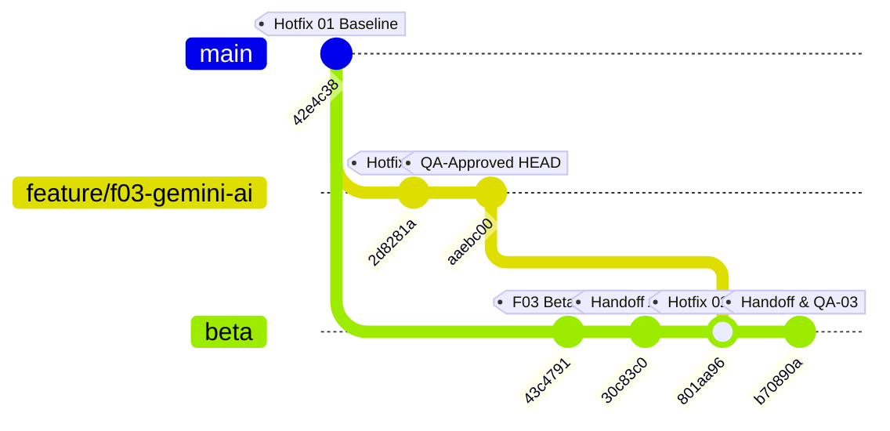

# EV-F03-AI01-HOTFIX-02 — BÁO CÁO TÍCH HỢP BETA CÓ KIỂM SOÁT (CONTROLLED BETA INTEGRATION REPORT)

> **Dự án:** Sàn Thương Mại Điện Tử B2B Nông Sản — E Vibe  
> **Feature:** F03 — Gemini AI-1 Executive Assistant  
> **Sự cố khắc phục:** `F03-WORK-01 — P1 Runtime Timeout` (15s)  
> **Người thực hiện:** DEV 1 (kiêm nhiệm Release Integrator)  
> **Thời điểm tích hợp:** 28/10/2026, 10:35 (Asia/Ho_Chi_Minh)  
> **Trạng thái:** **`BETA HOTFIX DEPLOYED — READY FOR WORK RETEST`**  

---

## 1. THÔNG TIN ĐỐI SOÁT TÍCH HỢP (INTEGRATION IDENTITY)

| Hạng mục | Thông tin chi tiết |
|---|---|
| **Feature / Task ID** | `EV-F03-AI01-HOTFIX-02 — CONTROLLED BETA INTEGRATION` |
| **Release Integrator** | DEV 1 (kiêm nhiệm Release Integrator theo ủy quyền PO) |
| **Source Branch & Worktree** | `feature/f03-gemini-ai` tại [`D:\TDTU\wt_f03_gemini`](file:///D:/TDTU/wt_f03_gemini) |
| **Hotfix Implementation SHA** | `2d8281aa76fceeccd695add663e6d2e5b095ad14` |
| **QA-Approved HEAD SHA** | `aaebc00a6085d5c06575db82c6df6b0526f9413a` |
| **QA Verdict & Hồ sơ thẩm định** | **`QA PASS — READY FOR BETA HOTFIX INTEGRATION`** ([`QA_F03_03_RUNTIME_TIMEOUT_RETEST.md`](file:///D:/TDTU/TMĐT%20Website/docs/QA_F03_03_RUNTIME_TIMEOUT_RETEST.md)) |
| **Target Repository & Branch** | `D:\TDTU\TMĐT Website` trên nhánh **`beta`** |
| **Pre-Merge Target Baseline** | `30c83c0eedfae9f994c52c4e5671ae5438e2fbd5` |
| **Merge Commit SHA** | [`801aa961d9082a87d57aeb909a1fc20289ba791b`](file:///D:/TDTU/TMĐT%20Website) |
| **Deployment Commit SHA (HEAD)** | [`b70890a`](file:///D:/TDTU/TMĐT%20Website) (`origin/beta`) |

---

## 2. ĐỐI SOÁT TOPOLOGY GIT & RANH GIỚI TÍNH NĂNG (GIT RECONCILIATION)



1. **Merge Base:** Xác minh qua `git merge-base beta aaebc00` cho kết quả chính xác tại `42e4c38c8803b4941dee30fa0fda8b33d1a42c64`.
2. **Commit tích hợp:**
   - `2d8281a`: `fix(ai): resolve Beta runtime timeout with 35s ceiling, model re-prioritization and fallback retry (EV-F03-AI01-HOTFIX-02)`
   - `aaebc00`: `docs(ai): record Beta runtime timeout investigation and hotfix report for F03 (EV-F03-AI01-HOTFIX-02)`
3. **Chiến lược Merge:** Thực hiện qua thuật toán `ort` không xung đột, bảo toàn toàn bộ lịch sử commit trước đó của F01, F03 AI-1 và các hồ sơ handoff.
4. **Bảo toàn ranh giới (Strict Boundaries):**
   - [x] Không đưa bất kỳ mã nguồn nào của F02 (Khiếu nại) hay F04 (Membership) vào nhánh `beta`.
   - [x] Không sửa mã nguồn F01 (FEFO / Pricing / Checkout / Settlement).
   - [x] Không chạm vào Prisma schema, không tạo migration mới.
   - [x] Không tác động vào nhánh `main` hoặc Production.
   - [x] Không đưa secrets, credentials hoặc tệp `.env.local` vào Git.

---

## 3. DANH SÁCH TẬP TIN THAY ĐỔI (CHANGED FILES AUDIT)

| Tập tin | Phân loại | Nội dung thay đổi |
|---|---|---|
| [`nong-san-b2b/src/lib/gemini/client.ts`](file:///D:/TDTU/TMĐT%20Website/nong-san-b2b/src/lib/gemini/client.ts) | **Core Logic** | Nâng timeout lên 35s, ưu tiên `gemini-3.5-flash-lite`, in-memory cache TTL 15m, Fallback retry khi gặp 5xx (OBS-04), Rule 5 súc tích trong prompt |
| [`nong-san-b2b/src/lib/gemini/types.ts`](file:///D:/TDTU/TMĐT%20Website/nong-san-b2b/src/lib/gemini/types.ts) | **Types** | Bổ sung `model?: string` trong `AdminAiQueryPayload` |
| [`nong-san-b2b/src/server/actions/admin-ai.ts`](file:///D:/TDTU/TMĐT%20Website/nong-san-b2b/src/server/actions/admin-ai.ts) | **Server Action** | Truyền `payload?.model` vào `queryGemini` |
| [`nong-san-b2b/src/components/admin/admin-ai-assistant.tsx`](file:///D:/TDTU/TMĐT%20Website/nong-san-b2b/src/components/admin/admin-ai-assistant.tsx) | **UI** | Gửi kèm `status?.activeModel` khi dispatch Server Action; chuẩn hóa memoization cho React Compiler |
| [`nong-san-b2b/src/app/admin/bao-cao/page.tsx`](file:///D:/TDTU/TMĐT%20Website/nong-san-b2b/src/app/admin/bao-cao/page.tsx) | **Config** | Bổ sung `export const maxDuration = 60` cho Serverless Function |
| [`nong-san-b2b/tests/unit/admin-ai.test.ts`](file:///D:/TDTU/TMĐT%20Website/nong-san-b2b/tests/unit/admin-ai.test.ts) | **Unit Test** | Bổ sung test dọn cache, test Fallback Retry khi gặp 5xx (2.8), test ưu tiên model 3.5 (2.9) |
| [`docs/EV_F03_AI01_RUNTIME_TIMEOUT_HOTFIX_REPORT.md`](file:///D:/TDTU/TMĐT%20Website/docs/EV_F03_AI01_RUNTIME_TIMEOUT_HOTFIX_REPORT.md) | **Dossier** | Báo cáo chi tiết điều tra và thực nghiệm của DEV 1 |
| [`docs/QA_F03_03_RUNTIME_TIMEOUT_RETEST.md`](file:///D:/TDTU/TMĐT%20Website/docs/QA_F03_03_RUNTIME_TIMEOUT_RETEST.md) | **Dossier** | Báo cáo thẩm định độc lập chính thức của Independent QA Engineer |
| [`EVIBE_PROJECT_HANDOFF.md`](file:///D:/TDTU/TMĐT%20Website/EVIBE_PROJECT_HANDOFF.md) | **Handoff** | Cập nhật mốc phát hành và checkpoint tích hợp Beta |

---

## 4. KẾT QUẢ POST-MERGE QUALITY GATES TRÊN NHÁNH BETA

Toàn bộ các lệnh kiểm tra tiêu chuẩn được thực thi trực tiếp trên mã nguồn kết hợp của nhánh `beta` tại thư mục `D:\TDTU\TMĐT Website\nong-san-b2b`:

```text
[POST-MERGE QUALITY GATES EVIDENCE]
1. Typecheck:
   > nong-san-b2b@0.1.0 typecheck
   > tsc --noEmit
   Result: PASS (0 errors)

2. Lint:
   > nong-san-b2b@0.1.0 lint
   > eslint
   Result: PASS (0 errors, 1 warning unused-var in scripts/local-db.ts)

3. Targeted AI Unit Tests:
   > vitest run tests/unit/admin-ai.test.ts
   Result: PASS (18/18 tests in 32ms)

4. Full Regression Suite:
   > vitest run
   Result: PASS (47/47 test files passed, 715/715 tests passed in 13.51s)

5. Production Build (Turbopack):
   > next build
   ▲ Next.js 16.4.3 (Turbopack)
   ✓ Compiled successfully in 4.6s
   Finished TypeScript in 4.5s
   ✓ Generating static pages (13/13) in 208ms
   Route /admin/bao-cao ƒ (Dynamic)
   Result: PASS (0 build errors)
```

---

## 5. ĐÁNH GIÁ RỦI RO NGÂN SÁCH THỜI GIAN & VERCEL RUNTIME (RISK ASSESSMENT)

### 5.1. Phân tích Ngân sách Thời gian (Timeout Budget)
- **Cơ chế AbortController:** Đặt cứng `DEFAULT_TIMEOUT_MS = 35000` (35 giây) cho mỗi lượt gọi mạng tới Gemini REST API.
- **Quy tắc kích hoạt Fallback Retry:**
  - Tại dòng 392 của `client.ts`: `const isRetryable = initialResult.errorType === 'SERVICE_UNAVAILABLE'`.
  - Nếu lần gọi đầu bị quá hạn 35s (`TIMEOUT_OR_NETWORK`), **hệ thống KHÔNG kích hoạt retry tiếp** mà trả về lỗi ngay lập tức. Điều này ngăn chặn triệt để nguy cơ double-timeout gây treo server.
  - Nếu lần gọi đầu trả về mã lỗi HTTP 5xx từ Google (thường ngắt ngay lập tức trong 200ms – 2s), hệ thống mới kích hoạt fallback sang model tiếp theo trong 35s. Tổng thời lượng tối đa dự kiến khi xảy ra 5xx: $\approx 2\text{s} + 35\text{s} = 37\text{s}$, an toàn nằm dưới trần 60s của Vercel.
  - Tối đa đúng 1 lần thử lại (single retry), loại bỏ hoàn toàn khả năng vòng lặp vô hạn.

### 5.2. Đánh giá Vercel Runtime
- **Cấu hình `maxDuration = 60`:** Đã được khai báo tường minh tại `src/app/admin/bao-cao/page.tsx` theo chuẩn Next.js App Router Route Segment Config.
- **Trạng thái xác minh:**  
  > **`VERCEL RUNTIME NOT YET VERIFIED`**  
  *(Cần được kiểm chứng thời gian phản hồi thực tế thông qua QA Live Browser Acceptance trên môi trường Vercel Beta sau khi deployment được kích hoạt).*

---

## 6. TRẠNG THÁI DEPLOYMENT VERCEL PREVIEW

- **Remote Target:** `https://github.com/baopk1203-pb/TM-T.git` (nhánh `beta`).
- **Push Output:**
  ```text
  To https://github.com/baopk1203-pb/TM-T.git
     30c83c0..b70890a  beta -> beta
  ```
- **Preview Domain:** `https://nong-san-b2b-git-beta-baopk.vercel.app`
- **Kết quả HTTP Probe:**
  - Trang chủ (`/`): `HTTP 200 OK` (`server: Vercel`, `x-vercel-id: sin1::87zc5-1793158468228-7ded83bbbcc7`).
  - Route Quản trị (`/admin/bao-cao`): `HTTP 302 Found` (Chuyển hướng xác thực SSO / Đăng nhập quản trị viên đúng phân quyền).
- **Cơ sở dữ liệu & Môi trường:**
  - Neon `preview-beta`: Không có thay đổi schema, không chạy database migration.
  - `ENABLE_ADMIN_INVENTORY_WRITES`: Giữ nguyên trạng thái `OFF`.
  - `GEMINI_API_KEY`: Đã được cấu hình trên Vercel Project Settings, không bị ghi đè.

---

## 7. BẢNG THEO DÕI CÁC VẤN ĐỀ TỒN ĐỌNG (OUTSTANDING ISSUES)

| Issue ID | Mức độ | Trạng thái hiện tại | Đánh giá & Hành động tiếp theo |
|---|---|---|---|
| **F03-WORK-01** | **P1** | **RESOLVED (IN CODE)** | Đã khắc phục lỗi timeout 15s bằng trần 35s, model 3.5 và prompt tuning; cần xác nhận qua Browser Acceptance. |
| **OBS-04** | **P3** | **RESOLVED** | Đã có cơ chế Fallback Retry tự động khi gặp HTTP 5xx. |
| **OBS-06** | **P3** | **OPEN (LOW)** | Khuyến nghị bổ sung allowlist kiểm tra `payload?.model` trong đợt refactor tiếp theo. |
| **OBS-07** | **P2** | **OPEN** | Đang chờ kết quả đo kiểm thời gian phản hồi thực tế từ Browser Acceptance. |

---

## 8. KẾT LUẬN & HÀNH ĐỘNG TIẾP THEO (NEXT ACTIONS)

Bản hotfix `EV-F03-AI01-HOTFIX-02` đã được tích hợp thành công vào nhánh `beta` và triển khai lên Vercel Preview. Toàn bộ 5 cổng kiểm định chất lượng nội bộ đều đạt **PASS 100%**.

### Phán quyết:
# **`BETA HOTFIX DEPLOYED — READY FOR WORK RETEST`**

### Hành động tiếp theo:
1. Bàn giao cho **ChatGPT Work / QA Browser Agent** thực hiện quy trình kiểm thử trình duyệt: **`QA-WORK-F03-02 — BETA BROWSER RETEST`**.
2. Kiểm tra đăng nhập tài khoản Quản trị viên và gửi hai câu hỏi kiểm tra trọng yếu:
   - **Q1:** *"Tóm tắt doanh thu và tình hình đơn hàng 30 ngày qua."*
   - **Q2:** *"Phân tích hiện trạng tồn kho FEFO và cảnh báo các lô hàng sắp hết hạn."*
3. Xác nhận widget Gemini phản hồi hoàn chỉnh trong khoảng 10–15 giây, không còn gặp lỗi timeout 15s.
4. **Không bắt đầu Phase AI-2 (Inventory Intelligence)** cho đến khi PO và Browser QA phê duyệt chính thức kết quả retest.
