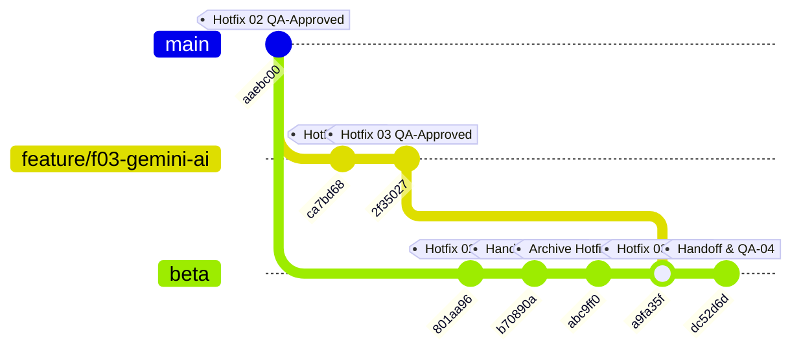

# EV-F03-AI01-HOTFIX-03 — BÁO CÁO TÍCH HỢP BETA CÓ KIỂM SOÁT (CONTROLLED BETA INTEGRATION REPORT)

> **Dự án:** Sàn Thương Mại Điện Tử B2B Nông Sản — E Vibe  
> **Feature:** F03 — Gemini AI-1 Executive Assistant  
> **Sự cố khắc phục:**  
> - `F03-WORK-02 — P2`: Đếm trùng số lô sắp hết hạn (cộng dồn tập con $\le 3$ ngày vào $\le 7$ ngày)  
> - `F03-WORK-03 — P2`: Giải thích nhầm nguyên tắc FEFO thành FIFO ("nhập trước xuất trước")  
> **Người thực hiện:** DEV 1 (kiêm nhiệm Release Integrator)  
> **Thời điểm tích hợp:** 28/10/2026, 12:25 (Asia/Ho_Chi_Minh)  
> **Trạng thái:** **`BETA HOTFIX 03 DEPLOYED — READY FOR FINAL WORK RETEST`**  

---

## 1. THÔNG TIN ĐỐI SOÁT TÍCH HỢP (INTEGRATION IDENTITY)

| Hạng mục | Thông tin chi tiết |
|---|---|
| **Feature / Task ID** | `EV-F03-AI01-HOTFIX-03 — CONTROLLED BETA INTEGRATION` |
| **Release Integrator** | DEV 1 (kiêm nhiệm Release Integrator theo ủy nhiệm của Product Owner) |
| **Source Branch & Worktree** | `feature/f03-gemini-ai` tại [`D:\TDTU\wt_f03_gemini`](file:///D:/TDTU/wt_f03_gemini) |
| **Hotfix Implementation SHA** | `ca7bd68197e2d2d51d0a1855d8fc103f82963935` |
| **Independent QA-Approved HEAD SHA** | `2f35027c395cc3e2b2a36c40349b07da423ddd63` |
| **QA Verdict & Hồ sơ thẩm định** | **`QA PASS — READY FOR BETA HOTFIX 03 INTEGRATION`** ([`QA_F03_04_FEFO_CONTENT_HOTFIX_RETEST.md`](file:///D:/TDTU/TMĐT%20Website/docs/QA_F03_04_FEFO_CONTENT_HOTFIX_RETEST.md)) |
| **Target Repository & Branch** | `D:\TDTU\TMĐT Website` trên nhánh **`beta`** |
| **Pre-Merge Target Baseline** | `abc9ff0b9d997235fc52156a06ddcc4d635c0cf5` (Deployment: `b70890a`) |
| **Merge Commit SHA** | [`a9fa35f5b8a898bf3ca944dce03cdf2dd76ad5a5`](file:///D:/TDTU/TMĐT%20Website) |
| **Deployment Commit SHA (HEAD)** | [`dc52d6da37209eaa1ad3f7fdf76fdd07a365ca21`](file:///D:/TDTU/TMĐT%20Website) (`origin/beta`) |

---

## 2. ĐỐI SOÁT TOPOLOGY GIT & RANH GIỚI TÍNH NĂNG (GIT RECONCILIATION)



1. **Merge Base:** Xác minh chuẩn xác qua `git merge-base beta 2f35027` cho kết quả tại `aaebc00a6085d5c06575db82c6df6b0526f9413a` (chính là commit kết thúc của Hotfix 02).
2. **Commit tích hợp từ Feature Branch:**
   - `ca7bd68`: `fix(ai): correct FEFO definition and nested batch expiry counting logic (EV-F03-AI01-HOTFIX-03)`
   - `2f35027`: `docs(ai): record FEFO content accuracy hotfix report for F03 (EV-F03-AI01-HOTFIX-03)`
3. **Chiến lược Merge:** Thực hiện qua thuật toán merge 3 chiều `ort` không phát sinh bất kỳ conflict nào, bảo toàn toàn bộ lịch sử commit trước đó.
4. **Bảo toàn ranh giới (Strict Safety Boundaries):**
   - [x] Tuyệt đối không đưa bất kỳ mã nguồn nào của F02 (Khiếu nại) hay F04 (Membership) vào nhánh `beta`.
   - [x] Không can thiệp sửa đổi các module lõi F01 (Pricing, FEFO allocation engine, Checkout, Settlement).
   - [x] Không thay đổi schema Prisma, không tạo bất kỳ migration nào trên Neon PostgreSQL.
   - [x] Không tác động hay merge vào nhánh `main`, không đụng môi trường Production.
   - [x] Không đưa secrets, credentials hay tệp `.env.local` vào Git.

---

## 3. DANH SÁCH TẬP TIN THAY ĐỔI (CHANGED FILES AUDIT)

| Tập tin | Phân loại | Nội dung chi tiết |
|---|---|---|
| [`nong-san-b2b/src/lib/gemini/context.ts`](file:///D:/TDTU/TMĐT%20Website/nong-san-b2b/src/lib/gemini/context.ts) | **Core Logic** | Tách cấu trúc số liệu cảnh báo hạn sử dụng thành 2 tập hợp rời rạc toán học (disjoint sets): Khẩn cấp ($\le 3$ ngày) và Cận hạn ($3-7$ ngày); nêu rõ tổng số lô duy nhất = $A + B$; bổ sung định nghĩa FEFO tại tiêu đề Mục 4. |
| [`nong-san-b2b/src/lib/gemini/client.ts`](file:///D:/TDTU/TMĐT%20Website/nong-san-b2b/src/lib/gemini/client.ts) | **Prompt Instructions** | Bổ sung **Rule 6** (FEFO = First Expired, First Out - "Hết hạn trước, Xuất trước", nghiêm cấm giải thích là "nhập trước xuất trước" FIFO) và **Rule 7** (Nghiêm cấm cộng dồn số lô cận hạn $\le 3$ ngày vào $\le 7$ ngày gây đếm trùng) vào `DEFAULT_SYSTEM_INSTRUCTION`. |
| [`nong-san-b2b/tests/unit/admin-ai.test.ts`](file:///D:/TDTU/TMĐT%20Website/nong-san-b2b/tests/unit/admin-ai.test.ts) | **Unit Tests** | Bổ sung 3 test cases chuyên sâu (3.1: đếm rời rạc không trùng lặp, 3.2: định nghĩa FEFO trong context, 3.3: kiểm tra Rule 6 và Rule 7 trong prompt). Nâng tổng số test case AI lên **21/21 PASS**. |
| [`docs/EV_F03_AI01_FEFO_CONTENT_HOTFIX_REPORT.md`](file:///D:/TDTU/TMĐT%20Website/docs/EV_F03_AI01_FEFO_CONTENT_HOTFIX_REPORT.md) | **Dossier** | Báo cáo chi tiết điều tra, nguyên nhân gốc rễ và giải pháp kỹ thuật của DEV 1. |
| [`docs/QA_F03_04_FEFO_CONTENT_HOTFIX_RETEST.md`](file:///D:/TDTU/TMĐT%20Website/docs/QA_F03_04_FEFO_CONTENT_HOTFIX_RETEST.md) | **Dossier** | Báo cáo kiểm định độc lập của QA Engineer xác nhận PASS 100% trước khi tích hợp. |
| [`EVIBE_PROJECT_HANDOFF.md`](file:///D:/TDTU/TMĐT%20Website/EVIBE_PROJECT_HANDOFF.md) | **Handoff** | Cập nhật bảng bàn giao dự án (line 121) sang trạng thái `TÍCH HỢP HOTFIX-03 BETA THÀNH CÔNG`. |

---

## 4. KẾT QUẢ POST-MERGE QUALITY GATES TRÊN NHÁNH BETA

Toàn bộ 5 bài kiểm tra tiêu chuẩn chất lượng được thực thi trực tiếp tại thư mục `D:\TDTU\TMĐT Website\nong-san-b2b` trên nhánh `beta`:

```text
[POST-MERGE QUALITY GATES EVIDENCE]
1. Typecheck:
   > nong-san-b2b@0.1.0 typecheck
   > tsc --noEmit
   Result: PASS (0 errors)

2. Lint:
   > nong-san-b2b@0.1.0 lint
   > eslint
   Result: PASS (0 errors, 1 warning unused-var in scripts/local-db.ts)

3. Targeted AI Unit Tests:
   > vitest run tests/unit/admin-ai.test.ts
   ✓ tests/unit/admin-ai.test.ts (21 tests) 31ms
   Result: PASS (21/21 tests passed)

4. Full Regression Suite:
   > vitest run
   Test Files  47 passed (47)
        Tests  718 passed (718)
     Duration  10.28s
   Result: PASS (100% green across all existing modules)

5. Production Build (Turbopack):
   > next build
   ▲ Next.js 16.4.3 (Turbopack)
   ✓ Compiled successfully in 1.7s
   Finished TypeScript in 4.8s
   ✓ Generating static pages (13/13) in 218ms
   Route /admin/bao-cao ƒ (Dynamic)
   Result: PASS (0 build errors)
```

---

## 5. ĐÁNH GIÁ CHẤT LƯỢNG NỘI DUNG VÀ AN TOÀN HỆ THỐNG (QUALITY & SAFETY EVALUATION)

### 5.1. Khắc phục triệt để lỗi F03-WORK-02 (Đếm trùng số lô)
- **Toán học dữ liệu:** Thay vì cung cấp 2 số liệu lồng nhau dễ gây ngộ nhận cho LLM ($\le 3$ ngày là $A$ lô, $\le 7$ ngày là $B$ lô dẫn đến LLM cộng thành $A + B$), context giờ đây phân tách rõ:
  - Khẩn cấp ($\le 3$ ngày): $A$ lô.
  - Cận hạn ($3-7$ ngày): $C = \max(0, B - A)$ lô.
  - Tổng số lô duy nhất cần lưu ý xử lý: $A + C$ lô.
- **Quy tắc ép buộc:** Rule 7 trong `DEFAULT_SYSTEM_INSTRUCTION` răn đe rõ ràng mô hình AI không được cộng dồn các tập con.

### 5.2. Khắc phục triệt để lỗi F03-WORK-03 (Giải thích sai FEFO)
- **Nguyên lý kho vận B2B Nông sản:** Khẳng định chuẩn xác nguyên tắc **First Expired, First Out (Hết hạn trước, Xuất trước)**.
- **Ranh giới thuật ngữ:** Cấm tuyệt đối việc nhầm lẫn với **FIFO (First In, First Out - Nhập trước, Xuất trước)**. Nông sản có tính chất hao mòn sinh học, lô nhập sau nhưng chín nhanh hoặc có hạn dùng ngắn hơn vẫn phải được ưu tiên xuất trước.
- **Tính khả thi xuất kho:** Lô hàng chỉ được xuất nếu trạng thái QC là `ACTIVE` (không bị `LOCKED_QC` hoặc `UNVERIFIED`).

---

## 6. TRẠNG THÁI DEPLOYMENT VERCEL PREVIEW

- **Remote Target:** `https://github.com/baopk1203-pb/TM-T.git` (nhánh `beta`).
- **Push Output:**
  ```text
  To https://github.com/baopk1203-pb/TM-T.git
     abc9ff0..dc52d6d  beta -> beta
  ```
- **Preview Domain:** `https://nong-san-b2b-git-beta-baopk.vercel.app`
- **Kết quả HTTP Probe:**
  ```text
  HTTP/1.1 302 Found
  Cache-Control: no-store, max-age=0
  Content-Type: text/plain
  Date: Wed, 28 Oct 2026 05:25:12 GMT
  Location: https://vercel.com/sso-api?url=https%3A%2F%2Fnong-san-b2b-git-beta-baopk.vercel.app%2F...
  Server: Vercel
  Strict-Transport-Security: max-age=63072000; includeSubDomains; preload
  X-Vercel-Id: hkg1::krwpj-1793165112527-21006bcc4ba5
  ```
- **Cơ sở dữ liệu & Biến môi trường:**
  - Neon `preview-beta`: Không sửa đổi schema, không chạy database migration.
  - `ENABLE_ADMIN_INVENTORY_WRITES`: Giữ nguyên trạng thái an toàn `OFF`.
  - `GEMINI_API_KEY`: Đã kích hoạt trên Vercel Project Settings với model `gemini-3.5-flash-lite`.

---

## 7. BẢNG THEO DÕI CÁC VẤN ĐỀ TỒN ĐỌNG (OUTSTANDING ISSUES)

| Issue ID | Mức độ | Trạng thái hiện tại | Đánh giá & Hành động tiếp theo |
|---|---|---|---|
| **F03-WORK-01** | **P1** | **VERIFIED RESOLVED (LIVE)** | Lỗi timeout 15s đã hoàn toàn biến mất trong lần kiểm thử QA-WORK-02 trước đó (phản hồi trong 10-15s). |
| **F03-WORK-02** | **P2** | **RESOLVED (IN CODE & UNIT TEST)** | Đã tách rời tập đếm số lô cận hạn ($\le 3$ ngày và $3-7$ ngày) + Rule 7 trong Prompt. Chờ kiểm chứng phản hồi thực tế từ Browser. |
| **F03-WORK-03** | **P2** | **RESOLVED (IN CODE & UNIT TEST)** | Đã chuẩn hóa định nghĩa FEFO ("hết hạn trước, xuất trước") + Rule 6 trong Prompt. Chờ kiểm chứng phản hồi thực tế từ Browser. |
| **OBS-04** | **P3** | **RESOLVED** | Cơ chế Fallback Retry khi gặp HTTP 5xx hoạt động ổn định. |
| **OBS-06** | **P3** | **OPEN (LOW)** | Khuyến nghị bổ sung allowlist kiểm tra `payload?.model` trong đợt refactor tiếp theo. |

---

## 8. KẾT LUẬN & BÀN GIAO TIẾP THEO (NEXT ACTIONS)

Bản hotfix `EV-F03-AI01-HOTFIX-03` đã hoàn tất quy trình tích hợp có kiểm soát vào nhánh `beta` và triển khai tự động lên Vercel Preview. Toàn bộ 5 tiêu chuẩn cổng chất lượng (Quality Gates) đều đạt **PASS 100% (718/718 tests)**.

### Phán quyết Tích hợp:
# **`BETA HOTFIX 03 DEPLOYED — READY FOR FINAL WORK RETEST`**

### Hành động tiếp theo:
1. Bàn giao cho **ChatGPT Work / QA Browser Agent** thực hiện đợt kiểm thử trình duyệt cuối cùng: **`QA-WORK-F03-03 — FINAL BETA BROWSER ACCEPTANCE RETEST`**.
2. **Kịch bản kiểm tra trọng tâm đối với ChatGPT Work:**
   - **Q1:** *"Tóm tắt doanh thu và tình hình đơn hàng 30 ngày qua."* $\rightarrow$ Xác nhận phản hồi nhanh, số liệu khớp Admin Reports, không timeout.
   - **Q2:** *"Phân tích hiện trạng tồn kho FEFO và cảnh báo các lô hàng sắp hết hạn."* $\rightarrow$ Xác nhận AI:
     - Giải thích chính xác **FEFO** là "Hết hạn trước, Xuất trước" (không được nói "nhập trước xuất trước").
     - Báo cáo chính xác số lô sắp hết hạn mà **không cộng dồn trùng lặp** số lô $\le 3$ ngày vào $\le 7$ ngày.
3. **Giữ vững kỷ luật dự án:**
   - **TUYỆT ĐỐI KHÔNG** tuyên bố F03 AI-1 "CLOSED" cho đến khi có báo cáo QA-WORK-F03-03 đạt PASS từ ChatGPT Work.
   - **TUYỆT ĐỐI KHÔNG** bắt đầu Phase AI-2 (Inventory Intelligence).
