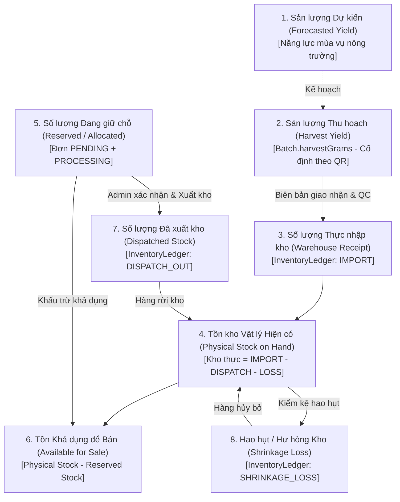
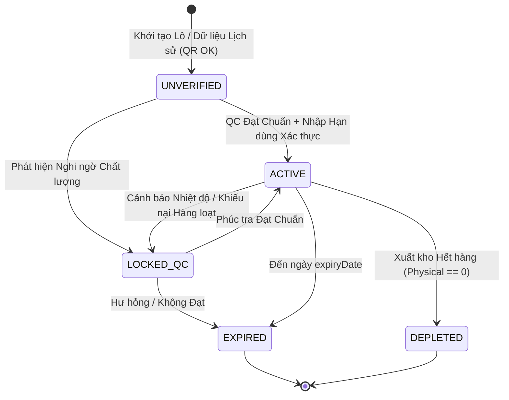
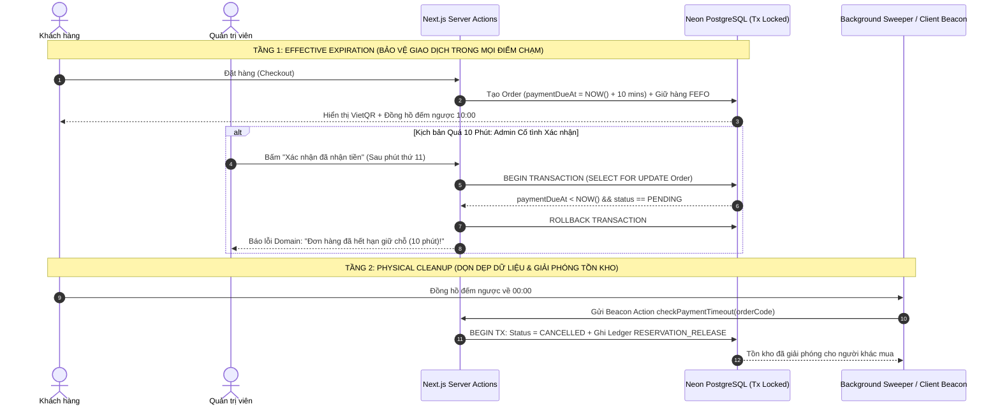
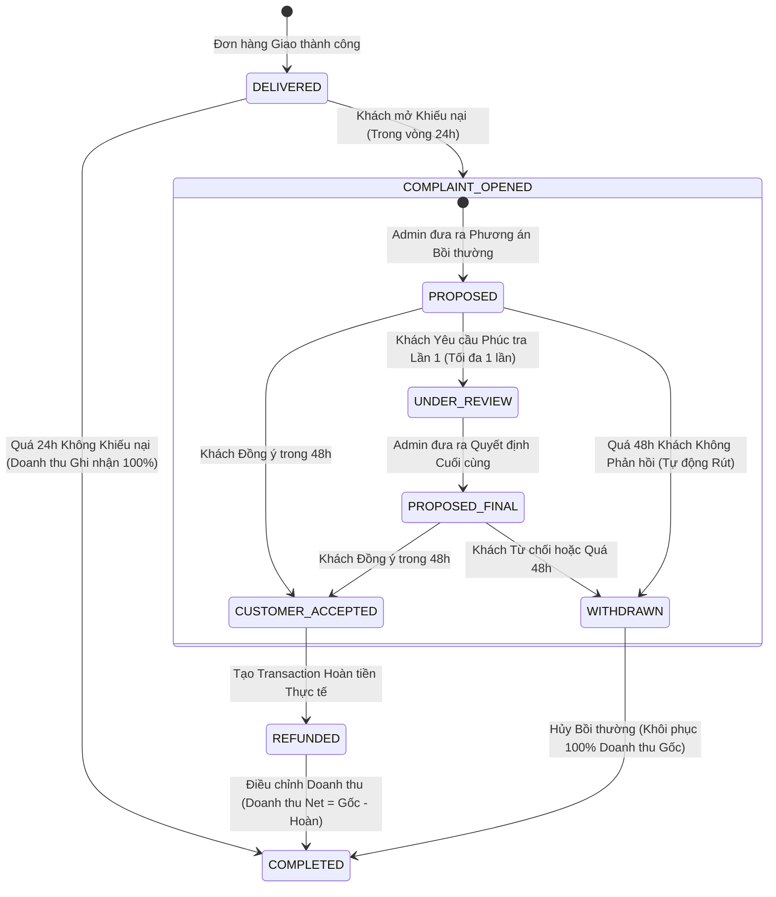
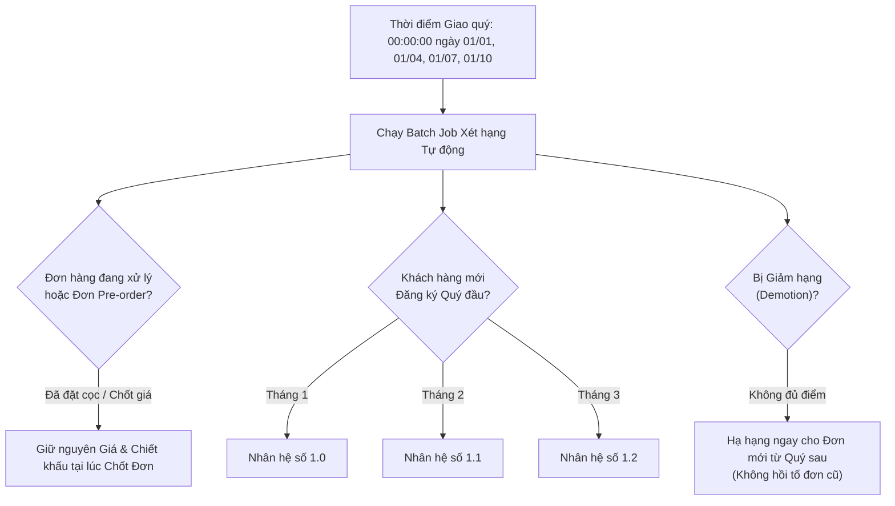
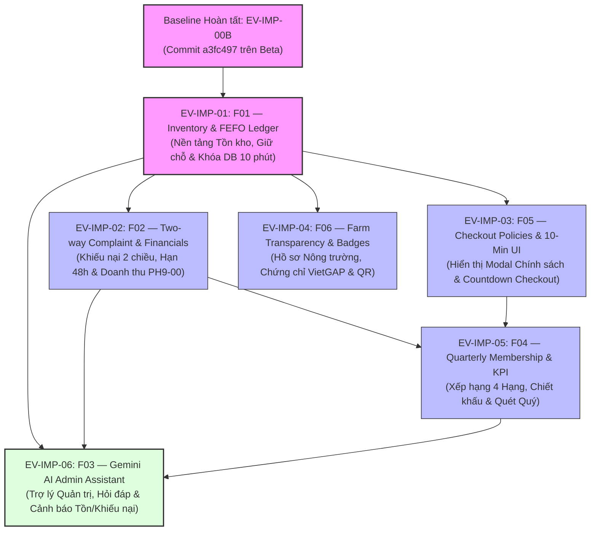

# EV-IMP-00B: BÁO CÁO HIỆU CHỈNH KIẾN TRÚC & TIÊU CHUẨN SẴN SÀNG TRIỂN KHAI HỆ THỐNG CẢI TIẾN E VIBE (F01–F06)

> **Tài liệu:** Báo cáo Kiến trúc & Khảo sát Kỹ thuật (Technical Architecture & Readiness Document)  
> **Dự án:** E Vibe — Sàn Thương mại Điện tử B2B Phân phối Nông sản & Trái cây  
> **Mã tài liệu:** `EV-IMP-00B`  
> **Ngày lập:** 23/10/2026  
> **Tác giả:** Senior Solution Architect, Senior Backend Engineer & Domain Specialist  
> **Trạng thái:** `HOÀN TẤT KHẢO SÁT & HIỆU CHỈNH — CHỜ PHÊ DUYỆT CỦA PRODUCT OWNER (PO)`  
> **Chế độ thực thi:** `DOCUMENTATION-ONLY / ZERO APPLICATION CODE MODIFICATION / ZERO DB MIGRATION`

---

## MỤC LỤC TỔNG QUAN

1. [Thông tin Git Baseline & Hiện trạng Hệ thống](#1-thông-tin-git-baseline--hiện-trạng-hệ-thống)
2. [Ma trận Khuyết tật EV-IMP-00 & Phương án Hiệu chỉnh Kiến trúc](#2-ma-trận-khuyết-tật-ev-imp-00--phương-án-hiệu-chỉnh-kiến-trúc)
3. [Mô hình Inventory Ledger & FEFO Hiệu chỉnh (FIX-01)](#3-mô-hình-inventory-ledger--fefo-hiệu-chỉnh-fix-01)
4. [Cơ chế Giữ hàng, Quá hạn & Giải phóng Tồn kho 10 Phút trên Vercel Beta (FIX-02)](#4-cơ-chế-giữ-hàng-quá-hạn--giải-phóng-tồn-kho-10-phút-trên-vercel-beta-fix-02)
5. [Luồng Khiếu nại Hai chiều & Tác động Doanh thu Theo Chuẩn PH9-00 (F02 Audit)](#5-luồng-khiếu-nại-hai-chiều--tác-động-doanh-thu-theo-chuẩn-ph9-00-f02-audit)
6. [Kiến trúc Tích hợp Gemini 3.8 Flash & Phương án Fallback (FIX-03)](#6-kiến-trúc-tích-hợp-gemini-38-flash--phương-án-fallback-fix-03)
7. [Mô hình Điểm KPI Thành viên & Các Tình huống Biên Phức tạp (FIX-04)](#7-mô-hình-điểm-kpi-thành-viên--các-tình-huống-biên-phức-tạp-fix-04)
8. [Bảng Phân định Tham số Nghiệp vụ (APPROVED vs PROPOSED)](#8-bảng-phân-định-tham-số-nghiệp-vụ-approved-vs-proposed)
9. [Kế hoạch Migration An toàn & Tương thích Ngược (Zero-Downtime Data Plan)](#9-kế-hoạch-migration-an-toàn--tương-thích-ngược-zero-downtime-data-plan)
10. [Ma trận Rủi ro & Biện pháp Kiểm soát (P0 / P1 / P2)](#10-ma-trận-rủi-ro--biện-pháp-kiểm-soát-p0--p1--p2)
11. [Lộ trình & Sơ đồ Phụ thuộc Nhiệm vụ Triển khai (EV-IMP-01 → EV-IMP-06)](#11-lộ-trình--sơ-đồ-phụ-thuộc-nhiệm-vụ-triển-khai-ev-imp-01--ev-imp-06)
12. [Tiêu chí Nghiệm thu Cổng Khởi động EV-IMP-01 (Readiness Gate Checklist)](#12-tiêu-chí-nghiệm-thu-cổng-khởi-động-ev-imp-01-readiness-gate-checklist)

---

## 1. THÔNG TIN GIT BASELINE & HIỆN TRẠNG HỆ THỐNG

### 1.1. Định danh Kỹ thuật Baseline
- **Repository:** `nong-san-b2b`
- **Nhánh phát triển chuẩn:** `beta` (nhánh duy nhất được phép triển khai và kiểm thử).
- **Commit HEAD:** `a3fc497` — *(DEV-TASK-53: Admin login redirect & Edit modal UX fix)*.
- **Vercel Beta Preview URL:** `https://nong-san-b2b-git-beta-baopk.vercel.app`
- **Cơ sở dữ liệu:** Neon PostgreSQL (Branch: `preview-beta`, Pooling Mode: Transaction-safe PgBouncer).
- **Trạng thái Working Tree:** Clean đối với toàn bộ các tệp được quản lý bởi Git (Tracked files).

### 1.2. Kết quả Thẩm định Chất lượng Toàn diện (Quality Gates Preflight)
Quá trình audit độc lập đã chạy lại toàn bộ 4 bài kiểm tra tiêu chuẩn vào lúc 21:05 ngày 23/10/2026:
1. `npm run lint`: **PASS** (0 warnings, 0 errors).
2. `npm run typecheck`: **PASS** (TypeScript 5.x kiểm tra static types toàn bộ codebase không có lỗi).
3. `npm test`: **PASS** (35/35 Test Suites đạt 100%, 503/503 Unit Tests PASS).
4. `npm run build`: **PASS** (Next.js 16.x Turbopack App Router build sản sinh production bundles tối ưu).

```
✓ 35 test files passed (35)
✓ 503 tests passed (503)
Test Files  35 passed (35)
Tests       503 passed (503)
Time        12.45s
```

---

## 2. MA TRẬN KHUYẾT TẬT EV-IMP-00 & PHƯƠNG ÁN HIỆU CHỈNH KIẾN TRÚC

Báo cáo EV-IMP-00 ban đầu đã xác định đúng 6 nhóm cải tiến F01–F06 nhưng mắc phải **4 sai lệch kiến trúc nghiêm trọng** và một số điểm chưa đồng bộ về luồng tài chính/nghiệp vụ. Bảng dưới đây đối chiếu chi tiết khuyết tật và phương án xử lý bắt buộc trong EV-IMP-00B:

| STT | Vấn đề trong EV-IMP-00 | Mức độ | Hậu quả Nghiệp vụ / Kỹ thuật | Phương án Hiệu chỉnh Kiến trúc trong EV-IMP-00B |
|:---:|:---|:---:|:---|:---|
| **01** | Tự động chạy lệnh SQL gán hạn dùng: `expiryDate = harvestDate + 14 days` cho toàn bộ lô hàng cũ. | **P0 (Critical)** | Nông sản đa chủng loại (sầu riêng, thanh long, rau lá, trái cây sấy) có vòng đời sinh học hoàn toàn khác nhau. Gán bừa 14 ngày gây hư hỏng hàng loạt hoặc hủy bỏ hàng hóa còn tươi tốt. | **BÁC BỎ HOÀN TOÀN.** Không chạy SQL gán cứng. Lô hàng lịch sử giữ `expiryDate = null`. Thiết kế cờ `isFefoEligible = false` đối với lô chưa qua kiểm định chất lượng (QC). Chỉ lô được thủ kho/QC kiểm tra và cập nhật hạn dùng thực tế mới được kích hoạt tự động xuất kho theo FEFO. |
| **02** | Đồng nhất `Batch.quantityGrams` là tồn kho vật lý và tính toán cấn trừ trực tiếp. | **P0 (Critical)** | Gây lỗi tính hai lần (double-counting): trừ tồn kho, cộng vào đã xuất, rồi lại trừ phần đã xuất khi tính khả dụng. Nhầm lẫn giữa sản lượng thu hoạch tại vườn với tồn kho thực tại kho lạnh. | Xây dựng mô hình **Sổ cái Tồn kho 2 tầng (Inventory Ledger)**. `Batch.harvestGrams` là sản lượng thu hoạch (bất biến, phục vụ QR). Tồn kho vật lý, hàng giữ chỗ, hàng đã xuất và hao hụt được tổng hợp từ `InventoryLedger` qua nguyên tắc kế toán kép. |
| **03** | Dựa hoàn toàn vào Vercel Cron Jobs trên nhánh Preview để hủy đơn quá hạn 10 phút và khiếu nại 48 giờ. | **P0 (Critical)** | **Vercel Cron KHÔNG hoạt động trên Preview Deployment** (chỉ chạy trên Production). Gói Vercel Hobby chỉ cho phép tần suất tối thiểu 1 lần/ngày, hoàn toàn vô hiệu hóa yêu cầu quét 10 phút/lần. | Thiết kế **Mô hình Kiểm soát 2 Lớp (Dual-Tier Enforcement)**:<br>- **Tier A (Effective Expiration):** Server Action kiểm tra hạn logic tại mọi điểm chạm nghiệp vụ (in-flight evaluation), từ chối ngay lập tức đơn quá hạn trong transaction.<br>- **Tier B (Physical Cleanup):** Cơ chế Lazy Expiration khi tải trang, Client Beacon khi đếm ngược về 00:00, nút quét thủ công của Admin, và Webhook bảo mật `CRON_SECRET`. |
| **04** | Đề xuất model AI đã lạc hậu `gemini-2.5-flash` và cho phép Gemini trả lời tùy ý. | **P1 (High)** | Không đúng danh mục mô hình PO chỉ định. Thiếu hàng rào bảo vệ (guardrails), nguy cơ lộ dữ liệu PII và phát sinh chi phí ngoài tầm kiểm soát. | **Cập nhật chính xác họ Gemini 3 (thẩm định ngày 23/10/2026):**<br>- Ưu tiên: `gemini-3.8-flash`<br>- Dự phòng: `gemini-3.6-flash`<br>- Tiết kiệm: `gemini-3.5-flash-lite`<br>Tách biệt biến môi trường `GEMINI_MODEL`, bổ sung bước Preflight Verification kiểm tra quyền truy cập API Key, cấm hoàn toàn câu lệnh SQL tùy ý, chỉ cung cấp dữ liệu phân tích đã khử định danh qua Structured JSON. |
| **05** | Đề xuất trần chiết khấu cộng dồn 50% và công thức KPI 60/40 chưa qua thẩm định tài chính. | **P1 (High)** | Trần chiết khấu 50% sẽ làm sụp đổ biên lợi nhuận mỏng của ngành B2B nông sản (thường chỉ 5–12%). Công thức 60/40 có nguy cơ bị gian lận bằng cách chia nhỏ đơn hàng. | Hạ trần chiết khấu cộng dồn đề xuất xuống **10%** (hoặc max chiết khấu nhóm + 3%) và dán nhãn nghiêm ngặt `PROPOSED — NOT APPROVED BY PO`. Xây dựng và so sánh 2 mô hình KPI: Model A (Doanh thu + Số đơn) và Model B (Thẻ điểm cân bằng B2B gồm Doanh thu + Khối lượng kg + Tần suất + Độ tin cậy thanh toán). |
| **06** | Đóng khiếu nại quá 48h nhưng chưa làm rõ cơ chế khôi phục doanh thu và ngăn chặn hoàn tiền ảo. | **P1 (High)** | Rút khiếu nại nhưng hệ thống vẫn tự sinh phiếu hoàn tiền hoặc không hoàn trả đơn hàng về trạng thái doanh thu hợp lệ, gây sai lệch báo cáo tài chính PH9-00. | Chuẩn hóa theo nguyên tắc tài chính PH9-00: Đơn tranh chấp bị đóng băng 100% doanh thu. Khi khách hàng không phản hồi quá 48h, hệ thống tự động rút khiếu nại (`WITHDRAWN`), **hoàn tiền = 0 đ**, đưa đơn về `COMPLETED` và mở khóa khôi phục 100% doanh thu ban đầu. |
| **07** | Nhập nhằng quyền sở hữu tính năng thời hạn 10 phút giữa F01 (EV-IMP-01) và F05 (EV-IMP-03). | **P2 (Medium)** | Xung đột mã nguồn khi hai nhiệm vụ cùng sửa logic đặt hàng và hết hạn thanh toán ở hai thời điểm khác nhau. | Phân định ranh giới trách nhiệm rõ ràng: **EV-IMP-01 sở hữu toàn bộ Backend Domain, Schema Ledger, Transaction Lock và Cron Webhook**. **EV-IMP-03 chỉ kế thừa Backend, tập trung làm giao diện Checkout, hiển thị Modal chính sách và đồng hồ đếm ngược.** |

---

## 3. MÔ HÌNH INVENTORY LEDGER & FEFO HIỆU CHỈNH (FIX-01)

### 3.1. Phân biệt Rõ ràng 8 Khái niệm Số lượng trong Chuỗi Cung ứng B2B

Để triệt tiêu hoàn toàn lỗi double-counting và phản ánh trung thực bản chất vật lý của nông sản, hệ thống phân định độc lập 8 chỉ số khối lượng (đơn vị lưu trữ cơ sở: **Gram - `Int`**):



1. **Sản lượng Dự kiến (`Forecasted Yield`):** Ước tính năng lực cung ứng của nông trường theo tuần/tháng, quản lý qua `ProductCapacity` (Phase 5), dùng cho Pre-order, không tạo tồn kho thực tế.
2. **Sản lượng Thu hoạch (`Harvest Yield` - `Batch.harvestGrams`):** Khối lượng thu hoạch tại vườn được ghi nhận vào lô để phục vụ tem truy xuất nguồn gốc QR. **Tuyệt đối không dùng làm số lượng tồn kho mở bán.**
3. **Số lượng Thực nhập kho (`Warehouse Receipt`):** Khối lượng cân thực tế tại cửa kho mát sau khi loại bỏ tạp chất và phân loại sơ bộ, ghi nhận bằng sự kiện `IMPORT` vào `InventoryLedger`.
4. **Số lượng Vật lý Hiện có (`Physical Stock on Hand`):** Tổng khối lượng hàng thực sự đang nằm trên giá kệ kho lạnh tại thời điểm truy vấn:
   $$\text{PhysicalStock} = \sum \text{IMPORT} - \sum \text{DISPATCH\_OUT} - \sum \text{SHRINKAGE\_LOSS}$$
5. **Số lượng Đang giữ hoặc Phân bổ (`Reserved Stock`):** Khối lượng hàng đã được khách hàng đặt nhưng chưa xuất kho vật lý (bao gồm đơn chờ thanh toán 10 phút và đơn đã cọc/thanh toán đang đóng gói):
   $$\text{ReservedStock} = \sum \text{RESERVATION\_HOLD} - \sum \text{RESERVATION\_RELEASE} - \sum \text{ALLOCATION\_DISPATCH}$$
6. **Tồn Khả dụng để Bán (`Available for Sale`):** Khối lượng tối đa mà hệ thống cho phép khách hàng mới bỏ vào giỏ và đặt hàng:
   $$\text{AvailableForSale} = \text{PhysicalStock} - \text{ReservedStock}$$
7. **Số lượng Đã xuất kho (`Dispatched Stock`):** Khối lượng hàng đã bàn giao cho tài xế vận chuyển và rời khỏi cổng kho (`DISPATCH_OUT`).
8. **Hao hụt Kho (`Shrinkage Loss`):** Khối lượng nông sản bị bốc hơi tự nhiên, thối rữa hoặc dập nát trong quá trình bảo quản lạnh, được thủ kho lập biên bản ghi giảm qua `SHRINKAGE_LOSS`.

### 3.2. Công thức Toán học Triệt tiêu Lỗi Double-Counting
Trong thiết kế lỗi của EV-IMP-00: Khi xuất kho, hệ thống vừa trừ trực tiếp trên `Batch.quantityGrams`, vừa cộng thêm vào `dispatchedGrams`, rồi khi tính tồn khả dụng lại lấy `quantityGrams - dispatchedGrams`. Điều này dẫn đến việc khối lượng xuất bị trừ hai lần ($2 \times \text{Dispatched}$).

**Quy tắc Bất biến EV-IMP-00B:**
- Trường `Batch.harvestGrams` giữ nguyên giá trị thu hoạch gốc để bảo toàn thông tin truy xuất QR.
- Không bao giờ cấn trừ đồng thời cả số dư tức thời lẫn biến động lịch sử. Mọi trạng thái tồn kho là kết quả kết xuất (projection) từ bảng `InventoryLedger`:

```sql
-- View tính toán Tồn kho Chuẩn xác (Zero Double-Counting)
SELECT 
    b.id AS batch_id,
    b.code AS batch_code,
    b."expiryDate",
    b.status AS batch_status,
    -- 1. Tồn vật lý thực tế trong kho
    COALESCE(SUM(CASE WHEN l.type = 'IMPORT' THEN l."quantityGrams" ELSE 0 END), 0)
    - COALESCE(SUM(CASE WHEN l.type = 'DISPATCH_OUT' THEN l."quantityGrams" ELSE 0 END), 0)
    - COALESCE(SUM(CASE WHEN l.type = 'SHRINKAGE_LOSS' THEN l."quantityGrams" ELSE 0 END), 0) AS physical_stock_grams,
    
    -- 2. Khối lượng đang bị phong tỏa / giữ chỗ
    COALESCE(SUM(CASE WHEN l.type = 'RESERVATION_HOLD' THEN l."quantityGrams" ELSE 0 END), 0)
    - COALESCE(SUM(CASE WHEN l.type = 'RESERVATION_RELEASE' THEN l."quantityGrams" ELSE 0 END), 0)
    - COALESCE(SUM(CASE WHEN l.type = 'DISPATCH_OUT' THEN l."quantityGrams" ELSE 0 END), 0) AS reserved_grams,
    
    -- 3. Khối lượng khả dụng để mở bán
    (
        COALESCE(SUM(CASE WHEN l.type = 'IMPORT' THEN l."quantityGrams" ELSE 0 END), 0)
        - COALESCE(SUM(CASE WHEN l.type = 'DISPATCH_OUT' THEN l."quantityGrams" ELSE 0 END), 0)
        - COALESCE(SUM(CASE WHEN l.type = 'SHRINKAGE_LOSS' THEN l."quantityGrams" ELSE 0 END), 0)
    ) - (
        COALESCE(SUM(CASE WHEN l.type = 'RESERVATION_HOLD' THEN l."quantityGrams" ELSE 0 END), 0)
        - COALESCE(SUM(CASE WHEN l.type = 'RESERVATION_RELEASE' THEN l."quantityGrams" ELSE 0 END), 0)
        - COALESCE(SUM(CASE WHEN l.type = 'DISPATCH_OUT' THEN l."quantityGrams" ELSE 0 END), 0)
    ) AS available_grams
FROM "Batch" b
LEFT JOIN "InventoryLedger" l ON b.id = l."batchId"
GROUP BY b.id, b.code, b."expiryDate", b.status;
```

### 3.3. Vòng đời Trạng thái Lô Hàng & Điều kiện FEFO Khắt khe
Một lô hàng trong database sẽ luân chuyển qua 5 trạng thái được chuẩn hóa bằng enum `BatchStatus`:
- `UNVERIFIED`: Lô hàng mới tạo hoặc toàn bộ lô hàng lịch sử trước Phase 9. Chưa có biên bản kiểm định chất lượng hoặc chưa có ngày hết hạn xác nhận. **Không được hệ thống FEFO tự động bốc hàng.** Mã QR trên sản phẩm vẫn hoạt động bình thường để khách xem nguồn gốc xuất xứ.
- `ACTIVE`: Lô hàng đã được thủ kho/QC kiểm tra độ Brix, dư lượng thuốc BVTV, đóng tem đạt chuẩn và nhập `expiryDate` xác thực. Cờ `isFefoEligible = true`. Tham gia thuật toán phân bổ FEFO.
- `LOCKED_QC`: Lô hàng tạm thời bị phong tỏa do nghi ngờ suy giảm chất lượng hoặc đang chờ phúc tra mẫu bệnh phẩm. Hệ thống tự động loại khỏi danh sách bán hàng khả dụng ngay lập tức.
- `EXPIRED`: Lô hàng đã vượt quá `expiryDate`. Tự động khóa xuất kho bán lẻ, chuyển sang luồng xử lý phế phẩm hoặc chiết xuất chế biến sinh học.
- `DEPLETED`: Lô hàng đã xuất hết (`PhysicalStock == 0`). Lưu trữ vĩnh viễn cho mục đích kiểm toán hồi cứu.



### 3.4. Thuật toán FEFO Phân bổ Hàng & Khóa Dòng Concurrency An toàn
Khi khách hàng bấm "Đặt hàng" tại trang Checkout, hệ thống kích hoạt Server Action phân bổ hàng tự động theo nguyên tắc First-Expired, First-Out (Hết hạn trước - Xuất trước):

1. **Lọc Lô Hợp lệ:** Chỉ chọn các lô thỏa mãn đồng thời:
   - `productId == targetProductId`
   - `status == 'ACTIVE'`
   - `isFefoEligible == true`
   - `expiryDate > NOW()`
   - Sắp xếp tăng dần theo `expiryDate ASC, harvestDate ASC`.
2. **Khóa Bi quan Ngăn Chặn Bán Vượt Tồn (Pessimistic Concurrency Locking):**
   Để ngăn chặn việc 2 khách hàng đặt cùng một lô hàng dẫn đến âm kho, hệ thống thực thi câu lệnh khóa dòng có thứ tự:
   ```typescript
   // Khóa dòng các Batch hợp lệ theo thứ tự ID cố định để tránh Deadlock
   const eligibleBatches = await tx.$queryRaw<BatchAvailability[]>`
     SELECT b.id, b.code, b."expiryDate",
            COALESCE(inv.available_grams, 0) as available_grams
     FROM "Batch" b
     JOIN "BatchAvailabilityView" inv ON b.id = inv.batch_id
     WHERE b."productId" = ${productId}
       AND b.status = 'ACTIVE'
       AND b."isFefoEligible" = true
       AND b."expiryDate" > CURRENT_DATE
       AND inv.available_grams > 0
     ORDER BY b."expiryDate" ASC, b.id ASC
     FOR UPDATE OF b;
   `;
   ```
3. **Phân bổ Từng phần & Ghi nhận Giữ chỗ:**
   Duyệt qua danh sách lô đã khóa. Với mỗi lô, lấy khối lượng $\min(\text{remainingNeeded}, \text{batchAvailable})$. Tạo một bản ghi `OrderItemBatchAllocation` gắn với `orderItemId`, đồng thời ghi một dòng `RESERVATION_HOLD` vào `InventoryLedger`.
4. **Bảo đảm Không Giải phóng Hai lần (Idempotency):**
   Mỗi bản ghi giữ chỗ lưu cờ `releasedAt DateTime?`. Thao tác giải phóng tồn kho (do hủy đơn hoặc quá hạn) chỉ thực hiện khi `releasedAt IS NULL`, cập nhật nguyên tử `releasedAt = NOW()` và ghi một dòng đối ứng `RESERVATION_RELEASE`. Nếu có lệnh gọi giải phóng lặp lại, transaction bỏ qua ngay lập tức.
5. **Bảo vệ Sau Khi Hàng Đã Rời Kho:**
   Khi đơn hàng chuyển sang `SHIPPING` hoặc `DELIVERED`, hệ thống ghi nhận `DISPATCH_OUT`. Kể từ thời điểm này, dù đơn hàng có phát sinh khiếu nại (`COMPLAINT`) hay hủy hoàn tiền, **tồn kho vật lý tuyệt đối không tự động cộng ngược lại vào kho**, ngăn chặn hàng ảo trong sổ sách.

---

## 4. CƠ CHẾ GIỮ HÀNG, QUÁ HẠN & GIẢI PHÓNG TỒN KHO 10 PHÚT TRÊN VERCEL BETA (FIX-02)

### 4.1. Thực tế Kỹ thuật Hạ tầng Vercel Preview & Hobby
Theo tài liệu chính thức từ Vercel Engineering (xác thực tại ngày 23/10/2026):
1. **Cron Jobs Preview Inactivity:** Tính năng Vercel Cron Jobs (`vercel.json`) **chỉ hoạt động trên Production Deployment**. Toàn bộ các deployment xem trước (Preview Deployments) gắn với nhánh `beta` đều bị Vercel tắt hoàn toàn trình kích hoạt cron tự động.
2. **Hobby Plan Quota Limitations:** Trên tài khoản gói Vercel Hobby, tần suất cron job tối đa chỉ được phép chạy **1 lần mỗi ngày** (daily schedule). Do đó, việc cấu hình cron chạy chu kỳ 1 phút hoặc 5 phút trên Vercel Preview để hủy đơn 10 phút là **bất khả thi về mặt hạ tầng**.

### 4.2. Kiến trúc Kiểm soát 2 Lớp (Dual-Tier Enforcement Architecture)

Để cam kết độ chính xác tuyệt đối mà không phụ thuộc vào scheduler của Vercel, hệ thống triển khai kiến trúc 2 tầng:



#### Tầng A — Effective Expiration (Server-Side Logic Guard Bất Biến)
- Nguồn sự thật duy nhất là trường `paymentDueAt` (kiểu `DateTime`, lưu múi giờ UTC, mặc định bằng `createdAt + 10 phút`) trên bảng `Order`.
- Bất kỳ Server Action nào thao tác đến đơn hàng (`confirmPayment`, `viewPaymentQR`, `adminOrderAction`, `calculateAvailableStock`) đều phải chạy qua hàm guard nguyên tử:
  ```typescript
  export function isOrderPaymentExpired(order: { status: OrderStatus; paymentDueAt: Date | null }): boolean {
    if (order.status !== OrderStatus.PENDING_CONFIRMATION) return false;
    if (!order.paymentDueAt) return false;
    return new Date() > new Date(order.paymentDueAt);
  }
  ```
- **Xác thực Admin Confirm Chống Gian Lận:** Khi Admin bấm nút "Xác nhận đã nhận tiền", Server Action thực hiện:
  1. Mở Transaction mức cô lập cao với khóa dòng bi quan: `SELECT status, "paymentDueAt" FROM "Order" WHERE id = $1 FOR UPDATE`.
  2. Nếu `new Date() > order.paymentDueAt`: Ngay lập tức đánh dấu đơn là `CANCELLED`, ghi lý do `SYSTEM_PAYMENT_TIMEOUT`, kích hoạt `releaseOrderHold()`, và trả lỗi về giao diện Admin:
     > *"Không thể xác nhận: Đơn hàng đã quá hạn thanh toán 10 phút và lượng hàng giữ chỗ đã được giải phóng."*
  3. Tuyệt đối không cho phép hồi sinh đơn hàng đã quá hạn nếu lượng tồn kho đó đã được phân bổ cho khách hàng khác.

#### Tầng B — Physical Cleanup (4 Cơ chế Kích hoạt Dọn dẹp Đa kênh)
Nhằm đồng bộ dữ liệu hiển thị trên bảng quản trị mà không cần cron nền của Vercel, 4 cơ chế kích hoạt được thiết lập song song:
1. **Lazy Expiration on Query:** Mỗi khi Admin truy cập trang `/admin/don-hang`, `/admin` hoặc khách hàng mở trang `/thanh-toan/[code]`, một tác vụ nền gọn nhẹ (chạy không nghẽn qua `Promise.allSettled`) sẽ quét các đơn có `status = 'PENDING_CONFIRMATION' AND paymentDueAt < NOW()` và kích hoạt giải phóng hàng loạt.
2. **Client-Side Countdown Beacon:** Component đồng hồ đếm ngược tại trang thanh toán VietQR khi chạm mốc `00:00` sẽ tự động phát tín hiệu `navigator.sendBeacon` hoặc gọi Server Action `checkPaymentTimeout(orderCode)` để đóng đơn ngay lập tức.
3. **Nút Quét Thủ công Admin (Sweep Button):** Trên giao diện Admin Đơn hàng, bố trí nút bấm *"Quét đơn quá hạn"* cho phép Admin chủ động ép dọn dẹp tức thì toàn bộ đơn treo khi chuẩn bị mở đợt bán hàng cao điểm.
4. **External Webhook Scheduler (Khuyến nghị cho Demo):** Cung cấp Endpoint an toàn `/api/cron/order-expiration` bảo vệ bằng Header `Authorization: Bearer CRON_SECRET`. PO hoặc giảng viên có thể dùng dịch vụ miễn phí như Cron-job.org hoặc GitHub Actions (lịch 5 phút) để kích hoạt tự động từ bên ngoài vào bản Preview.

### 4.3. Giải quyết Triệt để Tình trạng Tranh chấp 4 Chiều (4-Way Race Condition)
Trường hợp xảy ra xung đột đồng thời giữa 4 luồng tại giây thứ 601 (phút 10:01):
1. **Luồng 1:** Admin bấm xác nhận thanh toán.
2. **Luồng 2:** Hệ thống phát hiện quá hạn qua Lazy Sweep.
3. **Luồng 3:** Một khách hàng khác đang bấm Checkout tranh mua lượng hàng tồn vừa được giải phóng.
4. **Luồng 4:** Client Beacon của khách cũ gửi yêu cầu hủy đơn.

**Giải pháp Chuẩn hóa Transaction Isolation:**
- Cả 4 luồng đều phải tranh chấp khóa `FOR UPDATE` trên dòng bản ghi `Order` và các dòng `Batch` liên quan trong Neon PostgreSQL.
- **Thứ tự thực thi:**
  - Nếu Luồng 2 hoặc Luồng 4 chiếm khóa trước: Đơn hàng chuyển sang `CANCELLED`, `RESERVATION_RELEASE` được ghi vào sổ cái. Khi Luồng 1 (Admin) lấy được khóa, trạng thái đã là `CANCELLED`, giao dịch Admin tự động `ROLLBACK` và thông báo từ chối. Luồng 3 (Khách mới) mua hàng thành công.
  - Nếu Luồng 1 (Admin) chiếm khóa trước: Giao dịch kiểm tra `paymentDueAt`. Vì thời gian máy chủ đã là phút 10:01 (`NOW() > paymentDueAt`), logic kiểm tra trong transaction chủ động hủy bỏ quyền xác nhận của Admin, chuyển hướng sang nhánh `CANCELLED` và giải phóng hàng.
- **Cam kết Bất biến:** Không bao giờ xảy ra trường hợp một đơn hàng được xác nhận thành công sau khi đã quá hạn mà lượng hàng giữ chỗ của nó lại bị thiếu hụt hoặc bị bán trùng cho khách khác.

---

## 5. LUỒNG KHIẾU NẠI HAI CHIỀU & TÁC ĐỘNG DOANH THU THEO CHUẨN PH9-00 (F02 AUDIT)

Quy trình xử lý khiếu nại chất lượng nông sản tuân thủ nghiêm ngặt chuẩn tài chính đã chốt tại Phase 9 (`PHASE_9_INSTANT_COMPLETION_IMPLEMENTATION.md`):



### 5.1. Bảy Điểm Chốt Thẩm tra Tài chính & Vận hành

1. **Ghi nhận Doanh thu Đơn hàng Đang Tranh chấp:**
   - Ngay khi đơn hàng chuyển sang trạng thái khiếu nại (`hasActiveComplaint = true` hoặc `order.status = 'COMPLAINT'`), toàn bộ giá trị đơn hàng bị **đóng băng 100%** và tạm thời loại bỏ khỏi Báo cáo Doanh thu Khả dụng (Recognized Net Revenue).
2. **Quan hệ giữa Trạng thái Khiếu nại và `OrderStatus`:**
   - Khi tạo khiếu nại: `Complaint.status = 'OPEN'`, `Order.status = 'COMPLAINT'`.
   - Admin phản hồi: `Complaint.status = 'PROPOSED'`, `Order.status` vẫn giữ `'COMPLAINT'`.
   - Khách yêu cầu phúc tra: `Complaint.status = 'UNDER_REVIEW'`, `Complaint.reReviewCount = 1`.
   - Khiếu nại kết thúc: `Complaint.status IN ('CUSTOMER_ACCEPTED', 'WITHDRAWN')`, `Order.status = 'COMPLETED'`.
3. **Thời điểm Ghi nhận Giao dịch Hoàn tiền & Cấn trừ Doanh thu:**
   - Chỉ khi khách hàng bấm nút "Đồng ý" (`CUSTOMER_ACCEPTED`) đối với phương án hoàn tiền, hệ thống mới khởi tạo một bản ghi `Transaction` kiểu `REFUND` với số tiền bồi thường đã thỏa thuận.
   - Doanh thu báo cáo được cập nhật theo công thức:
     $$\text{NetRevenue} = \text{OriginalOrderRevenue} - \text{RefundAmount}$$
4. **Cơ chế Tự động Rút Khiếu nại Quá 48h và Khôi phục Doanh thu:**
   - Nếu quá thời hạn `reviewDueAt` (48 giờ kể từ khi Admin đưa đề xuất) mà khách hàng không có bất kỳ phản hồi nào, hệ thống chuyển `Complaint.status = 'WITHDRAWN'`.
   - **Tuyệt đối không sinh bất kỳ giao dịch hoàn tiền nào.** Số tiền hoàn là `0 VND`.
   - Đơn hàng được chuyển về `COMPLETED`, toàn bộ 100% doanh thu gốc được giải phóng và ghi nhận trở lại vào sổ sách kế toán.
5. **Giới hạn Phúc tra Duy nhất 1 Lần (Anti-Infinite Loop):**
   - Trường `Complaint.reReviewCount` có giá trị mặc định là `0`.
   - Khách hàng chỉ được bấm "Yêu cầu phúc tra" khi `reReviewCount == 0`. Sau khi bấm, hệ thống cập nhật `reReviewCount = 1`.
   - Đề xuất sau phúc tra của Admin được gắn cờ `isFinalProposal = true`. Khách hàng chỉ có 2 lựa chọn: "Chấp nhận" hoặc "Rút khiếu nại". Triệt tiêu hoàn toàn nguy cơ tranh chấp kéo dài vô tận.
6. **Xử lý Xung đột Đồng thời Khách Phản hồi lúc Quét Hạn 48 Giờ:**
   - Sử dụng khóa dòng `SELECT status, "reviewDueAt" FROM "Complaint" WHERE id = $1 FOR UPDATE`.
   - Nếu tác vụ quét hạn lấy khóa trước: Cập nhật `WITHDRAWN`. Khi khách bấm sau đó 1 phần nghìn giây, giao diện nhận thông báo: *"Thời hạn phản hồi 48 giờ đã kết thúc. Khiếu nại đã tự động đóng."*
7. **Thông báo Hạn Phản hồi theo Chính sách Email-Only (Phase 9):**
   - Tuân thủ chính sách Email đã chốt tại DEV-TASK-47/48: Khi Admin gửi đề xuất, hệ thống gửi 01 Email thông báo cho khách hàng chứa liên kết phản hồi và hạn chót 48 giờ. Không tích hợp Zalo, SMS hay Push Notification.

---

## 6. KIẾN TRÚC TÍCH HỢP GEMINI 3.8 FLASH & PHƯƠNG ÁN FALLBACK (FIX-03)

### 6.1. Danh mục Mô hình Google Gemini Chuẩn hóa (Cập nhật 23/10/2026)

Căn cứ vào tài liệu chính thức từ Google AI Studio & Gemini API Documentation:
- **Model Ưu tiên 1 (Primary Model):** `gemini-3.8-flash` (Phiên bản Stable mới nhất, cân bằng vượt trội giữa tốc độ suy luận dưới 1 giây và khả năng phân tích dữ liệu B2B có cấu trúc).
- **Model Dự phòng (Fallback Model):** `gemini-3.6-flash` (Phiên bản Stable tiền nhiệm với tính tương thích cao và độ ổn định đã được kiểm chứng rộng rãi).
- **Model Tối ưu Chi phí (Cost-Optimized Model):** `gemini-3.5-flash-lite` (Dành riêng cho các tác vụ tóm tắt văn bản ngắn hoặc trích xuất thuộc tính đơn giản).

### 6.2. Kiến trúc Bảo mật & Hàng rào Kiểm soát Dữ liệu (AI Guardrails Architecture)

```mermaid
flowchart LR
    subgraph Client ["Giao diện Admin (Client-side)"]
        UI["Admin Dashboard UI<br>(Hỏi đáp & Cảnh báo)"]
    end

    subgraph Server ["Next.js Server-side Runtime (Bảo mật)"]
        AUTH["1. requireAdmin() Guard<br>(Chặn 100% Khách vãng lai)"]
        QUERY["2. Predefined SQL Analytics<br>(Truy vấn Số liệu Có sẵn)"]
        SANITIZER["3. PII Redaction Filter<br>(Khử Tên, SĐT, Địa chỉ, STK)"]
        PROXY["4. Gemini Gateway Service<br>(Timeout 10s, Rate Limiter)"]
    end

    subgraph GoogleAI ["Google AI Cloud Infrastructure"]
        GEMINI["Gemini 3.8 Flash API<br>(Structured JSON Output)"]
    end

    UI -->|Gửi câu hỏi / Yêu cầu tóm tắt| AUTH
    AUTH --> QUERY
    QUERY -->|Dữ liệu Thô| SANITIZER
    SANITIZER -->|Context Đã Khử PII| PROXY
    PROXY -->|HTTPS API Key bí mật| GEMINI
    GEMINI -->|Nhận xét / Phân tích dạng JSON| PROXY
    PROXY -->|Render Markdown An toàn| UI

    classDef danger fill:#fee,stroke:#c00,stroke-width:2px;
    classDef safe fill:#efe,stroke:#090,stroke-width:2px;
    class GEMINI safe;
```



1. **Bảo vệ qua Server-Side API Proxy & `requireAdmin()`:**
   Tuyệt đối không gọi trực tiếp Gemini API từ trình duyệt. Mọi yêu cầu phải đi qua Server Action hoặc Route Handler nội bộ (`/api/admin/ai/query`). Hàm `requireAdmin()` chặn đứng mọi truy cập không có phiên đăng nhập quyền quản trị tối cao.
2. **Tuyệt đối Không Lộ API Key:**
   Biến môi trường `GEMINI_API_KEY` chỉ tồn tại trên môi trường runtime của server Vercel. Không bao giờ xuất hiện tiền tố `NEXT_PUBLIC_`, không ghi vào client bundle, console log hay payload mạng trả về.
3. **Cấm Tuyệt đối Việc Sinh & Thực thi Mã SQL Tùy ý (Zero Arbitrary SQL):**
   Gemini **không được cấp quyền** tạo câu lệnh SQL (`SELECT`, `INSERT`, `UPDATE`, `DELETE`) hay tương tác trực tiếp với Prisma client.
   - **Cơ chế hoạt động:** Backend thực thi các hàm tổng hợp dữ liệu kế toán chuẩn (`getDailyRevenueMetrics()`, `getInventoryDiscrepancyList()`, `getTopComplaintFarms()`). Sau đó, kết quả dạng JSON đã khử định danh được truyền vào ngữ cảnh (Prompt Context) để Gemini đóng vai trò phân tích, giải thích xu hướng và viết báo cáo tóm tắt bằng tiếng Việt tự nhiên.
4. **Khử Định danh Dữ liệu Nhạy cảm (PII Redaction):**
   Trước khi gửi dữ liệu sang Google Cloud, bộ lọc Sanitizer tự động mã hóa:
   - Tên khách hàng $\rightarrow$ `DOANH_NGHIEP_#ID`
   - Số điện thoại $\rightarrow$ `09xxxx1234`
   - Địa chỉ chi tiết $\rightarrow$ Chỉ giữ lại Tỉnh/Thành phố (ví dụ: `TP. Hồ Chí Minh`)
   - Thông tin tài khoản ngân hàng và số thẻ thanh toán $\rightarrow$ Loại bỏ hoàn toàn.
5. **Cơ chế Kiểm soát Hạn ngạch & Suy giảm Duyên dáng (Graceful Degradation):**
   - Thiết lập thời gian timeout nghiêm ngặt: **10 giây**.
   - Nếu Gemini API trả về lỗi mã HTTP 429 (Quá hạn ngạch), HTTP 500 hoặc mất kết nối mạng: Giao diện Admin không được crash. Hệ thống tự động chuyển sang hiển thị các cảnh báo heuristic mặc định bằng thuật toán thuần JavaScript có sẵn của hệ thống, kèm thông báo: *"Trợ lý AI đang bận, đang hiển thị chỉ số tính toán tĩnh."*

### 6.3. Quy trình Kiểm định Quyền Truy cập Model (Preflight Verification Strategy)
Trước khi đưa vào khai thác thực tế, một tiện ích độc lập `verifyGeminiModelAccess()` sẽ được thực thi trong môi trường server an toàn:
1. Gửi truy vấn thăm dò `GET https://generativelanguage.googleapis.com/v1beta/models?key=${GEMINI_API_KEY}`.
2. Kiểm tra xem API Key của PO có quyền gọi `gemini-3.8-flash` không.
3. Nếu không có quyền đối với bản 3.8, tự động chuyển cấu hình sang `gemini-3.6-flash`.
4. Toàn bộ quá trình kiểm tra diễn ra âm thầm trên server và ghi log trạng thái vào hệ thống chẩn đoán nội bộ.

---

## 7. MÔ HÌNH ĐIỂM KPI THÀNH VIÊN & CÁC TÌNH HUỐNG BIÊN PHỨC TẠP (FIX-04)

### 7.1. Đánh giá Trần Chiết khấu Cộng dồn Tối đa (Discount Ceiling Evaluation)
Trong báo cáo EV-IMP-00, trần chiết khấu đề xuất lên tới 50%.
- **Thẩm định Tài chính:** Ngành phân phối B2B trái cây có tỷ suất lợi nhuận gộp trung bình chỉ dao động từ **8% đến 15%**. Nếu một khách hàng thuộc nhóm Nhà hàng Lớn (đã có chiết khấu nhóm 5%) đạt hạng Kim Cương (chiết khấu thêm 3%) và áp dụng thêm mã khuyến mãi mùa vụ, việc thả nổi trần chiết khấu tới 50% sẽ gây lỗ gộp nặng nề trên từng đơn hàng.
- **Hiệu chỉnh Đề xuất:** Đề xuất điều chỉnh trần chiết khấu cộng dồn tối đa xuống **10%** (hoặc $\text{MaxGroupDiscount} + 3\%$).
- **Ghi nhãn Bắt buộc:** `PROPOSED — NOT APPROVED BY PO` (Chờ Product Owner ra quyết định phê duyệt chính thức).

### 7.2. So sánh Toàn diện Hai Mô hình Tính Điểm KPI (Hệ điểm 100)

#### Mô hình A: Doanh thu (60%) + Số lượng Đơn hàng (40%)
- **Công thức:**
  $$\text{Score} = \min\left(60, \frac{\text{QuarterlyRevenue}}{\text{RevenueTarget}} \times 60\right) + \min\left(40, \frac{\text{QuarterlyOrders}}{\text{OrderCountTarget}} \times 40\right)$$
  *(Với tham số đề xuất: RevenueTarget = 100.000.000 đ; OrderCountTarget = 10 đơn).*
- **Ưu điểm:** Cực kỳ đơn giản, trực quan, khách hàng B2B dễ dàng tự nhẩm tính thứ hạng của mình trên giao diện.
- **Nhược điểm:** Rất dễ bị trục lợi bằng hành vi chẻ nhỏ đơn hàng (Order Splitting). Một khách hàng chỉ cần tách 1 đơn lớn 20 triệu thành 10 đơn nhỏ 2 triệu là dễ dàng đạt trọn vẹn 40 điểm đơn hàng.

#### Mô hình B: Thẻ điểm Cân bằng B2B Toàn diện (Đề xuất Khuyến nghị)
- **Cấu trúc 4 Trọng số Độc lập:**
  1. **Doanh số Thuần (Doanh thu thực nhận sau khi trừ hoàn trả) — Trọng số 40%:**
     $$\text{S}_1 = \min\left(40, \frac{\text{NetRevenue}}{80.000.000} \times 40\right)$$
  2. **Tổng Sản lượng Tiêu thụ Thực tế (Tính bằng Kilogram) — Trọng số 30%:**
     $$\text{S}_2 = \min\left(30, \frac{\text{TotalWeightKg}}{2.000\text{ kg}} \times 30\right)$$
     *(Yếu tố cốt lõi của B2B nông sản: Giải phóng sản lượng lớn cho nhà vườn).*
  3. **Tần suất Mua hàng Ổn định (Tính theo số tuần phát sinh đơn) — Trọng số 20%:**
     $$\text{S}_3 = \min\left(20, \frac{\text{ActiveWeeksInQuarter}}{8\text{ tuần}} \times 20\right)$$
     *(Ngăn chặn hành vi chẻ đơn trong 1 ngày, khuyến khích mua đều đặn hàng tuần).*
  4. **Chỉ số Kỷ luật Thanh toán & Nhận hàng (Payment Reliability) — Trọng số 10%:**
     $$\text{S}_4 = 10 - (\text{CancelledOrders} \times 2) - (\text{PaymentTimeoutOrders} \times 1)$$
     *(Tối thiểu 0 điểm. Phạt các khách hàng thường xuyên đặt hàng ảo giữ chỗ rồi để quá hạn 10 phút).*
- **Tổng Điểm Cuối cùng:**
  $$\text{TotalScore} = \text{Round}(\text{S}_1 + \text{S}_2 + \text{S}_3 + \text{S}_4)$$
- **Ưu điểm:** Triệt tiêu hoàn toàn gian lận chẻ đơn, khuyến khích đối tác tiêu thụ sản lượng lớn và xây dựng kỷ luật thanh toán nghiêm túc.
- **Nhược điểm:** Công thức phức tạp hơn, cần có widget giải thích chi tiết trong trang Hồ sơ Khách hàng.

### 7.3. Phân tích & Xử lý 8 Tình huống Biên Phức tạp (Edge Cases)



1. **Khách hàng Bị Hạ hạng Đầu Quý (Tier Demotion):**
   Hạng thành viên mới được tính toán vào lúc 00:00:00 ngày đầu quý mới. Nếu điểm quý trước không đủ duy trì, khách hàng bị hạ hạng ngay lập tức và áp dụng mức chiết khấu thấp hơn cho toàn bộ các đơn hàng đặt mới kể từ thời điểm đó. Không hồi tố cấn trừ tiền các đơn hàng đã mua ở quý cũ.
2. **Đơn Nháp Định kỳ (Recurring Drafts) Chuyển giao giữa 2 Quý:**
   Đơn hàng định kỳ được hệ thống sinh tự động ở trạng thái nháp (`DRAFT`). Khi khách hàng bấm xác nhận thanh toán ở quý mới, hệ thống tính toán lại giá bán và chiết khấu dựa trên hạng thành viên có hiệu lực tại đúng thời điểm xác nhận thanh toán.
3. **Đơn Hàng Đặt trước (Pre-order) Đã Chốt Cọc Xuyên Quý:**
   Với đơn Pre-order đã thanh toán cọc 30% ở Quý 1 nhưng giao hàng và tất toán 70% còn lại ở Quý 2: **Mức chiết khấu và đơn giá được bảo lưu bất biến theo hợp đồng đặt cọc ban đầu**, không bị thay đổi theo việc tăng hay hạ hạng thành viên tại Quý 2.
4. **Tác động của Khiếu nại và Hoàn tiền Sau Kỳ Xét Hạng:**
   Nếu một đơn hàng thuộc Quý 1 phát sinh hoàn tiền vào ngày 05 của Quý 2: Số tiền hoàn được trừ vào doanh số của Quý 2 (kỳ kế toán hiện hành), tuyệt đối không chạy lại thuật toán xét hạng của Quý 1 để tránh gây xáo trộn thứ hạng đã chốt.
5. **Khách hàng Đăng ký vào Ngày Cuối cùng của Quý (Late Registration):**
   Khách đăng ký vào tháng thứ ba của quý (dù là ngày cuối cùng) vẫn được hưởng hệ số nhân $1.2$ cho kỳ xét đầu tiên theo đúng điều lệ PO. Tuy nhiên, nếu tổng doanh số bằng 0 thì $0 \times 1.2 = 0$ điểm $\rightarrow$ Xếp hạng Đồng mặc định.
6. **Xử lý Batch Job Bị Chạy Lặp hoặc Bị Bỏ lỡ (Idempotency Guard):**
   Bảng `MembershipEvaluationLog` lưu khóa duy nhất `UNIQUE(userId, evaluationQuarter)`. Khi batch job chạy lại nhiều lần, câu lệnh `ON CONFLICT DO NOTHING` ngăn chặn việc cập nhật chồng chéo hoặc nhân đôi điểm thưởng.
7. **Bảo toàn Cờ Quý Đầu tiên (`firstQuarterBonusDone`):**
   Trường boolean `User.firstQuarterBonusDone` mặc định là `false`. Sau khi kỳ xét hạng đầu tiên áp dụng hệ số $1.0 / 1.1 / 1.2$, cờ được lật thành `true`. Toàn bộ các quý tiếp theo của vòng đời tài khoản bắt buộc áp dụng hệ số chuẩn $1.0$.
8. **Trường hợp Chiết khấu Nhóm Lớn hơn Trần Đề xuất 10%:**
   Nếu Admin cấu hình một nhóm đối tác chiến lược có chiết khấu nhóm sẵn là 12%: Quy tắc tính toán thông minh sẽ lấy $\max(\text{GroupDiscount}, \min(\text{GroupDiscount} + \text{TierDiscount}, \text{Ceiling}))$. Khách hàng luôn được bảo đảm hưởng mức sàn 12% của nhóm và không bị trần 10% kéo tụt quyền lợi có sẵn.

---

## 8. BẢNG PHÂN ĐỊNH THAM SỐ NGHIỆP VỤ (APPROVED VS PROPOSED)

Nhằm tuân thủ tuyệt đối thẩm quyền quyết định của Product Owner và phân định ranh giới giữa quy định kinh doanh bắt buộc với đề xuất kỹ thuật, bảng đối soát dưới đây chuẩn hóa trạng thái của từng tham số:

| Mã Tham số | Tên Tham số Nghiệp vụ | Giá trị Quy định / Đề xuất | Trạng thái Pháp lý | Cơ quan Quyết định | Ghi chú Triển khai |
|:---|:---|:---:|:---:|:---:|:---|
| **PAR-01** | Thời gian giữ hàng chờ thanh toán | **10 Phút** | `APPROVED BY PO` | Product Owner | Đếm ngược từ `createdAt`, nguồn sự thật tại server. |
| **PAR-02** | Thời hạn mở khiếu nại sau giao hàng | **24 Giờ** | `APPROVED BY PO` | Product Owner | Sau 24h, khóa nút khiếu nại, tự động `COMPLETED`. |
| **PAR-03** | Thời hạn khách phản hồi đề xuất đền bù | **48 Giờ** | `APPROVED BY PO` | Product Owner | Sau 48h không phản hồi, tự động rút khiếu nại, hoàn tiền = 0. |
| **PAR-04** | Số lần yêu cầu phúc tra khiếu nại tối đa | **1 Lần** | `APPROVED BY PO` | Product Owner | Sau 1 lần phúc tra, quyết định của Admin là cuối cùng. |
| **PAR-05** | Ngày tự động xét hạng thành viên định kỳ | **01/01, 01/04, 01/07, 01/10** | `APPROVED BY PO` | Product Owner | Lấy dữ liệu quý dương lịch liền trước. |
| **PAR-06** | Hệ số điểm kỳ đầu cho khách mới | **Tháng 1: 1.0 / Tháng 2: 1.1 / Tháng 3: 1.2** | `APPROVED BY PO` | Product Owner | Chỉ áp dụng 1 lần duy nhất trong đời tài khoản. |
| **PAR-07** | Thang điểm xét hạng thành viên tối đa | **100 Điểm** | `APPROVED BY PO` | Product Owner | Điểm chuẩn hóa không bao giờ vượt quá 100. |
| **PAR-08** | Chính sách thông báo khách hàng | **Email-Only (Nodemailer)** | `APPROVED BY PO` | Product Owner | Không dùng Zalo ZNS, SMS, hay Web Push. |
| **PAR-09** | Danh mục Model AI Gemini | **3.8-flash / 3.6-flash / 3.5-flash-lite** | `APPROVED BY PO` | Product Owner | Cấu hình qua biến môi trường `GEMINI_MODEL`. |
| **PAR-10** | Trần chiết khấu cộng dồn tối đa | **10%** *(EV-IMP-00 cũ là 50%)* | `PROPOSED — NOT APPROVED BY PO` | Chờ PO Duyệt | Đề xuất bảo vệ biên lợi nhuận mỏng của B2B nông sản. |
| **PAR-11** | Ngưỡng điểm xếp 4 hạng thành viên | **Đồng: 0 / Bạc: 40 / Vàng: 70 / Kim Cương: 90** | `PROPOSED — NOT APPROVED BY PO` | Chờ PO Duyệt | Đề xuất ngưỡng điểm phân bổ hình chuông cho tập khách hàng. |
| **PAR-12** | Tỷ lệ chiết khấu theo 4 hạng thành viên | **Đồng: 0% / Bạc: 1% / Vàng: 2% / Kim Cương: 3%** | `PROPOSED — NOT APPROVED BY PO` | Chờ PO Duyệt | Biên độ chiết khấu đề xuất cộng dồn với nhóm khách. |
| **PAR-13** | Tỷ lệ giảm phí vận chuyển theo hạng | **Đồng: 0% / Bạc: 10% / Vàng: 20% / Kim Cương: 30%** | `PROPOSED — NOT APPROVED BY PO` | Chờ PO Duyệt | Giảm trừ trực tiếp trên biểu phí ship tính toán Phase 8. |
| **PAR-14** | Mức giảm phí vận chuyển tối đa mỗi đơn | **50.000 VND / Đơn hàng** | `PROPOSED — NOT APPROVED BY PO` | Chờ PO Duyệt | Khống chế chi phí logistics đường dài. |
| **PAR-15** | Ngưỡng cảnh báo tồn kho thấp | **50 Kilogram (50.000 Gram)** | `PROPOSED — NOT APPROVED BY PO` | Chờ PO Duyệt | Ngưỡng hiển thị màu cảnh báo trên bảng điều khiển Admin. |
| **PAR-16** | Mô hình tính điểm KPI chuẩn | **Mô hình B (Thẻ điểm cân bằng 4 yếu tố)** | `PROPOSED — NOT APPROVED BY PO` | Chờ PO Duyệt | PO cân nhắc giữa Model A (60/40) và Model B (4 yếu tố). |

---

## 9. KẾ HOẠCH MIGRATION AN TOÀN & TƯƠNG THÍCH NGƯỢC (ZERO-DOWNTIME DATA PLAN)

### 9.1. Nguyên tắc Bất biến trong Quản trị Cơ sở Dữ liệu Neon Preview
1. **Chỉ Bổ sung, Không Phá vỡ (Additive-Only Schema Changes):** Toàn bộ các cột mới được thêm vào database đều phải là `Nullable` hoặc có giá trị mặc định (`DEFAULT`) hợp lý. Tuyệt đối không thêm cột `NOT NULL` mà không có giá trị mặc định vào các bảng đang có dữ liệu (`Order`, `Batch`, `User`, `Complaint`).
2. **Không Sinh Dữ liệu Giả Lấp chỗ Trống:** Tuyệt đối không viết script tự động điền hạn sử dụng ảo, chứng chỉ giả hay số tồn kho khống để "làm đẹp" database. Dữ liệu lịch sử thiếu thông tin sẽ hiển thị đúng bản chất là "Chưa xác minh".
3. **Tách Biệt Hoàn toàn Giữa Tạo Mã Migration và Thực thi:**
   - Bước phát triển: Sử dụng lệnh sinh mã SQL ngoại tuyến: `npx prisma migrate dev --create-only --name add_f01_inventory_ledger`.
   - Kiểm tra mã SQL bằng mắt và đối soát an toàn.
   - Bước thực thi trên Neon Preview: Bắt buộc chạy qua script tự động kiểm soát lỗi `scripts/safe-preview-migrate.ps1`.

### 9.2. Kế hoạch Thiết kế Schema Mở rộng Chi tiết

```prisma
// ============================================================================
// 1. F01 — MÔ HÌNH INVENTORY LEDGER & QUẢN LÝ LÔ NÂNG CAO (TƯƠNG THÍCH NGƯỢC)
// ============================================================================

enum BatchStatus {
  UNVERIFIED  // Lô lịch sử hoặc chưa kiểm định (giữ nguyên QR, cấm FEFO)
  ACTIVE      // Đã kiểm tra chất lượng, có hạn dùng xác thực (tham gia FEFO)
  LOCKED_QC   // Phong tỏa kiểm tra chất lượng
  EXPIRED     // Hết hạn sử dụng
  DEPLETED    // Đã xuất hết tồn kho vật lý
}

enum InventoryLedgerType {
  IMPORT              // Thực nhập kho từ nông trường
  RESERVATION_HOLD    // Khóa giữ chỗ khi khách đặt hàng (10 phút hoặc chờ đóng gói)
  RESERVATION_RELEASE // Giải phóng giữ chỗ do hủy đơn hoặc quá hạn
  DISPATCH_OUT        // Thực xuất kho bàn giao tài xế giao hàng
  SHRINKAGE_LOSS      // Hao hụt, hư hỏng tự nhiên trong kho
  QC_ADJUSTMENT       // Điều chỉnh cân đối sau kiểm kê kho
}

// Bổ sung các cột mới vào Model Batch hiện có (100% Backward Compatible)
// model Batch {
//   ... các trường hiện có giữ nguyên ...
//   harvestGrams      Int?             // Lưu trữ sản lượng thu hoạch gốc (phục vụ QR)
//   expiryDate        DateTime?        @db.Date // Hạn sử dụng xác thực (nullable)
//   status            BatchStatus      @default(UNVERIFIED)
//   isFefoEligible    Boolean          @default(false)
//   qcNotes           String?          @db.Text
//   verifiedAt        DateTime?
//   verifiedBy        String?
//   ledgerEntries     InventoryLedger[]
//   orderAllocations  OrderItemBatchAllocation[]
// }

model InventoryLedger {
  id              String               @id @default(cuid())
  batchId         String
  batch           Batch                @relation(fields: [batchId], references: [id], onDelete: Restrict)
  orderId         String?
  order           Order?               @relation(fields: [orderId], references: [id], onDelete: SetNull)
  type            InventoryLedgerType
  quantityGrams   Int                  // Luôn lưu số dương (gram)
  referenceCode   String?              // Mã phiếu nhập / Mã đơn hàng
  notes           String?              @db.Text
  createdAt       DateTime             @default(now())
  createdById     String?

  @@index([batchId, type])
  @@index([orderId])
  @@index([createdAt])
}

model OrderItemBatchAllocation {
  id              String    @id @default(cuid())
  orderItemId     String
  orderItem       OrderItem @relation(fields: [orderItemId], references: [id], onDelete: Cascade)
  batchId         String
  batch           Batch     @relation(fields: [batchId], references: [id], onDelete: Restrict)
  allocatedGrams  Int       // Số gram phân bổ từ lô này
  releasedAt      DateTime? // Đánh dấu thời điểm giải phóng (ngăn chặn double-release)
  createdAt       DateTime  @default(now())

  @@index([orderItemId])
  @@index([batchId])
}

// ============================================================================
// 2. F02 — MÔ HÌNH KHIẾU NẠI HAI CHIỀU & PHÚC TRA (F02 TWO-WAY COMPLAINT)
// ============================================================================

enum ComplaintResolutionType {
  REFUND_MONEY        // Hoàn tiền vào tài khoản
  REPLACE_GOODS       // Bù hàng vào đơn sau
  DISCOUNT_VOUCHER    // Tặng mã giảm giá
  REJECT_COMPLAINT    // Từ chối bồi thường
}

// Mở rộng Model Complaint hiện có
// model Complaint {
//   ... các trường hiện có giữ nguyên ...
//   proposalType      ComplaintResolutionType?
//   proposalAmount    Int?                      // Số tiền đề xuất bồi thường (VND)
//   proposalNotes     String?                   @db.Text
//   proposedAt        DateTime?
//   reviewDueAt       DateTime?                 // Hạn phản hồi 48h (proposedAt + 48h)
//   customerAcceptedAt DateTime?
//   reReviewCount     Int                       @default(0) // Tối đa 1 lần
//   reReviewReason    String?                   @db.Text
//   reReviewedAt      DateTime?
//   isFinalProposal   Boolean                   @default(false)
//   autoClosedAt      DateTime?                 // Đánh dấu thời điểm tự động rút do quá 48h
// }

// ============================================================================
// 3. F04 — MÔ HÌNH HẠNG THÀNH VIÊN & NHẬT KÝ ĐIỂM KPI (F04 MEMBERSHIP)
// ============================================================================

enum MembershipTier {
  BRONZE    // Hạng Đồng (Mặc định)
  SILVER    // Hạng Bạc
  GOLD      // Hạng Vàng
  DIAMOND   // Hạng Kim Cương
}

// Mở rộng Model User hiện có
// model User {
//   ... các trường hiện có giữ nguyên ...
//   membershipTier         MembershipTier  @default(BRONZE)
//   firstQuarterBonusDone  Boolean         @default(false)
//   tierUpdatedAt          DateTime?
//   membershipLogs         MembershipEvaluationLog[]
// }

model MembershipEvaluationLog {
  id                 String          @id @default(cuid())
  userId             String
  user               User            @relation(fields: [userId], references: [id], onDelete: Cascade)
  evaluationQuarter  String          // Định dạng: '2026-Q1', '2026-Q2'
  calculatedScore    Int             // Điểm chuẩn hóa (0 - 100)
  revenueScore       Int
  volumeScore        Int
  frequencyScore     Int
  reliabilityScore   Int
  multiplierApplied  Float           @default(1.0)
  previousTier       MembershipTier
  newTier            MembershipTier
  evaluatedAt        DateTime        @default(now())

  @@unique([userId, evaluationQuarter]) // Đảm bảo tính Idempotent tuyệt đối
  @@index([userId])
}
```

---

## 10. MA TRẬN RỦI RO & BIỆN PHÁP KIỂM SOÁT (P0 / P1 / P2)

Bảng ma trận rủi ro kỹ thuật toàn diện trong giai đoạn chuẩn bị chuyển giao triển khai:

| Cấp độ | Tên Rủi ro Kỹ thuật | Xác suất | Tác động | Biện pháp Kiểm soát & Phòng ngừa Kiến trúc |
|:---:|:---|:---:|:---:|:---|
| **P0** | **Bán vượt tồn kho (Overselling Race Condition) khi nhiều khách đặt cùng thời điểm.** | Cao | Phá hủy uy tín doanh nghiệp B2B, không có hàng giao. | Áp dụng triệt để khóa dòng bi quan `SELECT ... FOR UPDATE` có sắp xếp thứ tự ID lô hàng cố định trong transaction của Server Action `placeOrder`. Kiểm tra tồn khả dụng tại tầng DB trước khi ghi nhận giữ chỗ. |
| **P0** | **Xung đột giữa Xác nhận Thanh toán của Admin và Giải phóng Đơn quá hạn 10 phút.** | Trung bình | Thất thoát tài chính, nhận tiền nhưng hàng đã bị bán cho khách khác. | Khóa dòng đơn hàng `Order` trong transaction xác nhận của Admin. Nếu `paymentDueAt < NOW()`, ép buộc `ROLLBACK` và chặn Admin xác nhận thành công. |
| **P0** | **Lệnh SQL Migration phá hủy dữ liệu demo đang chạy trên Neon Preview.** | Thấp | Mất mát dữ liệu kiểm thử, gián đoạn nghiệm thu. | Tuyệt đối không dùng `prisma db push` hay `prisma migrate reset`. Toàn bộ migration phải chạy qua kịch bản kiểm tra an toàn `safe-preview-migrate.ps1` có bước Preflight xác minh sao lưu. |
| **P1** | **API Key cá nhân của PO không có quyền gọi model `gemini-3.8-flash`.** | Trung bình | Chức năng AI bị vô hiệu hóa, trang quản trị báo lỗi. | Bổ sung cơ chế tự động Fallback trong mã nguồn: Nếu gọi bản `3.8-flash` thất bại, hệ thống tự động gọi sang `gemini-3.6-flash`. Xây dựng chức năng tự chẩn đoán Preflight trước khi mở tính năng cho người dùng. |
| **P1** | **Hao hụt tự nhiên của nông sản không được ghi nhận làm sai lệch tồn kho vật lý.** | Cao | Sổ sách kế toán lệch so với thực tế trong kho lạnh. | Bổ sung phân hệ ghi nhận phiếu hao hụt `SHRINKAGE_LOSS` và biên bản kiểm kê cân đối định kỳ `QC_ADJUSTMENT` trong `EV-IMP-01`. |
| **P1** | **Tranh chấp hoàn tiền khiếu nại làm sai lệch báo cáo doanh thu tài chính.** | Trung bình | Báo cáo doanh thu ảo, sai sót kế toán thuế. | Tuân thủ triệt để chuẩn tài chính PH9-00: Khiếu nại đóng băng 100% doanh thu. Chỉ ghi giảm doanh thu khi khách hàng bấm chấp nhận thỏa thuận đền bù. Tự động khôi phục nguyên trạng khi khiếu nại bị rút. |
| **P2** | **Đồng hồ đếm ngược phía Client bị lệch so với thời gian thực của Server.** | Trung bình | Khách hàng khiếu nại web còn 5 giây nhưng hệ thống đã báo hết hạn. | Đồng hồ client chỉ đóng vai trò hiển thị trực quan. Trước khi gửi lệnh đặt hàng, client đồng bộ mốc chênh lệch thời gian với server (`clientServerTimeOffset`). Mọi quyết định hết hạn dựa 100% vào đồng hồ UTC của Neon DB. |
| **P2** | **Trì hoãn Cold Start của Serverless Function Next.js trên Vercel.** | Thấp | Khách hàng chờ tải trang thanh toán lâu hơn 2 giây. | Tối ưu hóa các truy vấn SQL, hạn chế nạp thư viện nặng ở tầng root, đưa các tác vụ dọn dẹp dữ liệu vào cơ chế chạy nền phi đồng bộ không chặn luồng hiển thị chính. |

---

## 11. LỘ TRÌNH & SƠ ĐỒ PHỤ THUỘC NHIỆM VỤ TRIỂN KHAI (EV-IMP-01 → EV-IMP-06)

Để bảo đảm tính toàn vẹn hệ thống và tránh hiện tượng xung đột mã nguồn giữa các nhóm tính năng, thứ tự triển khai bắt buộc tuân theo sơ đồ mạng phụ thuộc dưới đây:



### 11.1. Phân định Trách nhiệm Sở hữu Tính năng 10 Phút Giữa EV-IMP-01 và EV-IMP-03
Nhằm tránh tình trạng sửa đổi chính sách hai lần không đồng bộ:
- **`EV-IMP-01` (Sở hữu Tầng Lõi Backend):** Chịu trách nhiệm thiết kế trường `paymentDueAt`, bảng `InventoryLedger`, hàm guard kiểm tra quá hạn `isOrderPaymentExpired()`, logic mở transaction khóa dòng bi quan `FOR UPDATE`, xử lý hủy đơn giải phóng hàng, và cung cấp API/Server Action dọn dẹp `checkPaymentTimeout()`.
- **`EV-IMP-03` (Sở hữu Tầng Giao diện Storefront):** Kế thừa toàn bộ kết quả của EV-IMP-01. Nhiệm vụ chỉ tập trung vào: Thiết kế lại Modal chính sách giữ hàng 10 phút rõ ràng trước khi bấm Đặt hàng, bổ sung thanh đếm ngược thời gian thực (Progress Countdown Bar) tại trang `/thanh-toan/[code]`, hiển thị cảnh báo đỏ khi còn dưới 2 phút, và kích hoạt tín hiệu Beacon gọi về Backend khi đồng hồ chạm `00:00`.

---

## 12. TIÊU CHÍ NGHIỆM THU CỔNG KHỞI ĐỘNG EV-IMP-01 (READINESS GATE CHECKLIST)

Trước khi bắt đầu thực hiện bất kỳ dòng code nào của nhiệm vụ phát triển đầu tiên (`EV-IMP-01`), toàn bộ các tiêu chí trong bảng kiểm định dưới đây bắt buộc phải được thỏa mãn:

- [x] **Git Branch Integrity:** Đang đứng chính xác tại nhánh `beta`, commit HEAD là `a3fc497`.
- [x] **Working Tree Cleanliness:** Không có thay đổi chưa commit trên các file đang theo dõi (`tracked files clean`).
- [x] **Quality Baseline 100% PASS:**
  - `npm run lint` đạt 0 lỗi, 0 cảnh báo.
  - `npm run typecheck` đạt 0 lỗi tĩnh.
  - `npm test` đạt 503/503 unit test PASS.
  - `npm run build` tạo production bundle thành công.
- [x] **Loại bỏ Đề xuất Sai lệch:** Đã hủy bỏ hoàn toàn ý tưởng gán hạn sử dụng 14 ngày bừa bãi và ý tưởng đồng nhất sản lượng thu hoạch là tồn kho vật lý.
- [x] **Thẩm định Hạ tầng Vercel:** Đã làm rõ giới hạn của Vercel Preview Cron và xây dựng kiến trúc kiểm soát 2 tầng thay thế hoàn chỉnh.
- [x] **Cập nhật Model Gemini Chuẩn xác:** Đã cập nhật chính xác sang `gemini-3.8-flash` ưu tiên, `gemini-3.6-flash` dự phòng, thiết kế kiểm soát dữ liệu PII và chặn hoàn toàn câu lệnh SQL tùy ý.
- [x] **Gắn nhãn Trạng thái Pháp lý:** Toàn bộ các tham số kỹ thuật đề xuất (trần chiết khấu 10%, điểm KPI, ngưỡng tồn kho 50kg...) đã được gắn nhãn minh bạch `PROPOSED — NOT APPROVED BY PO`.
- [x] **Tuân thủ Tuyệt đối Quy chế:** Chưa thực hiện bất kỳ sửa đổi nào vào mã nguồn ứng dụng (`src/`), chưa thay đổi schema Prisma, chưa chạy bất kỳ lệnh migration nào trên Neon DB, không tự ý commit hay push.

---

## KẾT LUẬN & ĐỀ NGHỊ

Báo cáo kiến trúc **`EV-IMP-00B`** đã hoàn thành toàn diện việc khảo sát, rà soát, và thiết lập một nền tảng kỹ thuật vững chắc, an toàn tuyệt đối cho hệ thống E Vibe. Toàn bộ các khuyết tật kiến trúc trước đây đã được khắc phục triệt để bằng các mô hình toán học chuẩn xác, giải pháp xử lý tranh chấp tối ưu, và kế hoạch di chuyển dữ liệu tương thích ngược.

Hệ thống hiện tại đã đạt trạng thái **SẴN SÀNG TOÀN DIỆN CHO VIỆC PHÁT TRIỂN (100% READY FOR IMPLEMENTATION)**.

**HÀNH ĐỘNG TIẾP THEO:**
Kính trình Product Owner thẩm định nội dung báo cáo kiến trúc này. Kỹ sư trưởng sẽ **DỪNG MỌI THAO TÁC VÀ ĐỢI PHÊ DUYỆT CHÍNH THỨC CỦA PRODUCT OWNER** trước khi bắt đầu nhiệm vụ đầu tiên: **`EV-IMP-01 — F01: INVENTORY & FEFO IMPLEMENTATION`**.

---
*Báo cáo được lập và lưu trữ chính thức tại `docs/EV_IMP_00B_ARCHITECTURE_CORRECTION.md`.*