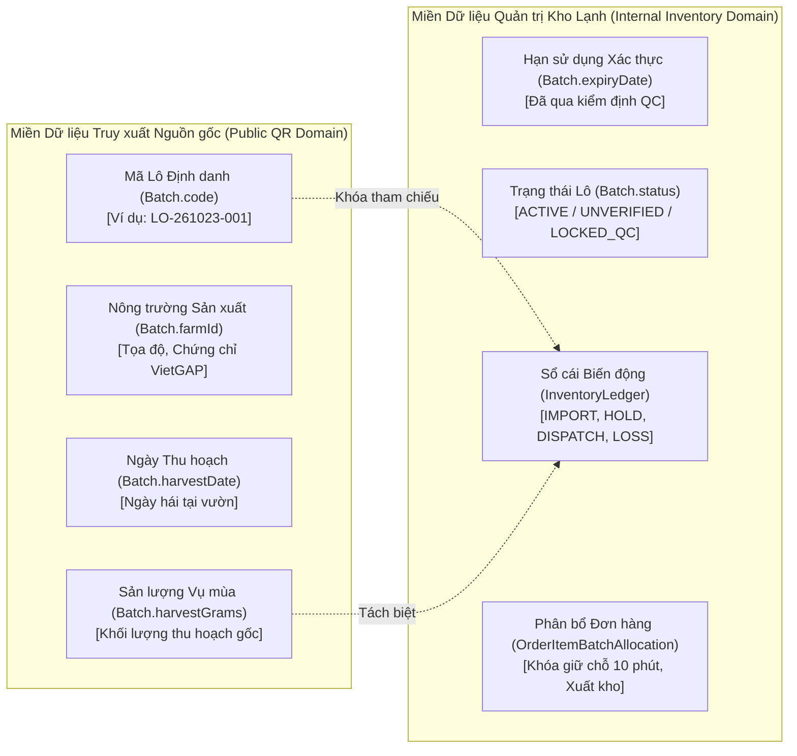
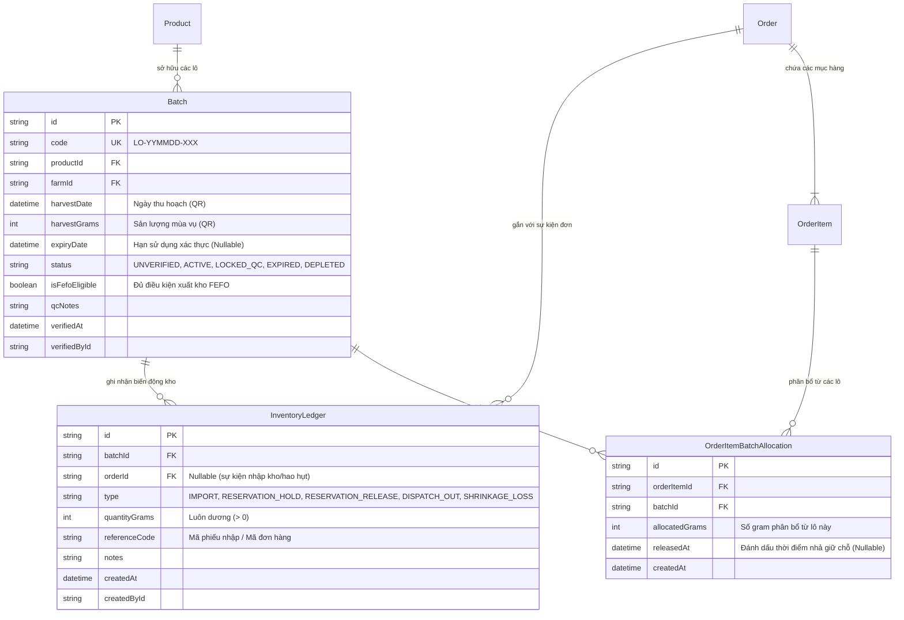

# EV-IMP-01A: HỢP ĐỒNG DỮ LIỆU TỒN KHO & ĐẶC TẢ KIẾN TRÚC FEFO (INVENTORY DOMAIN CONTRACT)

> **Tài liệu:** Hợp đồng Dữ liệu Tồn kho & Đặc tả Kiến trúc FEFO (Inventory Domain Contract & Specification)  
> **Dự án:** E Vibe — Sàn Thương mại Điện tử B2B Phân phối Nông sản & Trái cây  
> **Mã nhiệm vụ:** `EV-IMP-01A`  
> **Phiên bản:** `1.0.0`  
> **Ngày lập:** 23/10/2026  
> **Tác giả:** Senior Backend Engineer & Solution Architect  
> **Trạng thái:** `HOÀN TẤT ĐẶC TẢ — CHUẨN BỊ CHO TRIỂN KHAI PURE DOMAIN ENGINE`  
> **Phạm vi:** `DOCUMENTATION & DOMAIN SPECIFICATION ONLY — NO SCHEMA MIGRATION / NO APPLICATION MUTATION`

---

## 1. Ý NGHĨA HIỆN TẠI CỦA `Batch.quantityGrams` VÀ HIỆN TRẠNG MÃ NGUỒN

### 1.1. Hiện trạng Mã nguồn tại Baseline `a3fc497`
Khảo sát toàn bộ codebase hiện hữu (`prisma/schema.prisma`, `src/server/actions/batch.ts`, `src/app/admin/lo-hang/batch-management.tsx`, `src/actions/order.ts`):

1. **Định nghĩa Schema hiện tại:**
   ```prisma
   model Batch {
     id            String      @id @default(cuid())
     code          String      @unique
     productId     String
     farmId        String
     harvestDate   DateTime    @db.Date
     quantityGrams Int
     note          String?
     product       Product     @relation(fields: [productId], references: [id])
     farm          Farm        @relation(fields: [farmId], references: [id])
     orderItems    OrderItem[]
     createdAt     DateTime    @default(now())
   }
   ```
2. **Bản chất nghiệp vụ thực tế của trường `quantityGrams`:**
   - Trường này được nhập bởi Admin khi bấm "Thêm lô hàng thu hoạch" tại trang `/admin/lo-hang` (`createBatch()`).
   - Dữ liệu nhập vào đại diện cho **Sản lượng thu hoạch tại vườn** (Harvest Output/Yield) của một đợt hái quả (ví dụ: 5.000.000 gram = 5 tấn sầu riêng).
   - Trường này hiển thị công khai trên trang truy xuất nguồn gốc tem QR (`/truy-xuat/[code]`) để đối tác mua hàng B2B tra cứu quy mô mùa vụ của lô hàng.
   - **Thực tế vận hành:** Trường `quantityGrams` hiện nay **hoàn toàn không được khấu trừ** khi có đơn hàng thành công, không có sổ cái đối soát, không có ngày hết hạn (`expiryDate`), và **không đại diện cho tồn kho vật lý đang có trong kho lạnh**.
   - Việc gán `OrderItem.batchId` hiện tại chỉ được thực hiện thủ công bởi Admin ở giai đoạn giao hàng/chốt đơn hoặc để trống, chưa có cơ chế tự động cấp phát hàng theo FEFO.

---

## 2. PHÂN BIỆT DỮ LIỆU TRUY XUẤT QR VÀ DỮ LIỆU QUẢN TRỊ KHO

Để đảm bảo tính toàn vẹn lịch sử và bảo vệ hệ thống QR hiện hữu, hệ sinh thái dữ liệu được phân định thành 2 miền trách nhiệm độc lập:



1. **Dữ liệu Phục vụ QR Truy xuất (Bất biến & Công khai):**
   - Lưu trữ tại thực thể `Batch`: `code`, `farmId`, `productId`, `harvestDate`, `harvestGrams` (chuyển đổi từ `quantityGrams` cũ).
   - Mục đích: Khách quét mã QR trên thùng carton/tem nhãn xem thông tin xuất xứ nguồn gốc nông trường, ngày thu hoạch, chứng chỉ an toàn vệ sinh thực phẩm. Dữ liệu này mang tính lịch sử vĩnh viễn và không bao giờ bị giảm đi khi bán hàng.
2. **Dữ liệu Phục vụ Quản trị Kho & Cấp phát FEFO (Biến động & Nội bộ):**
   - Quản lý qua `InventoryLedger` và các cờ trạng thái kiểm định trên `Batch`: `expiryDate`, `status`, `isFefoEligible`.
   - Mục đích: Đo lường chính xác tồn kho vật lý thực tế trên giá kệ kho lạnh, lượng hàng đang bị phong tỏa giữ chỗ (10 phút), hàng đã xuất kho bàn giao tài xế và lượng hao hụt tự nhiên.

---

## 3. TÁM TRẠNG THÁI & KHÁI NIỆM SỐ LƯỢNG TRONG CHUỖI CUNG ỨNG B2B

Để triệt tiêu hoàn toàn sự nhập nhằng và loại bỏ lỗi tính toán sai lệch, hệ thống định nghĩa 8 chỉ số khối lượng chuẩn mực (đơn vị đo lường cơ sở: **Gram - Số nguyên `Int`**):

1. **Sản lượng Dự kiến (`Forecasted Yield`):**
   - Khối lượng nông sản dự kiến sẽ thu hoạch trong tương lai dựa trên thỏa thuận bao tiêu với nông trường, quản lý qua `ProductCapacity` (Phase 5). Phục vụ cho tính năng Đặt hàng trước (Pre-order) và Đơn định kỳ (Recurring Order). **Không tạo bất kỳ tồn kho thực tế nào trong kho.**
2. **Sản lượng Thu hoạch (`Harvest Yield` - `Batch.harvestGrams`):**
   - Khối lượng cân tại nông trường ngay sau khi hái. Lưu trữ bất biến phục vụ tra cứu QR. **Không được coi là hàng đã có trong kho.**
3. **Số lượng Thực nhập kho (`Warehouse Receipt` - `IMPORT`):**
   - Khối lượng nông sản thực tế được xe tải lạnh chở về kho trung tâm E Vibe, qua kiểm tra cảm quan sơ bộ, cân điện tử tại cửa kho và xếp lên pallet/giá kệ lạnh. Mỗi lần nhập kho sinh một bản ghi `InventoryLedger` loại `IMPORT`.
4. **Tồn kho Vật lý Hiện có (`Physical Stock on Hand`):**
   - Khối lượng hàng thực tế đang nằm trong kho lạnh tại thời điểm truy vấn. Chỉ thay đổi khi hàng được nhập thêm vào, hàng rời khỏi kho theo xe giao vận, hoặc hàng bị tiêu hủy do hao hụt:
     $$\text{PhysicalStock} = \sum \text{IMPORT} - \sum \text{DISPATCH\_OUT} - \sum \text{SHRINKAGE\_LOSS}$$
5. **Số lượng Đang giữ chỗ / Phân bổ (`Reserved Stock`):**
   - Khối lượng hàng đã có người đặt và đang bị khóa giữ chỗ (bao gồm đơn chờ thanh toán tối đa 10 phút và đơn đã thanh toán/đặt cọc đang trong quá trình đóng gói chờ xuất kho):
     $$\text{ReservedStock} = \sum \text{RESERVATION\_HOLD} - \sum \text{RESERVATION\_RELEASE} - \sum \text{DISPATCH\_OUT}$$
6. **Tồn Khả dụng để Bán (`Available for Sale`):**
   - Khối lượng tối đa mà hệ thống cho phép khách hàng mới bỏ vào giỏ và đặt hàng thành công:
     $$\text{AvailableForSale} = \text{PhysicalStock} - \text{ReservedStock}$$
7. **Số lượng Đã xuất kho (`Dispatched Stock` - `DISPATCH_OUT`):**
   - Khối lượng hàng đã hoàn tất đóng gói, dán tem vận chuyển, đưa lên thùng xe của tài xế và lăn bánh rời khỏi cổng kho. Sinh bản ghi `InventoryLedger` loại `DISPATCH_OUT`.
8. **Hao hụt Kho (`Shrinkage Loss` - `SHRINKAGE_LOSS`):**
   - Khối lượng nông sản bị thối hỏng, dập nát, thâm đen hoặc bay hơi nước tự nhiên trong môi trường kho lạnh, được thủ kho lập biên bản loại bỏ. Sinh bản ghi `InventoryLedger` loại `SHRINKAGE_LOSS`.

---

## 4. NGUỒN SỰ THẬT DUY NHẤT & CHỨNG MINH TOÁN HỌC KHÔNG DOUBLE-COUNTING

### 4.1. Nguồn Sự Thật Duy Nhất (Single Source of Truth)
Nguồn sự thật của toàn bộ hệ thống tồn kho là bảng **`InventoryLedger`** (Sổ cái Tồn kho). Mọi số dư tồn kho hiển thị trên giao diện hoặc dùng để kiểm tra logic đều là **kết xuất tổng hợp (Aggregation Projection)** từ sổ cái theo nguyên tắc kế toán kép. Không lưu số dư tức thời đơn lẻ để tránh nguy cơ lệch dữ liệu (Data Drift).

### 4.2. Chứng minh Toán học Triệt tiêu Hoàn toàn Lỗi Double-Counting
Trong báo cáo EV-IMP-00 cũ, thiết kế sai lầm đã vừa trừ `quantityGrams`, vừa cộng vào `dispatchedGrams`, rồi khi tính khả dụng lại lấy `quantityGrams - dispatchedGrams`, dẫn đến việc lượng xuất kho bị trừ hai lần ($2 \times \text{Dispatched}$).

**Chứng minh tính toán chuẩn mực của EV-IMP-01A:**

Thay thế công thức $\text{PhysicalStock}$ và $\text{ReservedStock}$ vào công thức $\text{AvailableForSale}$:

$$\begin{aligned}
\text{AvailableForSale} &= \text{PhysicalStock} - \text{ReservedStock} \\
&= \left( \sum \text{IMPORT} - \sum \text{DISPATCH\_OUT} - \sum \text{SHRINKAGE\_LOSS} \right) \\
&\quad - \left( \sum \text{RESERVATION\_HOLD} - \sum \text{RESERVATION\_RELEASE} - \sum \text{DISPATCH\_OUT} \right) \\
&= \sum \text{IMPORT} - \sum \text{DISPATCH\_OUT} - \sum \text{SHRINKAGE\_LOSS} \\
&\quad - \sum \text{RESERVATION\_HOLD} + \sum \text{RESERVATION\_RELEASE} + \sum \text{DISPATCH\_OUT}
\end{aligned}$$

Rút gọn đại số hai số hạng đối lập $-\sum \text{DISPATCH\_OUT} + \sum \text{DISPATCH\_OUT} = 0$:

$$\mathbf{\text{AvailableForSale} = \left( \sum \text{IMPORT} - \sum \text{SHRINKAGE\_LOSS} \right) - \left( \sum \text{RESERVATION\_HOLD} - \sum \text{RESERVATION\_RELEASE} \right)}$$

**Kết luận Toán học:**
1. Khối lượng xuất kho $\sum \text{DISPATCH\_OUT}$ **triệt tiêu hoàn toàn** trong phép tính tồn khả dụng. Việc xuất kho không làm thay đổi tồn khả dụng (vì hàng trước đó đã được giữ chỗ $\text{RESERVATION\_HOLD}$, khi xuất kho nó chỉ chuyển từ trạng thái "Hàng giữ chỗ" sang "Hàng đã ra khỏi kho").
2. Hoàn toàn không có hiện tượng trừ hai lần lượng đã xuất.
3. Khi hàng đã xuất kho (`DISPATCH_OUT`), nếu đơn hàng bị khiếu nại hoặc hủy, hệ thống **không bao giờ ghi nhận `RESERVATION_RELEASE`** cho lượng hàng đã xuất, do đó tồn kho vật lý không bị tăng ảo.

---

## 5. MÔ HÌNH QUAN HỆ DỮ LIỆU ĐỀ XUẤT (ERD & RELATIONS)

Quan hệ giữa 4 thực thể cốt lõi được phác thảo chặt chẽ nhằm đảm bảo tính truy xuất vết và toàn vẹn tham chiếu:



### Quy tắc Toàn vẹn & Ràng buộc Quan hệ
1. `Batch` $\rightarrow$ `InventoryLedger`: Quan hệ 1-Nhiều (`onDelete: Restrict`). Tuyệt đối không cho phép xóa một lô hàng nếu đã có bất kỳ bản ghi sổ cái nào gắn với nó.
2. `OrderItem` $\rightarrow$ `OrderItemBatchAllocation`: Quan hệ 1-Nhiều (`onDelete: Cascade`). Một dòng đặt hàng có thể được phân bổ từ nhiều lô khác nhau theo thuật toán FEFO. Khóa duy nhất `@@unique([orderItemId, batchId])` ngăn chặn việc phân bổ trùng lặp cùng một lô trên một dòng đơn hàng.
3. `OrderItemBatchAllocation` $\rightarrow$ `Batch`: Quan hệ Nhiều-1 (`onDelete: Restrict`).

---

## 6. QUY TẮC NGHIỆP VỤ & XỬ LÝ CÁC TÌNH HUỐNG ĐẶC THÙ

### 6.1. Xử lý Lô Chưa Có Hạn Sử Dụng (Historical & Unverified Batches)
- Toàn bộ các lô hàng tạo trước Phase 9 hoặc các lô mới nhập chưa qua kiểm định chất lượng sẽ có:
  - `expiryDate = null`
  - `status = UNVERIFIED`
  - `isFefoEligible = false`
- **Hành vi hệ thống:**
  - Trang tra cứu QR `/truy-xuat/[code]` vẫn hoạt động 100% bình thường, phục vụ khách hàng quét mã xem thông tin mùa vụ.
  - Thuật toán FEFO **loại bỏ hoàn toàn** các lô này ra khỏi danh sách ứng viên xuất kho bán lẻ giao ngay (`isEligible = false`, lý do: `BATCH_UNVERIFIED` hoặc `MISSING_EXPIRY_DATE`).
  - Tuyệt đối không tự động nội suy `expiryDate = harvestDate + 14 days`.

### 6.2. Xử lý Giữ Hàng Đã Hết Hạn nhưng Chưa Dọn Dẹp (Effective vs Physical Cleanup)
- Một giữ chỗ (`RESERVATION_HOLD`) gắn với đơn hàng có trạng thái `PENDING_CONFIRMATION` chỉ có giá trị pháp lý khi:
  $$\text{NOW}() \le \text{Order.paymentDueAt}$$
- **Quy tắc Effective Expiration:**
  Khi tính toán tồn khả dụng tại tầng Domain hoặc câu truy vấn SQL:
  - Nếu một đơn hàng đang `PENDING_CONFIRMATION` nhưng máy chủ phát hiện $\text{NOW}() > \text{paymentDueAt}$, giữ chỗ của đơn hàng này được coi là **đã hết hiệu lực logic ngay lập tức**.
  - Lượng hàng này được hoàn trả về tồn khả dụng ngay trong luồng tính toán, không chờ đợi tác vụ dọn dẹp vật lý (`Physical Cleanup`) chạy xong.
  - Ngay khi có bất kỳ Server Action nào chạm vào đơn này, hệ thống sẽ kích hoạt ghi bổ sung dòng `RESERVATION_RELEASE` để đồng bộ sổ cái vật lý.

### 6.3. Xử lý Khôi phục khi Giao dịch Thất bại (Transaction Rollback Guarantees)
- Toàn bộ tiến trình đặt hàng gồm: Kiểm tra tồn kho $\rightarrow$ Khóa dòng bi quan $\rightarrow$ Ghi nhận đơn hàng $\rightarrow$ Phân bổ `OrderItemBatchAllocation` $\rightarrow$ Ghi sổ cái `RESERVATION_HOLD` bắt buộc phải được đóng gói trong một **Database Transaction nguyên tử (ACID)**.
- Nếu xảy ra bất kỳ lỗi nào (ví dụ: thiếu hàng giữa chừng, lỗi mạng Neon, deadlock): Toàn bộ transaction bị `ROLLBACK` 100%. Không có bất kỳ bản ghi giữ chỗ mồ côi (orphan hold) nào tồn tại trong hệ thống.

### 6.4. Các Khóa Duy Nhất & Quy tắc Idempotency Bắt Buộc
1. **Chống Phân bổ Hai lần:** Khóa duy nhất `@@unique([orderItemId, batchId])` tại bảng `OrderItemBatchAllocation`.
2. **Chống Giải phóng Giữ chỗ Trùng lặp (Double-Release Protection):**
   - Bản ghi `OrderItemBatchAllocation` chứa cột `releasedAt DateTime?`.
   - Lệnh giải phóng hàng (do khách hủy hoặc quá 10 phút) chỉ thực thi câu lệnh cập nhật có điều kiện:
     ```sql
     UPDATE "OrderItemBatchAllocation"
     SET "releasedAt" = NOW()
     WHERE "id" = $allocationId AND "releasedAt" IS NULL;
     ```
   - Nếu câu lệnh cập nhật trả về 0 dòng (nghĩa là đã được giải phóng trước đó bởi luồng khác), hệ thống bỏ qua và không ghi thêm bản ghi `RESERVATION_RELEASE` vào sổ cái.

### 6.5. Phương án Khởi tạo Tồn Ban Đầu Không Sinh Dữ Liệu Thu Hoạch Giả
- **Không tự động chuyển đổi:** Tuyệt đối không chạy lệnh `INSERT INTO "InventoryLedger" SELECT ... FROM "Batch"` lấy số `quantityGrams` cũ làm tồn kho ban đầu, vì số đó là sản lượng vườn, phần lớn đã được bán hoặc tiêu thụ từ các tháng trước.
- **Quy trình Khởi tạo Thực tế:**
  1. Thủ kho/Quản lý tiến hành kiểm kê thực tế tại kho lạnh.
  2. Tạo phiếu nhập kho ban đầu (Initial Warehouse Inbound Receipt) qua giao diện Admin mới hoặc script nhập liệu có chữ ký xác nhận của thủ kho.
  3. Lô hàng được kiểm tra độ tươi, dư lượng BVTV $\rightarrow$ nhập `expiryDate` chuẩn $\rightarrow$ chuyển trạng thái sang `ACTIVE` $\rightarrow$ ghi bản ghi `IMPORT` đúng với số cân thực tế trên pallet.

### 6.6. Phương án Kích hoạt Từng Phần (Hybrid Rollout / Feature Flags)
Để ngăn chặn tình trạng toàn bộ Storefront báo "Hết hàng" đột ngột sau khi cập nhật hệ thống (do các sản phẩm cũ chưa có lô `ACTIVE` nhập kho):
1. Thêm cờ quản lý tại mức Sản phẩm: `Product.inventoryTrackingEnabled Boolean @default(false)`.
2. **Cơ chế Lai (Hybrid Availability Mode):**
   - **Khi `inventoryTrackingEnabled == false` (Sản phẩm cũ chưa kiểm kê kho):**
     Hệ thống tiếp tục sử dụng cơ chế kiểm tra năng lực tuần `WeeklyCapacity` (Phase 5 hiện có) để xác định tình trạng còn hàng hay hết hàng. Khách hàng B2B vẫn đặt hàng bình thường.
   - **Khi `inventoryTrackingEnabled == true` (Sản phẩm đã áp dụng FEFO):**
     Hệ thống chuyển sang kiểm soát 100% bằng tồn khả dụng thực tế của các lô `ACTIVE` theo thuật toán FEFO. Nếu tồn khả dụng $\le 0$, storefront hiển thị nhãn "Tạm hết hàng trong kho".
3. Cơ chế này cho phép đội ngũ vận hành chuyển đổi từng loại nông sản sang quy trình FEFO một cách êm thuận, an toàn và không gây gián đoạn kinh doanh.

---

## 7. PHÁC THẢO PRISMA SCHEMA ĐỀ XUẤT CHO CÁC PHASE SAU

> [!IMPORTANT]
> **ĐÂY CHỈ LÀ PHÁC THẢO THIẾT KẾ CHO EV-IMP-01B / EV-IMP-01C.**  
> **TUYỆT ĐỐI KHÔNG CHỈNH SỬA TỆP `prisma/schema.prisma` HOẶC CHẠY MIGRATION TRONG NHIỆM VỤ EV-IMP-01A NÀY.**

```prisma
// ============================================================================
// DỰ THẢO SCHEMA CHO EV-IMP-01B (CHỈ THAM KHẢO - CHƯA ÁP DỤNG)
// ============================================================================

enum BatchStatus {
  UNVERIFIED  // Lô lịch sử hoặc chưa qua kiểm định QC (giữ nguyên QR, cấm FEFO)
  ACTIVE      // Đã kiểm định chất lượng, có hạn dùng xác thực (tham gia FEFO)
  LOCKED_QC   // Phong tỏa kiểm tra chất lượng (loại khỏi bán lẻ)
  EXPIRED     // Hết hạn sử dụng (chờ xuất hủy hoặc chế biến)
  DEPLETED    // Đã xuất hết tồn kho vật lý (lưu trữ kiểm toán)
}

enum InventoryLedgerType {
  IMPORT              // Thực nhập kho từ nông trường
  RESERVATION_HOLD    // Khóa giữ chỗ khi khách đặt hàng (tối đa 10 phút)
  RESERVATION_RELEASE // Giải phóng giữ chỗ do hủy đơn hoặc quá hạn
  DISPATCH_OUT        // Thực xuất kho bàn giao tài xế giao hàng
  SHRINKAGE_LOSS      // Hao hụt, hư hỏng tự nhiên trong kho
  QC_ADJUSTMENT       // Cân đối điều chỉnh sau kiểm kê kho định kỳ
}

// Mở rộng model Batch hiện có (Additive-only)
// model Batch {
//   id               String                     @id @default(cuid())
//   code             String                     @unique
//   productId        String
//   farmId           String
//   harvestDate      DateTime                   @db.Date
//   quantityGrams    Int                        // Giữ nguyên để tương thích ngược code cũ
//   harvestGrams     Int?                       // Khối lượng thu hoạch chuẩn (phục vụ QR)
//   expiryDate       DateTime?                  @db.Date // Hạn sử dụng xác thực
//   status           BatchStatus                @default(UNVERIFIED)
//   isFefoEligible   Boolean                    @default(false)
//   qcNotes          String?                    @db.Text
//   verifiedAt       DateTime?
//   verifiedById     String?
//   note             String?
//   createdAt        DateTime                   @default(now())
//   ledgerEntries    InventoryLedger[]
//   allocations      OrderItemBatchAllocation[]
// }

// Bổ sung bảng Sổ cái Tồn kho
// model InventoryLedger {
//   id              String               @id @default(cuid())
//   batchId         String
//   batch           Batch                @relation(fields: [batchId], references: [id], onDelete: Restrict)
//   orderId         String?
//   order           Order?               @relation(fields: [orderId], references: [id], onDelete: SetNull)
//   type            InventoryLedgerType
//   quantityGrams   Int                  // Luôn lưu số nguyên dương (> 0)
//   referenceCode   String?              // Mã phiếu nhập / Mã đơn hàng
//   notes           String?              @db.Text
//   createdAt       DateTime             @default(now())
//   createdById     String?
//
//   @@index([batchId, type])
//   @@index([orderId])
//   @@index([createdAt])
// }

// Bổ sung bảng Phân bổ Đơn hàng - Lô hàng
// model OrderItemBatchAllocation {
//   id              String    @id @default(cuid())
//   orderItemId     String
//   orderItem       OrderItem @relation(fields: [orderItemId], references: [id], onDelete: Cascade)
//   batchId         String
//   batch           Batch     @relation(fields: [batchId], references: [id], onDelete: Restrict)
//   allocatedGrams  Int       // Số gram phân bổ từ lô này
//   releasedAt      DateTime? // Đánh dấu thời điểm giải phóng (ngăn double-release)
//   createdAt       DateTime  @default(now())
//
//   @@unique([orderItemId, batchId])
//   @@index([orderItemId])
//   @@index([batchId])
// }
```

---
*Tài liệu này là hợp đồng dữ liệu chuẩn mực, làm kim chỉ nam để hiện thực hóa Pure Domain Engine trong `src/lib/domain/inventory.ts` tại Phần B.*