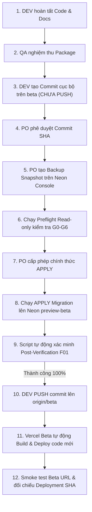

# EV-IMP-01B-SAFETY-FIX: BÁO CÁO HIỆU CHỈNH KỊCH BẢN AN TOÀN, RUNBOOK PHỤC HỒI & THỨ TỰ DEPLOYMENT

> **Tài liệu:** Báo cáo Khắc phục Rủi ro An toàn Migration F01 (Migration Script, Rollback & Deployment Safety Fix)  
> **Dự án:** E Vibe — Sàn Thương mại Điện tử B2B Phân phối Nông sản & Trái cây  
> **Mã nhiệm vụ:** `EV-IMP-01B-SAFETY-FIX`  
> **Phiên bản:** `1.0.0`  
> **Ngày lập:** 24/10/2026  
> **Tác giả:** Senior DevOps Engineer, PostgreSQL Reliability Engineer & Prisma Migration Specialist  
> **Trạng thái:** `COMPLETED — 100% OFFLINE QUALITY GATES & 32/32 SCRIPT TESTS PASS — ZERO DB MUTATION — AWAITING PO & QA REVIEW`  
> **Chế độ thực thi:** `TOOLING & DOCUMENTATION CORRECTION ONLY — ZERO NEON WRITES — ZERO COMMIT — ZERO PUSH`

---

## 1. THÔNG TIN GIT HEAD VÀ HIỆN TRẠNG WORKING TREE

- **Nhánh Git:** `beta`
- **Git HEAD Baseline:** `f50e3481f380a662cf121df1e9a6d9ef452c67dc` (`f50e348`)
- **Trạng thái Working Tree:**
  - `modified: nong-san-b2b/prisma/schema.prisma` (Cập nhật schema hoàn chỉnh cho F01).
  - `modified: nong-san-b2b/src/lib/domain/inventory.ts` (Pure domain FEFO engine, Invariants, Allocation math).
  - `modified: nong-san-b2b/tests/unit/inventory.test.ts` (43 unit tests domain inventory).
  - `modified: nong-san-b2b/tests/unit/packaging-integrity.test.ts` (Bổ sung mock `inventoryTrackingEnabled: false`).
  - `modified: docs/EV_IMP_01B_APPLY_PREPARATION_REPORT.md` (Cập nhật runbook rollback không phá hủy, quy trình deployment, loại bỏ hoàn toàn `DROP TABLE ... CASCADE`).
  - `untracked: nong-san-b2b/scripts/safe-preview-migrate.ps1` (Kịch bản migration an toàn cập nhật cho F01 với Hard Gates G0–G6).
  - `untracked: nong-san-b2b/tests/unit/safe-preview-migrate.test.ps1` (Bộ 32 test cases offline cho script).
  - `untracked: nong-san-b2b/prisma/migrations/20261023235900_add_f01_inventory_ledger/` (Gói migration DDL F01).
  - `untracked: docs/EV_IMP_01B_SAFETY_FIX_REPORT.md` (Báo cáo này).
- **Cam kết an toàn nghiêm ngặt:**
  - **KHÔNG GHI VÀO NEON DATABASE**: Tuyệt đối không chạy lệnh `prisma migrate deploy` hay câu lệnh SQL nào trên Neon Preview (`preview-beta`) hoặc Production.
  - **KHÔNG COMMIT, KHÔNG PUSH**: Toàn bộ các tệp tin được giữ nguyên vẹn trong working tree để Product Owner và QA kiểm định.

---

## 2. TỔNG HỢP CÁC VẤN ĐỀ QA & PRODUCT OWNER PHÁT HIỆN

| Mã vấn đề | Phân loại | Chi tiết phát hiện | Hậu quả tiềm tàng nếu không xử lý |
|:---:|:---:|:---|:---|
| **ISSUE-01** | Rollback Phá hủy | Kịch bản rollback cũ hướng dẫn `DROP TABLE ... CASCADE`, `DROP COLUMN` không kiểm soát và `DELETE FROM "_prisma_migrations"`. | Mất trắng dữ liệu bảng liên quan, làm đứt gãy tính toàn vẹn khóa ngoại và lịch sử kiểm toán biosecurity. |
| **ISSUE-02** | Script Lỗi thời | Kịch bản `safe-preview-migrate.ps1` còn hardcode Git HEAD của Phase 8 (`e414db2...`), kiểm tra sai checksum migration và chỉ nhận diện migration Phase 8. | Script bị dừng ngay tại Gate G0 hoặc G3, không thể chạy được cho F01. |
| **ISSUE-03** | Thiếu Backup Snapshot | Chưa có quy trình xác minh snapshot/backup độc lập trên Neon Preview trước khi tiến hành APPLY. | Nguy cơ không thể phục hồi dữ liệu nếu có sự cố mạng hoặc gián đoạn giữa chừng. |
| **PO REQ** | Deployment Ordering | Nguy cơ việc push code lên nhánh `beta` sẽ kích hoạt Vercel Preview deploy code mới với Prisma Client mới trước khi database có schema F01. | Lỗi runtime trên Vercel Beta Preview do truy vấn cột hoặc bảng chưa tồn tại trong Neon CSDL. |

---

## 3. NHỮNG SỬA ĐỔI TRONG SAFETY SCRIPT (`safe-preview-migrate.ps1`)

Kịch bản [`nong-san-b2b/scripts/safe-preview-migrate.ps1`](file:///d:/TMĐT%20Website/nong-san-b2b/scripts/safe-preview-migrate.ps1) đã được tái cấu trúc toàn diện nhằm phục vụ an toàn cho F01:

1. **Khắc phục Gate G0 (Git & Approved Commit SHA):**
   - Loại bỏ hoàn toàn giá trị hardcode HEAD.
   - Nhận diện tham số bắt buộc `-ApprovedCommitSha` (alias `-ExpectedHead`) được PO/QA cấp riêng.
   - Hỗ trợ đọc từ artifact phê duyệt độc lập `docs/EV_IMP_01B_APPROVAL.json`.
   - Kiểm tra nhánh bắt buộc là `beta`.
   - Kiểm tra quan hệ với `origin/beta` (phát hiện và chặn đứng branch bị `diverged`).
   - Kiểm tra working tree sạch (loại trừ các file tracked bị sửa đổi).
2. **Khắc phục Gate G4 (Migration SQL Integrity & Additive-Only):**
   - Kiểm tra SHA256 chính xác của file `prisma/migrations/20261023235900_add_f01_inventory_ledger/migration.sql`.
   - Quét nội dung SQL phát hiện và chặn đứng các câu lệnh DDL phá hủy (`DROP TABLE`, `DROP COLUMN`, `TRUNCATE`, `DROP SCHEMA`, `DROP DATABASE`, `CASCADE`).
3. **Khắc phục Gate G5 (Neon Backup & Recovery Readiness):**
   - Bổ sung tham số `-BackupSnapshotId` để ghi nhận định danh branch backup/restore point.
   - Hiển thị checklist 5 bước hướng dẫn PO tạo backup trên Neon Console.
   - Ở chế độ `Apply`, chặn thực thi (fail-closed) nếu chạy non-interactive mà không có backup snapshot ID hoặc cờ miễn trừ.
4. **Khắc phục Gate G3 (Migration History & Dual-Proof):**
   - Nhận diện 2 migrations baseline đã hoàn tất: `20261013094130_init` và `20261019193200_phase8_shipping_engine`.
   - Nhận diện chính xác 1 pending migration duy nhất: `20261023235900_add_f01_inventory_ledger`.
   - Chặn đứng nếu có nhiều hơn 1 pending migration hoặc thiếu baseline.
   - Đối chiếu kép (Dual-Proof) với bảng `_prisma_migrations` trong cơ sở dữ liệu.
5. **Bổ sung Post-Verification F01 chuyên biệt (Bước 6):**
   - Sau khi deploy thành công, script tự động chạy Node.js script xác minh:
     - Bảng `InventoryLedger` và `OrderItemBatchAllocation` tồn tại và truy vấn được.
     - Các cột mới trên `Batch` (`status`, `isFefoEligible`, `expiryDate`, `harvestGrams`, `qcNotes`, `verifiedAt`, `verifiedById`) và `Product` (`inventoryTrackingEnabled`) tồn tại.
     - Partial Unique Index `OrderItemBatchAllocation_active_unique_idx` tồn tại trong `pg_indexes`.
     - Đủ 5 Database CHECK constraints tồn tại trong `pg_constraint`.

---

## 4. BẢNG ĐỐI CHIẾU CÁC HARD GATES G0–G6 (TRƯỚC VS SAU)

| Hard Gate | Tiêu chuẩn Trước (Phase 8) | Tiêu chuẩn Sau Hiệu chỉnh (EV-IMP-01B-SAFETY-FIX) | Đánh giá An toàn |
|:---|:---|:---|:---:|
| **G0 (Git)** | Hardcode `ExpectedHead = 'e414db2...'`, chỉ kiểm tra Phase 8 và Init migration hash. | Nhận `-ApprovedCommitSha` từ PO/QA, kiểm tra quan hệ `origin/beta`, kiểm tra SHA256 cả 3 migrations (Init, Phase 8, F01). | **Tăng cường 100%**<br>Không tự tham chiếu |
| **G1 (Target)** | Kiểm tra Neon Hostname khớp `ExpectedHost`, chặn `neondb` sai. | Giữ nguyên positive match 100%, bổ sung cảnh báo định danh branch. | **Bảo toàn** |
| **G2 (Direct)** | Chặn `-pooler`, bắt buộc dùng direct connection. | Giữ nguyên quy định direct connection port 5432. | **Bảo toàn** |
| **G3 (History)** | Chỉ mong đợi Phase 8 pending, baselines chỉ gồm Init. | Mong đợi 2 Baselines (Init + Phase 8) và duy nhất F01 pending. Chặn multi-pending. | **Cập nhật chuẩn F01** |
| **G4 (DDL Safety)** | Chỉ kiểm tra SHA256 file Phase 8. | Kiểm tra SHA256 F01 + Quét regex chặn toàn bộ DDL phá hủy (`DROP`, `TRUNCATE`, `CASCADE`). | **Tăng cường 100%** |
| **G5 (Recovery)** | Mặc định `WAIVED_BY_PO_DEMO` không yêu cầu backup. | Yêu cầu xác minh Backup Snapshot ID từ Neon Console, có checklist chi tiết cho PO. | **Tăng cường 100%**<br>Có backup thực tế |
| **G6 (Prod Block)**| Chặn endpoint Production `ep-square-scene-b5ddgxil`. | Giữ nguyên chặn Production tuyệt đối (Negative defense-in-depth). | **Bảo toàn** |

---

## 5. CƠ CHẾ APPROVED COMMIT SHA KHÔNG TỰ THAM CHIẾU

### 5.1. Vấn đề tự tham chiếu là gì?
Nếu script tự chạy `git rev-parse HEAD` rồi tự gán kết quả đó làm `ExpectedHead`, hoặc hardcode một commit SHA nằm trong chính commit đó (nghịch lý gà - quả trứng), cơ chế kiểm tra tính toàn vẹn Git trở nên vô hiệu.

### 5.2. Giải pháp độc lập, không tự tham chiếu:
1. **Truyền từ bên ngoài (External Parameter):** Script định nghĩa tham số `[string]$ApprovedCommitSha = ''`. Kỹ sư bắt buộc phải truyền SHA này vào dòng lệnh khi chạy (ví dụ: lấy từ kết quả phê duyệt của QA).
2. **Approval Artifact:** Nếu tham số dòng lệnh rỗng, script hỗ trợ đọc từ file artifact kiểm soát độc lập `docs/EV_IMP_01B_APPROVAL.json` do PO ký duyệt:
   ```json
   {
     "approvedCommitSha": "f50e3481f380a662cf121df1e9a6d9ef452c67dc",
     "approvedBy": "Product Owner",
     "approvedAt": "2026-10-24T00:30:00Z"
   }
   ```
3. **Fail-Closed khi thiếu:** Nếu cả hai nguồn đều không có, script ném lỗi dừng ngay lập tức:
   `HARD GATE G0 FAILED: Thieu tham so bat buoc '-ApprovedCommitSha' (hoac '-ExpectedHead')!`
4. **Đối chiếu tiền tố và toàn phần:** Cho phép truyền SHA 40 ký tự hoặc 7 ký tự prefix tiêu chuẩn của Git.

---

## 6. SHA256 CỦA GÓI MIGRATION F01 VÀ CÁC BASELINE MIGRATIONS

Các giá trị băm cryptographic SHA256 đã được tính toán độc lập từ tệp tin thực tế và đưa vào bộ kiểm tra Gate G0 & G4:

```text
1. Migration F01 (Tạo mới):
   prisma/migrations/20261023235900_add_f01_inventory_ledger/migration.sql
   SHA256: 14A35A7CAB52CAE9BCB3D6651520F00C2796A4C590C069A43863EAE6FE93F0E5

2. Migration Phase 8 (Baseline 2):
   prisma/migrations/20261019193200_phase8_shipping_engine/migration.sql
   SHA256: 9F5ADE072D6B231FAC4B5E4DDCA20780A7DEC9719B8A4217257CD2BF708F2ECC

3. Migration Init (Baseline 1):
   prisma/migrations/20261013094130_init/migration.sql
   SHA256: 59C7B1B9D7FEB39421079B3A791D685E5887D8BAD1D5D644983A2C47A9E48B6D
```

---

## 7. QUY TRÌNH ROLLBACK / RECOVERY KHÔNG PHÁ HỦY DỮ LIỆU

> [!IMPORTANT]
> **NGUYÊN TẮC: ROLLBACK ỨNG DỤNG KHÔNG ĐỒNG NGHĨA VỚI ROLLBACK CƠ SỞ DỮ LIỆU.**

Tài liệu đã loại bỏ hoàn toàn các câu lệnh nguy hiểm `DROP TABLE ... CASCADE` và thay bằng Runbook 3 kịch bản:

### Kịch bản A: Migration CSDL thành công nhưng Ứng dụng mới gặp sự cố
- **Hành động:** Giữ nguyên 100% CSDL Neon đã migrate. Chỉ rollback bản build ứng dụng trên Vercel về commit ổn định trước đó.
- **Cơ sở kỹ thuật:** Toàn bộ thay đổi F01 là additive-only (cột mới nullable hoặc có default, bảng mới chưa có liên kết chặn). Ứng dụng cũ hoạt động 100% bình thường trên CSDL đã mở rộng mà không phát sinh bất kỳ lỗi nào.

### Kịch bản B: Quá trình Migration CSDL bị đứt gãy giữa chừng
- **Hành động:** Dừng ngay mọi lệnh tự động retry.
- **Kiểm tra trạng thái:** Đọc `_prisma_migrations` và các đối tượng bảng đã tạo trong Neon.
- **Xử lý:** Chỉ sử dụng `prisma migrate resolve` khi và chỉ khi kỹ sư DB đã xác minh chính xác trạng thái từng lệnh DDL trong `migration.sql` và được PO phê duyệt.

### Kịch bản C: Bắt buộc khôi phục dữ liệu
- **Hành động:** Sử dụng Neon Branch Backup snapshot đã tạo trước khi APPLY.
- **Đánh giá:** Tính toán các giao dịch/đơn hàng mới phát sinh (nếu có).
- **Lưu ý chuỗi kết nối:** Khi chuyển sang branch backup trên Neon, Hostname connection string thay đổi. Bắt buộc cập nhật biến môi trường `DATABASE_URL` trên Vercel và redeploy.

---

## 8. CHECKLIST SAO LƯU NEON PREVIEW (DÀNH CHO PRODUCT OWNER)

Trước khi thực thi lệnh APPLY, Product Owner thực hiện theo checklist 5 bước trên Neon Console:

1. [ ] **Đăng nhập Neon Console:** Truy cập `https://console.neon.tech` $\rightarrow$ Chọn Project **E Vibe**.
2. [ ] **Điều hướng Branch:** Vào mục **Branches** $\rightarrow$ Chọn nhánh **`preview-beta`**.
3. [ ] **Tạo Branch Sao lưu:**
   - Nhấn **Create Branch**.
   - Đặt tên branch: `backup-pre-f01-inventory-[YYYYMMDD-HHmm]`.
   - Chọn Parent Branch: `preview-beta`.
4. [ ] **Kiểm tra Truy cập:**
   - Xác nhận branch mới đã ở trạng thái **Ready**.
   - Lưu lại Hostname Direct Connection của branch backup (để dự phòng).
5. [ ] **Ghi nhận Snapshot ID:**
   - Cung cấp tên branch hoặc ID snapshot (ví dụ: `backup-pre-f01-inventory-20261024`) cho kỹ sư để truyền vào tham số `-BackupSnapshotId` khi chạy script.

---

## 9. TRÌNH TỰ MIGRATION VÀ DEPLOYMENT AN TOÀN TUYỆT ĐỐI (12 BƯỚC)

Để bảo đảm Vercel Beta Preview không bao giờ bị sập do chạy Prisma Client mới trên CSDL cũ:



---

## 10. KẾT QUẢ TESTS VÀ BẰNG CHỨNG KIỂM TRA

### 10.1. Bộ Kiểm thử Script PowerShell (`tests/unit/safe-preview-migrate.test.ps1`)
Chạy hoàn toàn offline, bao phủ 32 trường hợp fail-closed:

```text
=================================================================
   TONG KET BANG KET QUA KIEM THU OFFLINE (S1 - S32)             
=================================================================
TONG SO TEST: 32 | PASS: 32 | FAIL: 0
```

- **S1:** Sai Git branch $\rightarrow$ **STOP (PASS)**
- **S2:** Sai ApprovedCommitSha $\rightarrow$ **STOP (PASS)**
- **S3:** Host Production đã biết $\rightarrow$ **STOP (PASS)**
- **S4:** Host không thuộc allowlist $\rightarrow$ **STOP (PASS)**
- **S5:** Host có đuôi `-pooler` $\rightarrow$ **STOP (PASS)**
- **S6:** Connection string sai định dạng $\rightarrow$ **STOP (PASS)**
- **S7:** Prisma status lỗi kết nối P1001 $\rightarrow$ **STOP (PASS)**
- **S8:** Prisma status có F01 pending hợp lệ $\rightarrow$ **EXPECTED_PENDING (PASS)**
- **S9:** Có $\ge 2$ migrations pending $\rightarrow$ **STOP (PASS)**
- **S10:** Thiếu baseline Phase 8 $\rightarrow$ **STOP (PASS)**
- **S11:** Migration F01 đã apply $\rightarrow$ **ALREADY_APPLIED / NO-OP (PASS)**
- **S12:** G5 ghi nhận Backup Snapshot hợp lệ $\rightarrow$ **VERIFIED_BACKUP (PASS)**
- **S13:** Người dùng từ chối xác nhận deploy $\rightarrow$ **STOP an toàn (PASS)**
- **S14:** Deploy exit code khác 0 $\rightarrow$ **STOP (PASS)**
- **S15:** Post-check exit code khác 0 $\rightarrow$ **STOP (PASS)**
- **S16:** Chế độ Preflight không gọi deploy $\rightarrow$ **PASS**
- **S17:** Dọn dẹp an toàn biến môi trường `DATABASE_URL` $\rightarrow$ **PASS**
- **S18:** Expected host rỗng $\rightarrow$ **STOP (PASS)**
- **S19:** Tương thích ngược dạng `migration(s)` $\rightarrow$ **PASS**
- **S20:** Authentication failed P1000 $\rightarrow$ **STOP (PASS)**
- **S21:** Failed migration trong lịch sử CSDL $\rightarrow$ **STOP (PASS)**
- **S22:** Divergent migration history $\rightarrow$ **STOP (PASS)**
- **S23:** Database chưa quản lý bởi Prisma Migrate $\rightarrow$ **STOP (PASS)**
- **S24:** Status output không nhận diện được $\rightarrow$ **STOP (PASS)**
- **S25:** Redaction Engine che giấu 100% password, token, user Windows $\rightarrow$ **PASS**
- **S26:** DB check hợp lệ (Baselines đã apply, F01 chưa apply) $\rightarrow$ **PASS**
- **S27:** DB check phát hiện failed migration trong CSDL $\rightarrow$ **STOP (PASS)**
- **S28:** Dual-Proof lệch giữa Prisma CLI và CSDL $\rightarrow$ **STOP (PASS)**
- **S29:** SHA256 file migration F01 sai lệch $\rightarrow$ **STOP (PASS)**
- **S30:** File migration chứa DDL phá hủy (`DROP TABLE ... CASCADE`) $\rightarrow$ **STOP (PASS)**
- **S31:** Thiếu tham số `ApprovedCommitSha` $\rightarrow$ **STOP (PASS)**
- **S32:** Chế độ NonInteractive thiếu backup ID $\rightarrow$ **STOP (PASS)**

### 10.2. Toàn bộ Quality Gates Mã nguồn Ứng dụng
- `npx prisma validate`: **PASS 100%**
- `npx prisma generate`: **PASS 100%**
- `npm test`: **PASS (546/546 tests, 36 test suites)**
- `npm run lint`: **PASS (0 errors)**
- `npm run typecheck`: **PASS (0 errors)**
- `npm run build`: **PASS (Turbopack, production build thành công)**

---

## 11. NHỮNG ĐIỂM CÒN CẦN QA XÁC MINH (QA RE-TEST SCOPE)

1. Kiểm tra lại kịch bản `safe-preview-migrate.ps1` và xác nhận 32 unit tests đạt tiêu chuẩn độc lập.
2. Kiểm tra tài liệu Runbook 3 kịch bản rollback trong `docs/EV_IMP_01B_APPLY_PREPARATION_REPORT.md`, xác nhận không còn tồn tại hướng dẫn `DROP TABLE ... CASCADE`.
3. Kiểm tra tính chặt chẽ của cơ chế nhận Approved Commit SHA.
4. Xác nhận sự đầy đủ của checklist sao lưu Neon dành cho Product Owner.

---

## 12. NHỮNG ĐIỀU KIỆN YÊU CẦU PRODUCT OWNER PHÊ DUYỆT RIÊNG

Trước khi kỹ sư được phép thực thi lệnh APPLY:
1. **Phê duyệt Bản sửa đổi An toàn:** PO chấp thuận các giải pháp kỹ thuật trong báo cáo này.
2. **Tạo Backup Snapshot:** PO thực hiện tạo branch backup trên Neon Console theo checklist mục 8.
3. **Phê duyệt Commit SHA & Cấp phép APPLY:** PO ký duyệt Commit SHA và ra lệnh thực thi APPLY trong một nhiệm vụ riêng biệt.

---
*Báo cáo được lập và lưu trữ tại `docs/EV_IMP_01B_SAFETY_FIX_REPORT.md`.*
