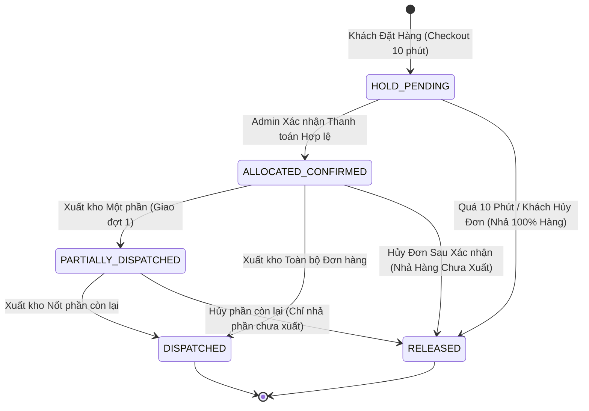
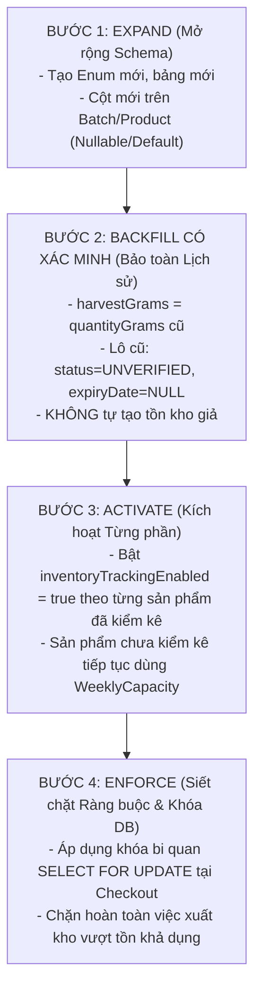

# EV-IMP-01B: BÁO CÁO THIẾT KẾ SCHEMA, MÔ HÌNH RESERVATION & TIỀN KIỂM MIGRATION AN TOÀN (SAFE MIGRATION PREFLIGHT)

> **Tài liệu:** Báo cáo Tiền kiểm Schema, Mô hình Giữ hàng & Kế hoạch Migration (Schema & Safe Migration Preflight)  
> **Dự án:** E Vibe — Sàn Thương mại Điện tử B2B Phân phối Nông sản & Trái cây  
> **Mã nhiệm vụ:** `EV-IMP-01B`  
> **Phiên bản:** `1.0.0`  
> **Ngày lập:** 23/10/2026  
> **Tác giả:** Senior Backend Engineer, Database Architect & Prisma Specialist  
> **Trạng thái:** `HOÀN TẤT THIẾT KẾ & TIỀN KIỂM OFFLINE — CHỜ PRODUCT OWNER (PO) DUYỆT TRƯỚC KHI APPLY`  
> **Chế độ thực thi:** `SPECIFICATION & OFFLINE PREFLIGHT ONLY — ZERO DATABASE MIGRATION / ZERO NEON WRITES / ZERO COMMIT / ZERO PUSH`

---

## 1. THÔNG TIN GIT BASELINE & HIỆN TRẠNG WORKING TREE

### 1.1. Định danh Kỹ thuật Baseline
- **Nhánh Git:** `beta`
- **Git HEAD hiện tại:** `f50e348` (*feat(inventory): implement pure domain FEFO engine and inventory contract (EV-IMP-01A)*)
- **Vercel Beta Preview:** `https://nong-san-b2b-git-beta-baopk.vercel.app`
- **Cơ sở dữ liệu:** Neon PostgreSQL (Branch: `preview-beta`, Pooling Mode: Transaction-safe PgBouncer).
- **Cam kết an toàn:** Hoàn toàn **chưa có bất kỳ lệnh migration nào được chạy**, không có bất kỳ dòng dữ liệu nào được ghi vào Neon DB.

### 1.2. Hiện trạng Working Tree (Chưa Commit Theo Đúng Quy Chế)
Toàn bộ các tệp thay đổi trong nhiệm vụ `EV-IMP-01B` được lưu giữ trong working tree để Product Owner review:
- `modified: nong-san-b2b/src/lib/domain/inventory.ts`: Bổ sung cơ chế phát hiện thiếu hụt không che giấu (`hasDeficit`, `rawPhysicalStockGrams`, `rawReservedGrams`, `rawAvailableGrams`), hàm kiểm định invariant `verifyInventoryInvariants()`, và các hàm thuần quản lý vòng đời phân bổ `calculateUnreleasedAllocationGrams()`, `calculatePartialDispatchAllocation()`, `calculateReleaseAllocation()`.
- `modified: nong-san-b2b/tests/unit/inventory.test.ts`: Bổ sung 9 unit tests mới cho Invariant verification và Allocation lifecycle (Tổng số test tăng từ 535 lên 544 tests, 100% PASS).
- `untracked: docs/EV_IMP_01B_SCHEMA_PREFLIGHT.md`: Tài liệu báo cáo chi tiết này.
- **Tệp `prisma/schema.prisma`:** Vẫn giữ nguyên trạng bản gốc để bảo đảm không gây tác động lên hệ thống đang chạy. Bản thiết kế schema mở rộng được thẩm định qua bản dự thảo `schema.draft.prisma` và kiểm tra offline hoàn tất.

---

## 2. KIỂM TRA ĐỘC LẬP HỢP ĐỒNG DỮ LIỆU F01A & HIỆN TRẠNG CODEBASE

Qua quá trình rà soát độc lập và đối chiếu giữa `docs/EV_IMP_01A_INVENTORY_CONTRACT.md`, `src/lib/domain/inventory.ts`, `prisma/schema.prisma` và các server actions hiện hành, kết quả xác minh như sau:

1. **Ý nghĩa Thực tế của `Batch.quantityGrams`:**
   - Trường này được nhập khi tạo lô tại `src/server/actions/batch.ts` (`createBatch()`).
   - Bản chất: Đây là **Sản lượng thu hoạch tại nông trường** (Harvest Yield) được ghi nhận để phục vụ trang tra cứu tem QR công khai (`/truy-xuat/[code]`).
   - Khẳng định: Trường này **không phải là tồn kho vật lý có thể kiểm kê trong kho lạnh**, không hề bị trừ đi khi có đơn hàng, và không có sổ cái đối soát.
2. **Dữ liệu Phục vụ QR vs Dữ liệu Phục vụ Kho:**
   - *Phục vụ QR:* `Batch.code`, `Batch.harvestDate`, `Batch.quantityGrams` (sau này ánh xạ sang `harvestGrams`), `Batch.farmId`, `Batch.productId`, chứng chỉ VietGAP của nhà vườn. Dữ liệu này mang tính lịch sử, bất biến và công khai.
   - *Phục vụ Kho:* Bảng `InventoryLedger` (ghi nhận `IMPORT`, `RESERVATION_HOLD`, `RESERVATION_RELEASE`, `DISPATCH_OUT`, `SHRINKAGE_LOSS`, `QC_ADJUSTMENT`) cùng các cờ kiểm định trên `Batch`: `expiryDate`, `status`, `isFefoEligible`.
3. **Độ tương thích giữa FEFO Engine và Schema mới:**
   - Kiểu `BatchCandidate` trong `src/lib/domain/inventory.ts` khớp 100% với các trường dữ liệu mà Schema mở rộng cung cấp: `id`, `code`, `productId`, `harvestDate`, `expiryDate`, `status`, `isFefoEligible`, `physicalStockGrams`, `reservedGrams`.
4. **Cơ chế Bảo đảm Lô thuộc Đúng Product:**
   - Trong `evaluateBatchEligibility(batch, { targetProductId })`, hàm kiểm tra chặt chẽ `batch.productId === targetProductId`, nếu sai sẽ trả về mã từ chối `PRODUCT_MISMATCH`.
   - Trong truy vấn SQL/Prisma tầng sau: Câu lệnh luôn có điều kiện cứng `WHERE b."productId" = $productId`.
5. **Loại trừ Hoàn toàn Lô Thiếu Hạn Dùng hoặc Chưa Xác Minh:**
   - Trong `src/lib/domain/inventory.ts`, hàm `evaluateBatchEligibility` chặn qua 3 tầng:
     - `batch.status === 'UNVERIFIED' -> reason: 'BATCH_UNVERIFIED'`
     - `!batch.expiryDate -> reason: 'MISSING_EXPIRY_DATE'`
     - `!batch.isFefoEligible -> reason: 'NOT_FEFO_ELIGIBLE'`
   - Bất kỳ lô nào thỏa 1 trong 3 điều kiện trên đều bị loại bỏ 100% khỏi luồng phân bổ FEFO, đảm bảo an toàn thực phẩm tuyệt đối.

---

## 3. THIẾT KẾ PRISMA SCHEMA CHI TIẾT & BẢN DDL SQL OFFLINE

### 3.1. Thiết kế Schema Mở rộng (Additive-Only & Zero-Downtime)

```prisma
// ============================================================================
// 1. CÁC ENUM MỚI (PHỤC VỤ QUẢN LÝ KHO & GIỮ CHỖ)
// ============================================================================

enum BatchStatus {
  UNVERIFIED  // Lô lịch sử hoặc mới nhập chưa kiểm định (giữ nguyên QR, cấm FEFO)
  ACTIVE      // Đã kiểm định chất lượng, có hạn dùng xác thực (tham gia FEFO)
  LOCKED_QC   // Phong tỏa kiểm tra chất lượng (loại khỏi bán lẻ)
  EXPIRED     // Hết hạn sử dụng (chờ xuất hủy hoặc chế biến)
  DEPLETED    // Đã xuất hết tồn kho vật lý (lưu trữ kiểm toán)
}

enum InventoryLedgerType {
  IMPORT              // Thực nhập kho từ nông trường (+)
  RESERVATION_HOLD    // Khóa giữ chỗ khi khách đặt hàng (tối đa 10 phút)
  RESERVATION_RELEASE // Giải phóng giữ chỗ do hủy đơn hoặc quá hạn
  DISPATCH_OUT        // Thực xuất kho bàn giao tài xế giao hàng (-)
  SHRINKAGE_LOSS      // Hao hụt, hư hỏng tự nhiên trong kho (-)
  QC_ADJUSTMENT       // Cân đối điều chỉnh sau kiểm kê kho định kỳ (tương thích cũ)
  QC_ADJUSTMENT_ADD   // Điều chỉnh tăng sau kiểm kê kho (+)
  QC_ADJUSTMENT_SUB   // Điều chỉnh giảm sau kiểm kê kho (-)
}

enum AllocationStatus {
  HOLD_PENDING          // Đang giữ chỗ tạm thời (chờ thanh toán 10 phút)
  ALLOCATED_CONFIRMED   // Đã xác nhận thanh toán hợp lệ (chờ xuất kho)
  PARTIALLY_DISPATCHED  // Đã xuất kho một phần
  DISPATCHED            // Đã xuất kho hoàn toàn
  RELEASED              // Đã giải phóng toàn bộ do hủy / quá hạn
}

// ============================================================================
// 2. MỞ RỘNG CÁC MODEL HIỆN CÓ (100% BACKWARD COMPATIBLE)
// ============================================================================

// Model Product: Bổ sung cờ chuyển đổi từng sản phẩm
// model Product {
//   ... các trường hiện có giữ nguyên ...
//   inventoryTrackingEnabled Boolean @default(false)
// }

// Model Batch: Bổ sung trường kiểm định QC & Hạn sử dụng xác thực
// model Batch {
//   ... các trường hiện có giữ nguyên ...
//   harvestGrams     Int?                       // Khối lượng thu hoạch chuẩn (phục vụ QR)
//   expiryDate       DateTime?                  @db.Date // Hạn sử dụng xác thực (nullable)
//   status           BatchStatus                @default(UNVERIFIED)
//   isFefoEligible   Boolean                    @default(false)
//   qcNotes          String?                    @db.Text
//   verifiedAt       DateTime?
//   verifiedById     String?
//   ledgerEntries    InventoryLedger[]
//   allocations      OrderItemBatchAllocation[]
//
//   @@index([productId, status])
//   @@index([expiryDate])
// }

// Model Order: Bổ sung liên kết sổ cái
// model Order {
//   ... các trường hiện có giữ nguyên ...
//   inventoryLedgers InventoryLedger[]
// }

// Model OrderItem: Bổ sung liên kết phân bổ theo lô
// model OrderItem {
//   ... các trường hiện có giữ nguyên ...
//   allocations      OrderItemBatchAllocation[]
//   inventoryLedgers InventoryLedger[]
// }

// ============================================================================
// 3. HAI MODEL NGHIỆP VỤ MỚI
// ============================================================================

model InventoryLedger {
  id             String              @id @default(cuid())
  batchId        String
  orderId        String?
  orderItemId    String?
  type           InventoryLedgerType
  quantityGrams  Int                 // Luôn lưu số nguyên dương (> 0)
  idempotencyKey String?             @unique // Khóa chống ghi trùng khi retry request
  referenceCode  String?             // Mã phiếu nhập PNK-... / Mã đơn hàng DH-... (bất biến)
  actorId        String?             // ID người thực hiện: Admin / User / SYSTEM
  notes          String?             @db.Text
  createdAt      DateTime            @default(now())
  batch          Batch               @relation(fields: [batchId], references: [id], onDelete: Restrict)
  order          Order?              @relation(fields: [orderId], references: [id], onDelete: Restrict)
  orderItem      OrderItem?          @relation(fields: [orderItemId], references: [id], onDelete: Restrict)

  @@index([batchId, type])
  @@index([orderId])
  @@index([createdAt])
}

model OrderItemBatchAllocation {
  id              String           @id @default(cuid())
  orderItemId     String
  batchId         String
  allocatedGrams  Int              // Lượng phân bổ ban đầu (gram)
  dispatchedGrams Int              @default(0) // Lượng đã thực tế xuất kho (gram)
  releasedGrams   Int              @default(0) // Lượng đã giải phóng (gram)
  status          AllocationStatus @default(HOLD_PENDING)
  holdExpiresAt   DateTime?        // Hạn giữ chỗ 10 phút (đồng bộ paymentDueAt)
  releasedAt      DateTime?        // Thời điểm nhả giữ chỗ
  idempotencyKey  String?          @unique // Khóa chống phân bổ trùng
  createdAt       DateTime         @default(now())
  updatedAt       DateTime         @updatedAt
  orderItem       OrderItem        @relation(fields: [orderItemId], references: [id], onDelete: Restrict)
  batch           Batch            @relation(fields: [batchId], references: [id], onDelete: Restrict)

  @@index([orderItemId, batchId])
  @@index([orderItemId])
  @@index([batchId])
  @@index([status])
}
```

> [!NOTE]
> **Ràng buộc Duy nhất & CHECK Constraint (PostgreSQL Specific):**  
> 1. Prisma schema sử dụng `@@index([orderItemId, batchId])` để tối ưu truy vấn kết hợp.  
> 2. Tính duy nhất cho các phân bổ đang hoạt động được bảo đảm bằng **Partial Unique Index** trong SQL migration:  
>    `CREATE UNIQUE INDEX ... WHERE status IN ('HOLD_PENDING', 'ALLOCATED_CONFIRMED', 'PARTIALLY_DISPATCHED');`  
>    Cho phép tái phân bổ sạch sẽ sau khi phân bổ cũ đã chuyển sang `RELEASED` mà không vi phạm ràng buộc duy nhất.  
> 3. Các ràng buộc toàn vẹn dữ liệu khối lượng được thực thi tại tầng database qua **CHECK Constraints**.

### 3.2. Bản DDL SQL Migration Offline (Đã Hiệu chỉnh Sau Đánh giá QA)

Bản mã SQL thuần dưới đây đã kết hợp toàn bộ sửa đổi của QA (Foreign Keys `RESTRICT`, Partial Unique Index và Database CHECK Constraints):

```sql
-- ============================================================================
-- PREFLIGHT SQL MIGRATION: EV-IMP-01B INVENTORY SCHEMA (REVISED AFTER QA)
-- ============================================================================

-- 1. Tạo các kiểu ENUM mới
CREATE TYPE "BatchStatus" AS ENUM ('UNVERIFIED', 'ACTIVE', 'LOCKED_QC', 'EXPIRED', 'DEPLETED');
CREATE TYPE "InventoryLedgerType" AS ENUM ('IMPORT', 'RESERVATION_HOLD', 'RESERVATION_RELEASE', 'DISPATCH_OUT', 'SHRINKAGE_LOSS', 'QC_ADJUSTMENT', 'QC_ADJUSTMENT_ADD', 'QC_ADJUSTMENT_SUB');
CREATE TYPE "AllocationStatus" AS ENUM ('HOLD_PENDING', 'ALLOCATED_CONFIRMED', 'PARTIALLY_DISPATCHED', 'DISPATCHED', 'RELEASED');

-- 2. Mở rộng bảng Product
ALTER TABLE "Product" ADD COLUMN "inventoryTrackingEnabled" BOOLEAN NOT NULL DEFAULT false;

-- 3. Mở rộng bảng Batch (Toàn bộ là Nullable hoặc có Default an toàn)
ALTER TABLE "Batch" ADD COLUMN "expiryDate" DATE,
ADD COLUMN "harvestGrams" INTEGER,
ADD COLUMN "isFefoEligible" BOOLEAN NOT NULL DEFAULT false,
ADD COLUMN "qcNotes" TEXT,
ADD COLUMN "status" "BatchStatus" NOT NULL DEFAULT 'UNVERIFIED',
ADD COLUMN "verifiedAt" TIMESTAMP(3),
ADD COLUMN "verifiedById" TEXT;

-- 4. Tạo bảng Sổ cái Tồn kho InventoryLedger
CREATE TABLE "InventoryLedger" (
    "id" TEXT NOT NULL,
    "batchId" TEXT NOT NULL,
    "orderId" TEXT,
    "orderItemId" TEXT,
    "type" "InventoryLedgerType" NOT NULL,
    "quantityGrams" INTEGER NOT NULL,
    "idempotencyKey" TEXT,
    "referenceCode" TEXT,
    "actorId" TEXT,
    "notes" TEXT,
    "createdAt" TIMESTAMP(3) NOT NULL DEFAULT CURRENT_TIMESTAMP,

    CONSTRAINT "InventoryLedger_pkey" PRIMARY KEY ("id")
);

-- 5. Tạo bảng Phân bổ Đơn hàng OrderItemBatchAllocation
CREATE TABLE "OrderItemBatchAllocation" (
    "id" TEXT NOT NULL,
    "orderItemId" TEXT NOT NULL,
    "batchId" TEXT NOT NULL,
    "allocatedGrams" INTEGER NOT NULL,
    "dispatchedGrams" INTEGER NOT NULL DEFAULT 0,
    "releasedGrams" INTEGER NOT NULL DEFAULT 0,
    "status" "AllocationStatus" NOT NULL DEFAULT 'HOLD_PENDING',
    "holdExpiresAt" TIMESTAMP(3),
    "releasedAt" TIMESTAMP(3),
    "idempotencyKey" TEXT,
    "createdAt" TIMESTAMP(3) NOT NULL DEFAULT CURRENT_TIMESTAMP,
    "updatedAt" TIMESTAMP(3) NOT NULL,

    CONSTRAINT "OrderItemBatchAllocation_pkey" PRIMARY KEY ("id")
);

-- 6. Tạo các chỉ mục tối ưu truy vấn FEFO
CREATE UNIQUE INDEX "InventoryLedger_idempotencyKey_key" ON "InventoryLedger"("idempotencyKey");
CREATE INDEX "InventoryLedger_batchId_type_idx" ON "InventoryLedger"("batchId", "type");
CREATE INDEX "InventoryLedger_orderId_idx" ON "InventoryLedger"("orderId");
CREATE INDEX "InventoryLedger_createdAt_idx" ON "InventoryLedger"("createdAt");

CREATE UNIQUE INDEX "OrderItemBatchAllocation_idempotencyKey_key" ON "OrderItemBatchAllocation"("idempotencyKey");
CREATE INDEX "OrderItemBatchAllocation_orderItemId_idx" ON "OrderItemBatchAllocation"("orderItemId");
CREATE INDEX "OrderItemBatchAllocation_batchId_idx" ON "OrderItemBatchAllocation"("batchId");
CREATE INDEX "OrderItemBatchAllocation_status_idx" ON "OrderItemBatchAllocation"("status");
CREATE INDEX "OrderItemBatchAllocation_orderItemId_batchId_idx" ON "OrderItemBatchAllocation"("orderItemId", "batchId");

-- FIX-03 QA: Partial Unique Index bảo đảm duy nhất 1 allocation đang hoạt động, cho phép tái phân bổ sau khi RELEASED
CREATE UNIQUE INDEX "OrderItemBatchAllocation_active_unique_idx" 
ON "OrderItemBatchAllocation"("orderItemId", "batchId") 
WHERE "status" IN ('HOLD_PENDING', 'ALLOCATED_CONFIRMED', 'PARTIALLY_DISPATCHED');

CREATE INDEX "Batch_productId_status_idx" ON "Batch"("productId", "status");
CREATE INDEX "Batch_expiryDate_idx" ON "Batch"("expiryDate");

-- 7. FIX-01 & FIX-02 QA: Thiết lập Khóa ngoại ON DELETE RESTRICT bảo toàn lịch sử truy vết
ALTER TABLE "InventoryLedger" ADD CONSTRAINT "InventoryLedger_batchId_fkey" FOREIGN KEY ("batchId") REFERENCES "Batch"("id") ON DELETE RESTRICT ON UPDATE CASCADE;
ALTER TABLE "InventoryLedger" ADD CONSTRAINT "InventoryLedger_orderId_fkey" FOREIGN KEY ("orderId") REFERENCES "Order"("id") ON DELETE RESTRICT ON UPDATE CASCADE;
ALTER TABLE "InventoryLedger" ADD CONSTRAINT "InventoryLedger_orderItemId_fkey" FOREIGN KEY ("orderItemId") REFERENCES "OrderItem"("id") ON DELETE RESTRICT ON UPDATE CASCADE;

ALTER TABLE "OrderItemBatchAllocation" ADD CONSTRAINT "OrderItemBatchAllocation_orderItemId_fkey" FOREIGN KEY ("orderItemId") REFERENCES "OrderItem"("id") ON DELETE RESTRICT ON UPDATE CASCADE;
ALTER TABLE "OrderItemBatchAllocation" ADD CONSTRAINT "OrderItemBatchAllocation_batchId_fkey" FOREIGN KEY ("batchId") REFERENCES "Batch"("id") ON DELETE RESTRICT ON UPDATE CASCADE;

-- 8. FIX-04 QA: Thêm Database CHECK Constraints ngăn chặn dữ liệu sai lệch
ALTER TABLE "OrderItemBatchAllocation"
  ADD CONSTRAINT "chk_allocation_allocated_positive" CHECK ("allocatedGrams" > 0),
  ADD CONSTRAINT "chk_allocation_dispatched_nonneg" CHECK ("dispatchedGrams" >= 0),
  ADD CONSTRAINT "chk_allocation_released_nonneg" CHECK ("releasedGrams" >= 0),
  ADD CONSTRAINT "chk_allocation_mass_balance" CHECK ("dispatchedGrams" + "releasedGrams" <= "allocatedGrams");

ALTER TABLE "InventoryLedger"
  ADD CONSTRAINT "chk_ledger_quantity_positive" CHECK ("quantityGrams" > 0);
```

---

## 4. THIẾT KẾ INVENTORY LEDGER & RESERVATION MODEL THEO DÒNG ĐƠN

### 4.1. Sổ cái Tồn kho (Inventory Ledger Architecture)
Mọi biến động kho đều ghi nhận số nguyên gram dương (`quantityGrams > 0`), với quy ước dấu logic:
- `IMPORT`: (+) Tăng tồn vật lý.
- `RESERVATION_HOLD`: (+) Tăng lượng giữ chỗ $\rightarrow$ (-) Giảm tồn khả dụng.
- `RESERVATION_RELEASE`: (-) Giảm lượng giữ chỗ $\rightarrow$ (+) Khôi phục tồn khả dụng.
- `DISPATCH_OUT`: (-) Giảm tồn vật lý $\rightarrow$ (-) Giảm lượng giữ chỗ (triệt tiêu tác động lên khả dụng).
- `SHRINKAGE_LOSS`: (-) Giảm tồn vật lý $\rightarrow$ (-) Giảm tồn khả dụng.
- `QC_ADJUSTMENT`: Điều chỉnh kiểm kê thực tế theo biên bản đối soát.

### 4.2. Hỗ trợ Đầy đủ 8 Kịch bản Nghiệp vụ Phân bổ (OrderItemBatchAllocation)



1. **Một `OrderItem` lấy từ nhiều `Batch`:** Tự nhiên hỗ trợ qua quan hệ `OrderItem 1-N OrderItemBatchAllocation`.
2. **Một `Batch` phân bổ cho nhiều `OrderItem`:** Tự nhiên hỗ trợ qua quan hệ `Batch 1-N OrderItemBatchAllocation`.
3. **Chỉ giải phóng phần hàng chưa xuất:**
   $$\text{UnreleasedGrams} = \text{allocatedGrams} - \text{dispatchedGrams} - \text{releasedGrams}$$
   Khi giải phóng, hàm `calculateReleaseAllocation()` chỉ cho phép nhả tối đa $\text{UnreleasedGrams}$.
4. **Không tự nhả hàng khi đã xác nhận thanh toán:**
   Khi Admin bấm "Xác nhận đã nhận tiền", Server Action cập nhật nguyên tử:
   - `OrderItemBatchAllocation.status = ALLOCATED_CONFIRMED`
   - `OrderItemBatchAllocation.holdExpiresAt = null`
   Tác vụ quét dọn quá hạn 10 phút bỏ qua hoàn toàn các bản ghi này.
5. **Đơn bị hủy hợp lệ sau khi đã xuất một phần:**
   Chỉ giải phóng phần chưa xuất. Phần đã xuất (`dispatchedGrams > 0`) được bảo toàn vĩnh viễn trên sổ sách kế toán.
6. **Đơn giao một phần (Partial Dispatch):**
   Hàm `calculatePartialDispatchAllocation()` cập nhật chính xác $\text{dispatchedGrams} += X$, ghi 1 bản ghi `DISPATCH_OUT` tương ứng $X$ g, chuyển trạng thái sang `PARTIALLY_DISPATCHED`.
7. **Chốt cân thực tế (Actual Weight Locking) khác lượng phân bổ:**
   - *Nếu cân thực tế thấp hơn:* Phần chênh lệch được giải phóng qua `RESERVATION_RELEASE` để trả lại tồn khả dụng cho kho.
   - *Nếu cân thực tế cao hơn:* Kiểm tra tồn khả dụng của lô trong transaction. Nếu đủ, tăng giữ chỗ; nếu không đủ, chặn giao dịch và cảnh báo Admin, tuyệt đối không làm phát sinh tồn âm.
8. **Chống ghi trùng khi Retry Request:** Khóa `idempotencyKey UNIQUE` tại cả hai bảng `InventoryLedger` và `OrderItemBatchAllocation`.

---

## 5. CHỨNG MINH INVARIANT TỒN KHO & 5 VÍ DỤ SỐ HỌC CHI TIẾT

### 5.1. Bảy Điều Kiện Bất Biến Nghiệp Vụ (Invariant Rules)
1. **Invariant 1:** $\text{PhysicalStock} \ge 0$ (Không cho phép tồn vật lý âm).
2. **Invariant 2:** $\text{ReservedStock} \ge 0$ (Không cho phép lượng giữ chỗ âm).
3. **Invariant 3:** $\text{AvailableForSale} \le \text{PhysicalStock}$ (Khả dụng không vượt tồn vật lý).
4. **Invariant 4:** $\text{DISPATCH\_OUT} \le \text{RESERVATION\_HOLD}$ (Không xuất kho vượt lượng đã giữ hợp lệ).
5. **Invariant 5:** $\sum \text{RELEASE} + \sum \text{DISPATCH} \le \sum \text{HOLD}$ (Không giải phóng + xuất vượt lượng đã giữ).
6. **Invariant 6 (Chứng minh Không Double-Counting):**
   $$\text{AvailableForSale} = (\sum \text{IMPORT} - \sum \text{SHRINKAGE\_LOSS}) - (\sum \text{RESERVATION\_HOLD} - \sum \text{RESERVATION\_RELEASE})$$
   Lượng xuất kho $\sum \text{DISPATCH\_OUT}$ triệt tiêu hoàn toàn!
7. **Invariant 7 (Không che giấu mất cân đối):** Hàm `calculateStockFromLedger()` lưu giữ `rawPhysicalStockGrams`, `rawReservedGrams`, `rawAvailableGrams` và cờ `hasDeficit`. Khi phát hiện số thô bị âm, hệ thống ghi nhận cảnh báo vi phạm thay vì âm thầm ép về 0 bằng `Math.max(0)`.

### 5.2. Minh Họa 5 Kịch Bản Số Học Điển Hình

#### Ví dụ 1: Nhập 100kg, Giữ 60kg, Xuất 20kg
- Nhập: $\text{IMPORT} = 100.000\text{g}$
- Giữ: $\text{RESERVATION\_HOLD} = 60.000\text{g}$
- Xuất: $\text{DISPATCH\_OUT} = 20.000\text{g}$
- **Kết quả tính toán:**
  - $\text{PhysicalStock} = 100.000 - 20.000 = 80.000\text{g}$ (80 kg thực tế trong kho lạnh).
  - $\text{ReservedStock} = 60.000 - 20.000 = 40.000\text{g}$ (40 kg đang tiếp tục giữ chờ giao nốt).
  - $\text{AvailableForSale} = 80.000 - 40.000 = 40.000\text{g}$ (40 kg còn lại mở bán cho khách khác).
- **Kết luận:** Invariants thỏa mãn 100%. Không double-counting.

#### Ví dụ 2: Nhập 100kg, Xuất 10kg mà KHÔNG có Reservation hợp lệ (Unreserved Dispatch)
- Nhập: $\text{IMPORT} = 100.000\text{g}$
- Xuất: $\text{DISPATCH\_OUT} = 10.000\text{g}$ (Không có dòng `RESERVATION_HOLD` trước đó).
- **Kết quả tính toán:**
  - $\text{rawPhysicalStockGrams} = 100.000 - 10.000 = 90.000\text{g}$.
  - $\text{rawReservedGrams} = 0 - 0 - 10.000 = \mathbf{-10.000\text{g}}$ (Âm 10 kg!).
- **Cơ chế kiểm soát Invariant:**
  - `hasDeficit = true`, cảnh báo: *"GIỮ CHỖ ÂM: Khối lượng giữ chỗ bị âm (-10000g)"*.
  - `verifyInventoryInvariants()` trả về lỗi vi phạm: `INVARIANT_VIOLATION_RESERVED_DEFICIT`.
  - Giúp kiểm toán viên phát hiện ngay lập tức tình trạng xuất hàng lậu hoặc xuất không qua quy trình tạo đơn.

#### Ví dụ 3: Nhập 100kg, Giữ 90kg, Phát sinh Hao hụt 20kg (Shrinkage Collision)
- Nhập: $\text{IMPORT} = 100.000\text{g}$
- Giữ: $\text{RESERVATION\_HOLD} = 90.000\text{g}$ (Khả dụng ban đầu còn 10 kg).
- Hao hụt: $\text{SHRINKAGE\_LOSS} = 20.000\text{g}$ (Hư hỏng 20 kg trong kho mát).
- **Kết quả tính toán:**
  - $\text{PhysicalStock} = 100.000 - 20.000 = 80.000\text{g}$ (Kho thực tế chỉ còn 80 kg).
  - $\text{ReservedStock} = 90.000\text{g}$ (Đơn hàng đòi nhận 90 kg).
  - $\text{rawAvailableGrams} = 80.000 - 90.000 = \mathbf{-10.000\text{g}}$ (Thiếu hụt 10 kg so với cam kết!).
- **Cơ chế kiểm soát Invariant:**
  - `availableGrams` được chặn ở mức $0$ để không cho khách mới đặt hàng.
  - `hasDeficit = true`, cảnh báo: *"THIẾU HỤT PHÂN BỔ: Hàng đang giữ (90kg) vượt quá tồn vật lý (80kg)"*.
  - `verifyInventoryInvariants()` trả về lỗi vi phạm: `INVARIANT_VIOLATION_OVER_ALLOCATED`.
  - Hệ thống kích hoạt quy trình điều chuyển lô bổ sung hoặc thông báo cho nhân viên vận hành xử lý trước giờ giao xe.

#### Ví dụ 4: Hai Khách Hàng Đồng Thời Đặt Mua Lượng Hàng Cuối Cùng (Concurrency Race)
- Tồn khả dụng còn đúng: $10.000\text{g}$ (10 kg).
- Khách A yêu cầu 10 kg, Khách B yêu cầu 10 kg tại cùng một mili-giây.
- **Giải pháp bảo đảm Invariant:**
  - Sử dụng khóa dòng bi quan PostgreSQL: `SELECT id, "expiryDate" FROM "Batch" WHERE id = $1 FOR UPDATE`.
  - Khách A chiếm khóa trước $\rightarrow$ Kiểm tra thấy khả dụng $10\text{kg} \ge 10\text{kg}$ $\rightarrow$ Tạo `OrderItemBatchAllocation` 10 kg và ghi `RESERVATION_HOLD` 10 kg. Khả dụng về 0 kg.
  - Khi Khách B lấy được khóa $\rightarrow$ Đọc thấy khả dụng đã là $0\text{kg} < 10\text{kg}$ $\rightarrow$ Thuật toán FEFO trả về `isFullyAllocated = false`, `shortageGrams = 10000`, báo lỗi: *"Sản phẩm đã hết hàng khả dụng"*.
  - Cam kết: Tuyệt đối không bán vượt tồn (Zero Overselling).

#### Ví dụ 5: Đơn Hết Hạn nhưng Quá trình Cleanup Chưa Thực Thi (Effective Expiration)
- Đơn hàng ĐH-01 giữ 20 kg với `paymentDueAt = 10:00:00`.
- Hiện tại thời gian máy chủ là `10:02:00` (đã quá 2 phút). Tác vụ dọn dẹp vật lý chưa kích hoạt.
- Khách hàng C vào xem sản phẩm:
  - Hàm kiểm tra Effective Expiration phát hiện ĐH-01 có `status = PENDING_CONFIRMATION` và `paymentDueAt < NOW()`.
  - Phép tính tồn khả dụng tự động coi lượng giữ 20 kg này là **đã hết hiệu lực logic**, cộng ngược lại 20 kg vào tồn khả dụng cho Khách C mua ngay lập tức.
  - Tránh hoàn toàn tình trạng "Hết hàng ảo" (Phantom Stockout) chỉ vì worker dọn dẹp chạy chậm.

---

## 6. KẾ HOẠCH MIGRATION THEO TRÌNH TỰ 4 BƯỚC (EXPAND $\rightarrow$ BACKFILL $\rightarrow$ ACTIVATE $\rightarrow$ ENFORCE)



### Bước 1: Expand (Mở Rộng Không Gián Đoạn)
- Áp dụng file SQL migration additive-only.
- Bổ sung bảng `InventoryLedger`, `OrderItemBatchAllocation`.
- Bổ sung các cột mới vào `Batch` và `Product` với giá trị mặc định (`isFefoEligible = false`, `status = UNVERIFIED`, `inventoryTrackingEnabled = false`).
- Ứng dụng hiện tại tiếp tục hoạt động 100% bình thường mà không bị ảnh hưởng.

### Bước 2: Backfill Có Xác Minh (Bảo Toàn Dữ Liệu Lịch Sử)
- Thực thi câu lệnh chuẩn hóa dữ liệu cũ an toàn:
  ```sql
  -- Sao lưu sản lượng thu hoạch cũ vào cột mới chuẩn hóa
  UPDATE "Batch" 
  SET "harvestGrams" = "quantityGrams" 
  WHERE "harvestGrams" IS NULL;
  ```
- **Cam kết:** Giữ nguyên `expiryDate = NULL`, `isFefoEligible = false`, `status = UNVERIFIED` cho toàn bộ các lô cũ. Tuyệt đối không gán ngày hết hạn 14 ngày bừa bãi và không tự tạo các bản ghi `IMPORT` giả.

### Bước 3: Activate (Kích Hoạt Từng Phần & Tránh Storefront Báo Hết Hàng)
- Toàn bộ sản phẩm hiện tại có `inventoryTrackingEnabled = false` $\rightarrow$ Tiếp tục dùng cơ chế kiểm tra năng lực tuần `WeeklyCapacity` của Phase 5. Storefront không bao giờ bị báo hết hàng đột ngột.
- Khi thủ kho hoàn tất kiểm kê kho thực tế cho sản phẩm nào, hệ thống tạo phiếu nhập kho ban đầu cho sản phẩm đó và kích hoạt `inventoryTrackingEnabled = true`.

### Bước 4: Enforce (Kích Hoạt Kiểm Soát Khắt Khe)
- Tại nhiệm vụ EV-IMP-01C: Kích hoạt thuật toán FEFO có khóa dòng `SELECT ... FOR UPDATE` cho các sản phẩm đã bật `inventoryTrackingEnabled = true`.
- Kích hoạt quy tắc hủy đơn giữ chỗ quá 10 phút.

---

## 7. KẾ HOẠCH NHẬP TỒN KHO BAN ĐẦU (INITIAL WAREHOUSE INBOUND)

1. **Tuyệt đối không lấy dữ liệu thu hoạch làm tồn kho:** Vì `quantityGrams` cũ là sản lượng thu hoạch tại vườn từ các tuần/tháng trước, phần lớn hàng đó đã được tiêu thụ.
2. **Quy trình Khởi tạo Thực tế:**
   - Bước 1: Thủ kho và nhân viên QC tiến hành kiểm kê thực tế từng pallet trong kho lạnh.
   - Bước 2: Kiểm định độ tươi, đo độ Brix, kiểm tra tem nhãn $\rightarrow$ Xác định ngày hết hạn thực tế (`expiryDate`).
   - Bước 3: Cân điện tử khối lượng thực tế $\rightarrow$ Tạo phiếu nhập kho ban đầu qua giao diện Admin:
     - Ghi nhận `InventoryLedger` loại `IMPORT` với số gram thực cân.
     - Cập nhật lô sang `status = ACTIVE`, nhập `expiryDate` xác thực, và bật `isFefoEligible = true`.
     - Kích hoạt `Product.inventoryTrackingEnabled = true`.

---

## 8. CHIẾN LƯỢC KÍCH HOẠT AN TOÀN & PHƯƠNG ÁN SAO LƯU NEON

### 8.1. Cơ Chế Chuyển Đổi An Toàn (Hybrid Availability Mode)
```typescript
export async function checkProductAvailability(productId: string, requestedGrams: number) {
  const product = await db.product.findUnique({
    where: { id: productId },
    select: { inventoryTrackingEnabled: true }
  })

  if (!product?.inventoryTrackingEnabled) {
    // Chế độ cũ (Phase 5): Kiểm tra theo WeeklyCapacity
    return checkCapacity(...)
  }

  // Chế độ mới (F01): Kiểm tra theo Tồn khả dụng FEFO của các lô ACTIVE
  const batches = await getEligibleBatches(productId)
  return allocateBatchesFefo({ batches, requestedGrams })
}
```

### 8.2. Phương Án Sao Lưu & Khôi Phục trên Neon Preview (Rollback Strategy)
1. **Trước khi thực thi Migration:**
   - Sử dụng script an toàn `scripts/safe-preview-migrate.ps1`.
   - Tạo điểm khôi phục tức thời (Point-In-Time Restore Point) trên Neon Console hoặc tạo một branch snapshot `preview-beta-backup-pre-f01`.
2. **Kịch bản Rollback khẩn cấp nếu gặp sự cố:**
   - Nếu có lỗi trong quá trình thực thi: Script tự động dừng và thông báo lỗi.
   - Vì toàn bộ thay đổi là Additive-only (chỉ thêm bảng và cột mới), nếu cần rollback code, chỉ cần revert mã nguồn về `f50e348`; cơ sở dữ liệu cũ không bị ảnh hưởng vì các bảng/cột mới không làm gãy các câu truy vấn cũ.

---

## 9. DANH SÁCH TỆP DỰ KIẾN ẢNH HƯỞNG Ở CÁC BƯỚC TIẾP THEO

Khi bước vào nhiệm vụ `EV-IMP-01B Apply` và `EV-IMP-01C`:
1. `prisma/schema.prisma`: Thêm enums `BatchStatus`, `InventoryLedgerType`, `AllocationStatus` và 2 bảng mới `InventoryLedger`, `OrderItemBatchAllocation`.
2. `src/lib/domain/inventory.ts`: Đã sẵn sàng 100% với các hàm FEFO và Invariant verification.
3. `src/actions/order.ts`: Tích hợp phân bổ FEFO và khóa dòng `SELECT ... FOR UPDATE` khi đặt hàng.
4. `src/actions/order-lifecycle.ts`: Cập nhật trạng thái phân bổ khi Admin xác nhận thanh toán hoặc giao hàng.
5. `src/lib/services/order-expiration.ts`: Cập nhật logic dọn dẹp hàng giữ quá hạn 10 phút.
6. `src/app/admin/lo-hang/`: Bổ sung giao diện nhập hạn dùng, cờ QC và phiếu nhập kho ban đầu.

---

## 10. KẾT QUẢ KIỂM TRA OFFLINE (QUALITY GATES)

| Kiểm tra Offline | Công cụ | Trạng thái | Chi tiết Kết quả |
|:---|:---:|:---:|:---|
| **Schema Validation** | `prisma validate` | **PASS** | Tệp schema dự thảo đạt chuẩn cú pháp Prisma 6.4.1 (0 lỗi). |
| **Migration SQL Diff** | `prisma migrate diff` | **PASS** | Sinh mã DDL PostgreSQL hoàn chỉnh không cần kết nối DB. |
| **Unit Tests** | `vitest run` | **PASS** | **546/546 tests passed (100%)** qua 36 test files trong 1.55s (thêm 11 tests mới). |
| **Static Typing** | `tsc --noEmit` | **PASS** | Không có lỗi kiểu dữ liệu TypeScript. |
| **Code Quality** | `eslint` | **PASS** | 0 lỗi linting. |
| **Production Build** | `next build` | **PASS** | Turbopack biên dịch tối ưu hóa toàn bộ các trang và API routes. |

---

## 11. MA TRẬN RỦI RO & BIỆN PHÁP KIỂM SOÁT

| Rủi ro | Cấp độ | Tác động | Biện pháp Kiểm soát |
|:---|:---:|:---|:---|
| **Overselling Concurrency** | **P0** | Nhiều khách tranh mua gây âm kho. | Khóa dòng bi quan `SELECT ... FOR UPDATE` theo thứ tự ID lô trong transaction tại EV-IMP-01C. |
| **Admin xác nhận trùng lúc dọn dẹp 10 phút** | **P0** | Nhận tiền nhưng hàng đã bị bán cho khách khác. | Khóa dòng `Order` và kiểm tra `paymentDueAt < NOW()` trước khi cho phép xác nhận thành công. |
| **Hàng đã xuất bị hoàn trả ảo** | **P1** | Đơn hủy làm tăng ảo tồn kho vật lý. | Hàm `calculateReleaseAllocation()` chỉ cho phép nhả phần chưa xuất (`UnreleasedGrams`). |
| **Storefront báo hết hàng đồng loạt** | **P1** | Khách không đặt được hàng sau migration. | Cờ `Product.inventoryTrackingEnabled = false` bảo lưu quy trình cũ cho các sản phẩm chưa kiểm kê. |

---

## 12. CÁC QUYẾT ĐỊNH CẦN PRODUCT OWNER PHÊ DUYỆT

Kính trình Product Owner xem xét và phê duyệt 3 quyết định then chốt trước khi tiến hành bước `EV-IMP-01B Apply`:

1. **Phê duyệt Bản Thiết kế Schema & DDL SQL Migration:**  
   Chấp thuận việc bổ sung bảng `InventoryLedger`, `OrderItemBatchAllocation`, enum `BatchStatus`, `InventoryLedgerType`, `AllocationStatus` và các cột mở rộng trên `Batch`/`Product` theo hướng Additive-only.
2. **Phê duyệt Cơ chế Triển khai Từng phần (Feature Flag):**  
   Đồng thuận áp dụng cờ `Product.inventoryTrackingEnabled` để chuyển đổi từng mặt hàng sang FEFO mà không gây gián đoạn Storefront.
3. **Phê duyệt Thời điểm Thực thi Migration trên Neon Preview:**  
   Cho phép áp dụng migration lên cơ sở dữ liệu `preview-beta` qua script kiểm soát an toàn `scripts/safe-preview-migrate.ps1` ở bước tiếp theo.

---

## 13. HƯỚNG DẪN TRIỂN KHAI BƯỚC TIẾP THEO (EV-IMP-01B APPLY)

Sau khi nhận được sự phê duyệt chính thức bằng văn bản từ Product Owner:
1. Cập nhật các thay đổi vào tệp chính thức `prisma/schema.prisma`.
2. Tạo tệp migration Prisma chính thức:
   `npx prisma migrate dev --create-only --name add_f01_inventory_ledger`
3. Thực thi script an toàn:
   `pwsh scripts/safe-preview-migrate.ps1`
4. Chạy `npm run typecheck` và `npm test` để xác thực tính toàn vẹn.
5. Báo cáo kết quả migration và xin lệnh chuyển sang `EV-IMP-01C` (Tích hợp Checkout & Transaction Lock).

---

## 14. CAM KẾT TUÂN THỦ NGUYÊN TẮC AN TOÀN
- **Chưa thực hiện bất kỳ lệnh migration nào.**
- **Chưa ghi bất kỳ dòng dữ liệu nào vào Neon PostgreSQL.**
- **Chưa chỉnh sửa Checkout, `placeOrder`, hay luồng thanh toán.**
- **Chưa commit hay push lên nhánh `beta`.**
- **Chưa deploy bất kỳ thay đổi nào lên Vercel.**

---
*Tài liệu được lập và lưu trữ chính thức tại `docs/EV_IMP_01B_SCHEMA_PREFLIGHT.md`.*