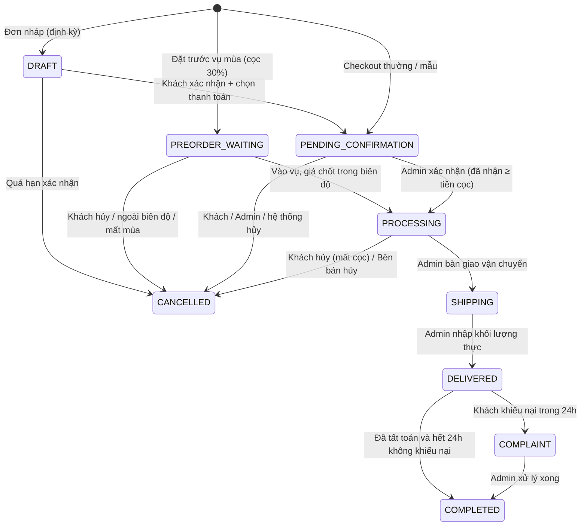

# KẾ HOẠCH TRIỂN KHAI – WEBSITE B2B NÔNG SẢN – TRÁI CÂY

> **Đối tượng đọc:** AI coding agent (Gemini) và nhóm phát triển.
> **Bối cảnh:** Đồ án môn Thương mại điện tử. Ưu tiên logic nghiệp vụ chặt chẽ, đủ luồng, chạy demo được; không cần tích hợp pháp lý thật.
> **Cách dùng:** Làm **tuần tự từng phase**. Mỗi phase có: Mục tiêu → Phạm vi → Việc cần làm (checklist) → Tiêu chí hoàn thành (DoD). Đánh dấu `[x]` khi xong và cập nhật mục **Tiến độ** ở cuối file.

---

## MỤC LỤC
- [0. Tóm tắt sản phẩm](#0-tóm-tắt-sản-phẩm)
- [1. Quy ước bắt buộc cho agent](#1-quy-ước-bắt-buộc-cho-agent)
- [2. Công nghệ & cấu trúc thư mục](#2-công-nghệ--cấu-trúc-thư-mục)
- [3. Quy tắc nghiệp vụ (nguồn sự thật)](#3-quy-tắc-nghiệp-vụ-nguồn-sự-thật)
- [4. Mô hình dữ liệu (Prisma)](#4-mô-hình-dữ-liệu-prisma)
- [5. Sơ đồ trang (routes)](#5-sơ-đồ-trang-routes)
- [6. Lộ trình các phase](#6-lộ-trình-các-phase)
- [Phase 0 → Phase 9](#phase-0--khởi-tạo-dự-án)
- [7. Bộ test case nghiệp vụ bắt buộc](#7-bộ-test-case-nghiệp-vụ-bắt-buộc)
- [8. Ngoài phạm vi / Hướng phát triển](#8-ngoài-phạm-vi--hướng-phát-triển)
- [9. Tiến độ](#9-tiến-độ)

---

## 0. Tóm tắt sản phẩm

- **Mô hình:** **Nhà phân phối B2B.** Công ty thu mua trái cây từ các nhà vườn liên kết rồi bán sỉ cho đại lý, siêu thị, cửa hàng, quán F&B. Chỉ có **một người bán**. Nhà vườn **không** có tài khoản, họ là dữ liệu do Admin quản lý.
- **3 bài toán:** Niềm tin (hồ sơ vườn + QR truy xuất lô), Giá (giá bậc theo sản lượng + chiết khấu nhóm khách), Vận chuyển (ngày giao, xe lạnh, chốt khối lượng thực).
- **2 phân hệ:** Khách hàng B2B (storefront + tài khoản) và Quản trị (một vai trò `ADMIN` duy nhất).
- **Tính năng điểm nhấn (USP) trong phạm vi:** Giá bậc + MOQ + thanh tiến trình · Hồ sơ vườn + QR theo lô · Đơn mẫu · Đơn định kỳ · Đặt trước vụ mùa (Pre-order).
- **Để phase cuối:** **Vận chuyển** (tính phí theo khoảng cách + loại xe, quản lý chuyến giao), xem Phase 8. **Thông báo** (Email + Zalo ZNS), xem Phase 9.

---

## 1. Quy ước bắt buộc cho agent

1. **Làm đúng phase hiện tại.** Không code trước tính năng của phase sau, đặc biệt **không** làm tính năng vận chuyển hay thông báo trước Phase 8/9. Chỉ tạo các "điểm móc" (interface, bảng sự kiện) đã được chỉ định.
2. **Kết thúc mỗi phase phải chạy:** `npm run lint`, `npm run typecheck`, `npm test`, `npm run build`. Tất cả phải pass, rồi báo cáo kết quả cho người dùng và **dừng chờ xác nhận** trước khi sang phase tiếp theo.
3. **Tiền** lưu bằng số nguyên **VND** (`Int`), không dùng float. **Khối lượng** lưu bằng **gram** (`Int`). Chỉ quy ra kg khi hiển thị.
4. **Không tin giá từ client.** Mọi giá, phí và tổng tiền phải được **tính lại ở server** bằng `src/lib/pricing` trước khi tạo đơn.
5. **Logic nghiệp vụ là hàm thuần (pure function)** đặt trong `src/lib/domain/*`, có unit test đi kèm. UI và server action chỉ gọi các hàm này.
6. **Chuyển trạng thái đơn** chỉ đi qua `src/lib/domain/order-state.ts`. Mỗi lần chuyển phải ghi một bản ghi `OrderEvent`.
7. **Ngôn ngữ:** giao diện **tiếng Việt**. Code, tên biến, tên bảng và commit message dùng **tiếng Anh**.
8. **Khi tài liệu này mâu thuẫn hoặc chưa rõ:** hỏi người dùng, không tự suy đoán. Nếu buộc phải giả định, ghi lại vào mục *Giả định đã đưa ra* của phase đó.
9. **Không tự ý đổi stack** hay thêm thư viện lớn ngoài danh sách ở mục 2 khi chưa hỏi.
10. API của thư viện thay đổi theo phiên bản (Next.js, Prisma, Auth.js). **Đọc tài liệu chính thức đúng phiên bản đã cài** trước khi viết cấu hình.

---

## 2. Công nghệ & cấu trúc thư mục

| Lớp | Công nghệ |
|---|---|
| Framework | **Next.js** (App Router, TypeScript, Server Actions), bản ổn định mới nhất |
| UI | Tailwind CSS + **shadcn/ui**, icon `lucide-react` |
| CSDL | **PostgreSQL** (local qua Docker, hoặc Neon/Supabase free) |
| ORM | **Prisma** |
| Xác thực | **Auth.js** (gói `next-auth`), Credentials provider + `bcryptjs` |
| Validate | `zod` (dùng chung client/server) |
| State giỏ hàng | `zustand` + persist localStorage |
| QR | `qrcode` |
| Biểu đồ | `recharts` (Phase 7) |
| Test | **Vitest** (unit), **Playwright** (e2e, Phase 9) |
| Phase 8 | Google Maps **Routes API** (Compute Route Matrix), có fallback khi không có API key |
| Phase 9 | `nodemailer` (SMTP), Zalo ZNS (HTTP API, có chế độ mock) |

> [!WARNING]
> Đường dẫn workspace `d:\TMĐT Website` chứa **dấu cách và ký tự có dấu (Đ)**, nên một số công cụ (npm package name, Prisma engine, Playwright) có thể lỗi. Vì vậy mã nguồn đặt trong thư mục con `nong-san-b2b/`. Nếu vẫn lỗi đường dẫn, báo người dùng để chuyển sang đường dẫn ASCII (ví dụ `D:\nong-san-b2b`).

```
d:\TMĐT Website\
├─ GEMINI.md                       # quy tắc cho agent (đọc trước)
├─ docs\KE_HOACH_TRIEN_KHAI.md     # file này
└─ nong-san-b2b\                   # mã nguồn Next.js
   ├─ prisma\ (schema.prisma, seed.ts, migrations\)
   ├─ public\uploads\              # ảnh upload (dev)
   ├─ src\
   │  ├─ app\
   │  │  ├─ (shop)\                # storefront + tài khoản khách
   │  │  ├─ admin\                 # trang quản trị
   │  │  └─ api\                   # route handlers (cron, qr...)
   │  ├─ components\ (ui\, shop\, admin\)
   │  ├─ lib\
   │  │  ├─ db.ts                  # Prisma client singleton
   │  │  ├─ auth.ts                # cấu hình Auth.js
   │  │  ├─ money.ts               # format VND, gram<->kg
   │  │  ├─ storage.ts             # lưu file upload (interface + local disk)
   │  │  ├─ domain\                # LOGIC NGHIỆP VỤ THUẦN + test
   │  │  │  ├─ pricing.ts
   │  │  │  ├─ order-state.ts
   │  │  │  ├─ settlement.ts       # chốt khối lượng, hoàn/hủy, khiếu nại
   │  │  │  ├─ capacity.ts
   │  │  │  ├─ delivery-date.ts
   │  │  │  ├─ recurring.ts
   │  │  │  ├─ preorder.ts
   │  │  │  └─ shipping\           # interface + ZeroShippingCalculator (Phase 4), Maps (Phase 8)
   │  │  ├─ events.ts              # ghi OrderEvent (móc cho Phase 9)
   │  │  └─ validators\            # zod schemas
   │  └─ server\actions\           # server actions theo module
   └─ tests\ (unit\, e2e\)
```

---

## 3. Quy tắc nghiệp vụ (nguồn sự thật)

### 3.1 Tài khoản & nhóm khách
- Khách vãng lai **xem được toàn bộ catalog và bảng giá bậc** (giá chuẩn, chưa trừ chiết khấu nhóm).
- **Đăng ký** gồm: họ tên, email, mật khẩu, SĐT, **tên doanh nghiệp/cửa hàng** (bắt buộc), mã số thuế (tùy chọn). Đăng ký xong **đặt hàng được ngay, không cần duyệt**.
- Muốn **checkout** phải đăng nhập. Giỏ hàng vẫn dùng được khi chưa đăng nhập vì lưu ở localStorage.
- **Nhóm khách hàng** (seed sẵn, Admin sửa được %):

| code | Tên | Chiết khấu thêm (mặc định) |
|---|---|---|
| `TIER1_AGENT` | Đại lý cấp 1 | 5% |
| `SUPERMARKET` | Siêu thị | 3% |
| `SMALL_SHOP` | Cửa hàng nhỏ | 0% (**mặc định khi đăng ký**) |

- Khách **không** tự chọn nhóm. Chỉ Admin được đổi nhóm của khách.
- Khi đã đăng nhập, trang sản phẩm hiển thị **giá sau chiết khấu nhóm** cạnh giá chuẩn.

### 3.2 Sản phẩm, quy cách, MOQ, giá bậc
- Mỗi **Product** có: `moqGrams`, `leadTimeDays`, `seasonStatus` (`HARVESTING` = Đang thu hoạch, `UPCOMING` = Sắp cắt tại vườn, `OFF_SEASON`), một nhà vườn (`farmId`), cờ `requiresCold` (chỉ dùng ở Phase 8).
- Mỗi sản phẩm có nhiều **Packaging** (ví dụ "Thùng 10kg" = 10000g, "Rổ 20kg" = 20000g).
- **Giá bậc tuyệt đối theo kg** (`PriceTier`): mỗi bậc có `minGrams` và `pricePerKg`. Bậc áp dụng là bậc có `minGrams` lớn nhất mà vẫn `≤ TổngGram`.
  - Ràng buộc khi Admin lưu: phải có ≥1 bậc, **bậc thấp nhất `minGrams` = `moqGrams`**, các `minGrams` không trùng nhau, và giá **giảm dần** khi `minGrams` tăng.
- **Công thức** (`src/lib/domain/pricing.ts`):
  ```
  totalGrams(product) = Σ quantity × packaging.weightGrams   // cộng dồn MỌI quy cách thường của cùng SP trong giỏ
  hợp lệ khi           totalGrams ≥ product.moqGrams
  basePricePerKg       = tier(product, totalGrams).pricePerKg
  unitPricePerKg       = round(basePricePerKg × (100 − groupDiscountPercent) / 100)
  lineTotal(item)      = round(unitPricePerKg × item.grams / 1000)
  subtotal             = Σ lineTotal
  ```
- **Thanh tiến trình** ("Mua thêm X kg để đạt giá Y đ/kg"): nếu còn bậc cao hơn thì `X = nextTier.minGrams − totalGrams`. Nếu chưa đạt MOQ thì hiển thị "Cần thêm X kg để đạt mức đặt tối thiểu".

### 3.3 Đơn mẫu (Sample)
- Packaging có `isSample = true` và giá cố định `samplePrice` (VND cho cả gói).
- Hàng mẫu **không áp MOQ, không tính vào `totalGrams`, không áp chiết khấu nhóm**.
- Mỗi khách chỉ được mua **1 gói mẫu cho mỗi sản phẩm**, trừ khi đơn trước đó đã bị hủy. Server phải kiểm tra lại khi checkout.
- Đơn chỉ chứa hàng mẫu thì `type = SAMPLE`.

### 3.4 Sản lượng khả dụng theo tuần (thay cho tồn kho)
- `WeeklyCapacity(productId, weekStart = thứ Hai, maxGrams)`.
- Khi checkout: tính `Σ gram` của các đơn **chưa hủy** có `deliveryDate` cùng tuần, cộng thêm gram của đơn mới. Nếu vượt `maxGrams` thì báo lỗi kèm số kg còn lại.
- Tuần chưa có bản ghi capacity thì **không giới hạn** (giả định cho demo).

### 3.5 Ngày giao (Phase 4, chưa tính phí)
- Ngày giao sớm nhất = hôm nay + `max(leadTimeDays)` của các sản phẩm trong giỏ. Nếu đặt **sau 17:00** (giờ VN, `Asia/Ho_Chi_Minh`) thì cộng thêm 1 ngày.
- Khung giờ: `MORNING` (6–11h), `AFTERNOON` (13–17h), `EVENING` (18–21h).
- Khách chọn **ngày mong muốn**. Admin có thể đổi ngày khi xác nhận đơn, và việc đổi ngày phải ghi `OrderEvent`.

### 3.6 Thanh toán (trả ngay tại checkout)
- Hai lựa chọn: `FULL` (chuyển khoản 100%) hoặc `DEPOSIT_30` (cọc 30%, phần còn lại thanh toán khi nhận hàng).
- `total = subtotal + shippingFee`. Trong Phase 4–7, `shippingFee = 0`, UI ghi "Phí vận chuyển: sẽ được báo khi xác nhận đơn".
- `depositAmount = ceil(total × 30 / 100 / 1000) × 1000` (làm tròn **lên** tới nghìn đồng).
- Số tiền cần chuyển ngay: `FULL` thì bằng `total`, `DEPOSIT_30` thì bằng `depositAmount`.
- Sau khi đặt, hiển thị **mã VietQR**:
  `https://img.vietqr.io/image/{BANK_BIN}-{ACCOUNT_NO}-compact2.png?amount={số tiền}&addInfo={mã đơn}&accountName={tên TK}`, lấy cấu hình từ biến môi trường.
- `paymentDueAt = createdAt + 24h`. Admin **xác nhận đã nhận tiền** thủ công, khi đó tạo `PaymentTransaction(type=PAYMENT)`.
- Quá hạn mà chưa có thanh toán thì đơn **tự hủy** (`cancelledBy = SYSTEM`). Việc này chạy qua route `/api/cron/expire-orders` và một nút "Quét đơn quá hạn" trong Admin.
- **Trạng thái thanh toán** được **suy ra** từ các giao dịch, không cho sửa tay:
  - `paid = Σ PAYMENT − Σ REFUND`
  - `AWAITING_PAYMENT` khi paid = 0 và đơn chưa hủy · `DEPOSIT_PAID` khi 0 < paid < total hiện hành · `PAID` khi paid ≥ total hiện hành
  - `REFUND_PENDING` khi có khoản hoàn đã tính nhưng chưa thực hiện · `REFUNDED` / `PARTIALLY_REFUNDED` sau khi hoàn
  - "total hiện hành" = `finalTotal` nếu đã chốt khối lượng, ngược lại là `total`.

### 3.7 Trạng thái đơn hàng



Bảng chuyển trạng thái (cài trong `order-state.ts` dưới dạng bảng tra; mọi chuyển khác đều bị từ chối):

| Từ | Sang | Ai | Điều kiện / Tác động |
|---|---|---|---|
| `DRAFT` | `PENDING_CONFIRMATION` | Khách | Tính lại giá theo thời điểm xác nhận, chọn thanh toán, kiểm tra MOQ/capacity |
| `DRAFT` | `CANCELLED` | Hệ thống | Quá hạn xác nhận (trước ngày giao − leadTime) |
| `PENDING_CONFIRMATION` | `PROCESSING` | Admin | `paid ≥ depositAmount` (hoặc `≥ total` nếu chọn FULL) |
| `PENDING_CONFIRMATION` | `CANCELLED` | Khách/Admin/Hệ thống | Hoàn 100% số đã trả |
| `PROCESSING` | `SHIPPING` | Admin | (Phase 8: bắt buộc có thông tin chuyến giao) |
| `PROCESSING` | `CANCELLED` | Khách | **Mất cọc**: `forfeit = min(paid, depositAmount)`, hoàn `paid − forfeit`. UI cảnh báo trước khi hủy |
| `PROCESSING` | `CANCELLED` | Admin (lỗi bên bán: hết hàng, thiên tai, xe hỏng) | Hoàn 100% |
| `SHIPPING` | `DELIVERED` | Admin | Nhập `actualGrams` cho từng dòng, chạy chốt khối lượng (3.8) |
| `DELIVERED` | `COMPLAINT` | Khách | Trong 24h kể từ `deliveredAt`, có ≥1 ảnh |
| `DELIVERED` | `COMPLETED` | Admin | Đã tất toán (`paid == finalTotal`, không còn hoàn pending) **và** đã quá 24h |
| `COMPLAINT` | `COMPLETED` | Admin | Khiếu nại được giải quyết (RESOLVED/REJECTED) và đã tất toán |
| `PREORDER_WAITING` | `PROCESSING` | Admin | Xem 3.10 |
| `PREORDER_WAITING` | `CANCELLED` | Khách/Admin | Xem 3.10 |

- Khi hủy phải lưu `cancelledBy` (`CUSTOMER` | `SELLER` | `SYSTEM`) và `cancelReason` (bắt buộc với Admin; gợi ý sẵn: *Hết hàng tại vườn, Thiên tai/thời tiết, Xe hỏng/sự cố vận chuyển, Khách không thanh toán, Khác*).
- **Không** được hủy từ `SHIPPING` trở đi. Sự cố ở giai đoạn này đi theo đường khiếu nại.

### 3.8 Chốt khối lượng thực giao (`settlement.ts`)
```
finalLineTotal = round(unitPricePerKg × actualGrams / 1000)     // giữ nguyên đơn giá đã chốt
finalSubtotal  = Σ finalLineTotal (+ dòng mẫu giữ nguyên giá)
finalTotal     = finalSubtotal + shippingFee
balance        = finalTotal − paid
  balance > 0 → khách thanh toán khi nhận (Admin ghi PaymentTransaction method CASH|BANK_TRANSFER)
  balance < 0 → tạo khoản hoàn |balance| (REFUND_PENDING) → Admin xác nhận đã hoàn
```
- `actualGrams` không được vượt `orderedGrams × 105%`. Vượt mức này thì báo lỗi; giả định là không giao dư quá 5%.

### 3.9 Khiếu nại hao hụt
- Khách gửi trong **24h** sau `deliveredAt`: mô tả, ảnh (1–5), chọn dòng sản phẩm, khối lượng hư hỏng ước tính.
- Admin xác minh `damagedGrams` rồi tính:
  ```
  allowedGrams = floor(actualGrams × 3 / 100)
  excessGrams  = max(0, damagedGrams − allowedGrams)
  compensation = round(unitPricePerKg × excessGrams / 1000)
  ```
- Hướng xử lý: `REFUND` (tạo khoản hoàn `compensation`) hoặc `REPLACE` (bù hàng ở chuyến sau, ghi chú, không phát sinh tiền) hoặc `REJECTED` (kèm lý do).

### 3.10 Đặt trước vụ mùa (Pre-order)
- Sản phẩm bật `preorderOpen` và có `preorderPricePerKg`, `preorderBandPercent` (mặc định 10), `expectedHarvestFrom/To`.
- Đơn Pre-order chỉ chứa **một sản phẩm**. **Bắt buộc `DEPOSIT_30`**, áp MOQ, áp chiết khấu nhóm trên `preorderPricePerKg`. `deliveryDate` để trống, thay bằng kỳ thu hoạch dự kiến.
- Trạng thái ban đầu là `PREORDER_WAITING` (sau khi Admin xác nhận đã nhận cọc; trước đó đơn vẫn hiện "chờ thanh toán").
- **Khi vào vụ**, Admin nhập `finalPricePerKg` và `fulfilledGrams`:
  - Nếu `|final − preorder| / preorder ≤ band%`: cập nhật đơn giá theo final (vẫn áp chiết khấu nhóm), Admin chọn ngày giao rồi chuyển `PROCESSING`.
  - Nếu ngoài biên độ: khách chọn **Chấp nhận** (sang `PROCESSING`) hoặc **Hủy** (hoàn 100% cọc). Trước Phase 9 thì khách tự vào dashboard để chọn.
  - Nếu `fulfilledGrams < orderedGrams` (mất mùa một phần): giảm khối lượng đơn và hoàn phần cọc tương ứng `round(deposit × (1 − fulfilled/ordered))`. Nếu `fulfilledGrams = 0` thì hủy và hoàn 100%.
- Khách tự hủy khi đơn đang `PREORDER_WAITING` thì **mất cọc**.

### 3.11 Đơn định kỳ
- Khách tạo lịch **từ một đơn đã COMPLETED** (nút "Đặt định kỳ từ đơn này") hoặc chọn sản phẩm thủ công: chọn thứ trong tuần (ví dụ T2, T5), khung giờ, địa chỉ, hình thức thanh toán mặc định.
- **Job sinh đơn** (`/api/cron/recurring` + nút "Chạy sinh đơn định kỳ" trong Admin, phải chạy lặp lại nhiều lần vẫn an toàn): với mỗi lịch đang bật, mỗi ngày giao rơi vào khoảng `[hôm nay + leadTime, hôm nay + leadTime + 7 ngày]` mà chưa có đơn, tạo **đơn `DRAFT`** theo **giá hiện hành**.
- Khách vào "Đơn chờ xác nhận" để kiểm tra giá, sửa số lượng rồi **Xác nhận và thanh toán**, khi đó đơn đi theo luồng thường. Hệ thống **không bao giờ tự trừ tiền**.
- Đơn nháp quá hạn (đã qua `deliveryDate − leadTimeDays`) thì hệ thống chuyển `CANCELLED`.

### 3.12 Lô hàng & QR truy xuất
- `Batch`: mã lô (`LO-YYMMDD-XXX`), sản phẩm, nhà vườn, ngày thu hoạch, khối lượng, ghi chú.
- QR của lô trỏ tới trang công khai `/truy-xuat/{code}`, hiển thị sản phẩm, vườn (ảnh, vị trí Google Maps nhúng iframe), chứng nhận còn hiệu lực và ngày thu hoạch.
- Khi đơn ở `PROCESSING`, Admin gán lô cho từng dòng (không bắt buộc). Trang chi tiết đơn của khách hiển thị link truy xuất lô.

### 3.13 Điểm móc cho phase cuối (cài từ sớm, KHÔNG triển khai đầy đủ)
- `src/lib/domain/shipping/index.ts`:
  ```ts
  export interface ShippingQuoteInput { items: { productId: string; grams: number; requiresCold: boolean }[]; address: AddressSnapshot; }
  export interface ShippingQuote { fee: number; vehicleType: 'NORMAL' | 'COLD' | null; distanceKm: number | null; note?: string }
  export interface ShippingCalculator { quote(input: ShippingQuoteInput): Promise<ShippingQuote> }
  export const zeroShippingCalculator: ShippingCalculator = { async quote() { return { fee: 0, vehicleType: null, distanceKm: null, note: 'Phí vận chuyển sẽ được báo khi xác nhận đơn' } } }
  export function getShippingCalculator(): ShippingCalculator { return zeroShippingCalculator } // Phase 8 thay thế
  ```
- `src/lib/events.ts`: `recordOrderEvent(tx, { orderId, type, fromStatus, toStatus, actorId, note, payload })` ghi vào bảng `OrderEvent`. **Phase 9** sẽ thêm bước gửi thông báo dựa trên các event này. Danh sách `type` cố định: `ORDER_CREATED`, `PAYMENT_CONFIRMED`, `STATUS_CHANGED`, `DELIVERY_DATE_CHANGED`, `WEIGHT_SETTLED`, `REFUND_CREATED`, `REFUND_COMPLETED`, `COMPLAINT_OPENED`, `COMPLAINT_RESOLVED`, `RECURRING_DRAFT_CREATED`, `PREORDER_HARVEST_READY`, `PAYMENT_EXPIRED`.

---

## 4. Mô hình dữ liệu (Prisma)

> Đây là bản phác thảo bắt buộc tuân theo về **thực thể, quan hệ và kiểu dữ liệu**. Agent được thêm index, `@map`, `createdAt/updatedAt`. Các model đánh dấu *(Phase 8)* / *(Phase 9)* **chưa tạo** ở Phase 1.

```prisma
enum Role            { CUSTOMER ADMIN }
enum SeasonStatus    { HARVESTING UPCOMING OFF_SEASON }
enum OrderType       { STANDARD SAMPLE RECURRING PREORDER }
enum OrderStatus     { DRAFT PREORDER_WAITING PENDING_CONFIRMATION PROCESSING SHIPPING DELIVERED COMPLAINT COMPLETED CANCELLED }
enum PaymentOption   { FULL DEPOSIT_30 }
enum TxType          { PAYMENT REFUND }
enum TxStatus        { PENDING DONE }            // REFUND PENDING = cần hoàn
enum TxMethod        { BANK_TRANSFER CASH }
enum CancelActor     { CUSTOMER SELLER SYSTEM }
enum TimeSlot        { MORNING AFTERNOON EVENING }
enum CertType        { VIETGAP GLOBALGAP ORGANIC OTHER }
enum ComplaintStatus { OPEN RESOLVED REJECTED }
enum Resolution      { REFUND REPLACE }

model CustomerGroup { id String @id @default(cuid())  code String @unique  name String  discountPercent Int  isDefault Boolean @default(false)  users User[] }

model User {
  id String @id @default(cuid())
  email String @unique
  passwordHash String
  role Role @default(CUSTOMER)
  fullName String
  phone String
  companyName String?
  taxCode String?
  groupId String?
  group CustomerGroup? @relation(fields: [groupId], references: [id])
  addresses Address[]
  orders Order[]
  recurringSchedules RecurringSchedule[]
  createdAt DateTime @default(now())
}

model Address { id String @id @default(cuid())  userId String  label String  recipient String  phone String  line String  ward String  district String  province String  isDefault Boolean @default(false)  lat Float?  lng Float?  user User @relation(fields: [userId], references: [id]) }

model Farm { id String @id @default(cuid())  slug String @unique  name String  ownerName String?  province String  addressText String  description String  lat Float  lng Float  images String[]  certificates Certificate[]  products Product[]  batches Batch[] }
model Certificate { id String @id @default(cuid())  farmId String  type CertType  code String  issuedAt DateTime  expiresAt DateTime  imageUrl String?  farm Farm @relation(fields: [farmId], references: [id]) }

model Product {
  id String @id @default(cuid())
  slug String @unique
  name String
  description String
  images String[]
  farmId String
  farm Farm @relation(fields: [farmId], references: [id])
  moqGrams Int
  leadTimeDays Int @default(1)
  seasonStatus SeasonStatus
  requiresCold Boolean @default(false)     // dùng ở Phase 8
  isActive Boolean @default(true)
  preorderOpen Boolean @default(false)
  preorderPricePerKg Int?
  preorderBandPercent Int @default(10)
  expectedHarvestFrom DateTime?
  expectedHarvestTo DateTime?
  packagings Packaging[]
  priceTiers PriceTier[]
  capacities WeeklyCapacity[]
  batches Batch[]
}
model Packaging { id String @id @default(cuid())  productId String  name String  weightGrams Int  isSample Boolean @default(false)  samplePrice Int?  isActive Boolean @default(true)  product Product @relation(fields: [productId], references: [id]) }
model PriceTier { id String @id @default(cuid())  productId String  minGrams Int  pricePerKg Int  product Product @relation(fields: [productId], references: [id])  @@unique([productId, minGrams]) }
model WeeklyCapacity { id String @id @default(cuid())  productId String  weekStart DateTime @db.Date  maxGrams Int  product Product @relation(fields: [productId], references: [id])  @@unique([productId, weekStart]) }
model Batch { id String @id @default(cuid())  code String @unique  productId String  farmId String  harvestDate DateTime @db.Date  quantityGrams Int  note String?  product Product @relation(fields: [productId], references: [id])  farm Farm @relation(fields: [farmId], references: [id])  orderItems OrderItem[] }

model Order {
  id String @id @default(cuid())
  code String @unique                     // DH-YYMMDD-XXXX
  userId String
  user User @relation(fields: [userId], references: [id])
  type OrderType
  status OrderStatus
  paymentOption PaymentOption
  groupDiscountPercent Int                // snapshot
  addressSnapshot Json
  deliveryDate DateTime? @db.Date
  timeSlot TimeSlot?
  subtotal Int
  shippingFee Int @default(0)
  total Int
  depositAmount Int
  finalSubtotal Int?
  finalTotal Int?
  paymentDueAt DateTime?
  deliveredAt DateTime?
  cancelledBy CancelActor?
  cancelReason String?
  customerNote String?
  recurringScheduleId String?
  recurringSchedule RecurringSchedule? @relation(fields: [recurringScheduleId], references: [id])
  preorderFinalPricePerKg Int?
  preorderFulfilledGrams Int?
  preorderCustomerDecision String?        // ACCEPT | CANCEL | null
  items OrderItem[]
  transactions PaymentTransaction[]
  events OrderEvent[]
  complaints Complaint[]
  createdAt DateTime @default(now())
}
model OrderItem {
  id String @id @default(cuid())
  orderId String
  productId String
  packagingId String
  productName String                      // snapshot
  packagingName String                    // snapshot
  isSample Boolean
  quantity Int
  orderedGrams Int
  unitPricePerKg Int                      // đã trừ CK nhóm (mẫu: 0, dùng lineTotal)
  lineTotal Int
  actualGrams Int?
  finalLineTotal Int?
  batchId String?
  order Order @relation(fields: [orderId], references: [id])
  batch Batch? @relation(fields: [batchId], references: [id])
}
model PaymentTransaction { id String @id @default(cuid())  orderId String  type TxType  status TxStatus  method TxMethod  amount Int  reference String?  note String?  createdAt DateTime @default(now())  completedAt DateTime?  order Order @relation(fields: [orderId], references: [id]) }
model OrderEvent { id String @id @default(cuid())  orderId String  type String  fromStatus OrderStatus?  toStatus OrderStatus?  actorId String?  note String?  payload Json?  createdAt DateTime @default(now())  order Order @relation(fields: [orderId], references: [id]) }
model Complaint { id String @id @default(cuid())  orderId String  orderItemId String  description String  photos String[]  reportedGrams Int  verifiedGrams Int?  status ComplaintStatus @default(OPEN)  resolution Resolution?  compensation Int?  adminNote String?  createdAt DateTime @default(now())  resolvedAt DateTime?  order Order @relation(fields: [orderId], references: [id]) }

model RecurringSchedule { id String @id @default(cuid())  userId String  name String  weekdays Int[]  timeSlot TimeSlot  addressId String  paymentOption PaymentOption  isActive Boolean @default(true)  items RecurringItem[]  orders Order[]  user User @relation(fields: [userId], references: [id]) }  // weekdays: 1=T2 … 7=CN
model RecurringItem { id String @id @default(cuid())  scheduleId String  productId String  packagingId String  quantity Int  schedule RecurringSchedule @relation(fields: [scheduleId], references: [id]) }

// (Phase 8)  ShippingRate, Shipment, AppSetting(warehouse lat/lng, bán kính phục vụ)
// (Phase 9)  NotificationLog, User.zaloOptIn Boolean, User.zaloPhone String?
```

---

## 5. Sơ đồ trang (routes)

**Storefront `(shop)`**
| Route | Nội dung |
|---|---|
| `/` | Hero, các khối theo mùa: "Đang thu hoạch", "Sắp cắt tại vườn", "Mở đặt trước", nhà vườn tiêu biểu |
| `/san-pham` | Danh sách sản phẩm, lọc theo mùa và nhà vườn, tìm kiếm |
| `/san-pham/[slug]` | Ảnh, mô tả, **bảng giá bậc**, chọn quy cách × số lượng, thanh tiến trình, nút mua mẫu; tab **Hồ sơ vườn** |
| `/nha-vuon/[slug]` | Hồ sơ vườn: ảnh, chứng nhận, bản đồ, sản phẩm |
| `/truy-xuat/[code]` | Trang truy xuất lô (công khai) |
| `/gio-hang` | Giỏ hàng nhóm theo sản phẩm, kiểm MOQ, thanh tiến trình, tạm tính |
| `/thanh-toan` | Địa chỉ → ngày/khung giờ → (phí ship: Phase 8) → hình thức thanh toán → xác nhận |
| `/thanh-toan/[code]` | Popup/trang "Đặt hàng thành công" + VietQR + hạn thanh toán |
| `/dang-nhap`, `/dang-ky` | Xác thực |
| `/tai-khoan` | Tổng quan: đơn đang xử lý, đơn nháp chờ xác nhận, pre-order |
| `/tai-khoan/don-hang`, `/tai-khoan/don-hang/[code]` | Danh sách và chi tiết đơn (timeline trạng thái, thanh toán, hủy, khiếu nại, link truy xuất lô) |
| `/tai-khoan/dinh-ky` | Quản lý lịch định kỳ, đơn nháp |
| `/tai-khoan/dia-chi`, `/tai-khoan/ho-so` | Địa chỉ, thông tin doanh nghiệp |

**Admin `/admin`** (middleware chặn, chỉ cho `role = ADMIN`)
`/admin` (dashboard) · `/admin/don-hang` (+ `[code]`) · `/admin/san-pham` (+ quy cách, bậc giá, pre-order) · `/admin/nha-vuon` (+ chứng nhận) · `/admin/lo-hang` (+ QR) · `/admin/san-luong` (capacity theo tuần) · `/admin/khach-hang` (+ đổi nhóm) · `/admin/nhom-khach` · `/admin/khieu-nai` · `/admin/dinh-ky` · `/admin/bao-cao` · *(Phase 8)* `/admin/van-chuyen` · *(Phase 9)* `/admin/thong-bao`

---

## 6. Lộ trình các phase

```mermaid
flowchart LR
    P0["P0 Khởi tạo"] --> P1["P1 Dữ liệu + Xác thực"]
    P1 --> P2["P2 Catalog + Nhà vườn + Lô/QR"]
    P2 --> P3["P3 Giỏ hàng + Engine giá"]
    P3 --> P4["P4 Checkout + Thanh toán"]
    P4 --> P5["P5 Vòng đời đơn + Quyết toán"]
    P5 --> P6["P6 Định kỳ + Pre-order + Dashboard khách"]
    P6 --> P7["P7 CRM + Báo cáo"]
    P7 --> P8["P8 VẬN CHUYỂN"]
    P8 --> P9["P9 THÔNG BÁO + Hoàn thiện + Deploy"]
```



| Phase | Kết quả demo được |
|---|---|
| 0 | Dự án chạy `npm run dev`, kết nối DB, CI script pass |
| 1 | Đăng ký/đăng nhập, phân quyền khách và Admin, seed dữ liệu |
| 2 | Admin quản lý sản phẩm/vườn/lô; khách xem catalog, bảng giá, hồ sơ vườn, quét QR |
| 3 | Thêm vào giỏ, giá nhảy theo bậc, thanh tiến trình, kiểm MOQ, hàng mẫu |
| 4 | Checkout ra đơn, VietQR, Admin xác nhận tiền, tự hủy khi quá hạn |
| 5 | Admin đi hết vòng đời đơn, hủy/hoàn cọc, chốt khối lượng, khiếu nại |
| 6 | Đơn định kỳ (đơn nháp), Pre-order mùa vụ, dashboard khách |
| 7 | Quản lý khách và nhóm, dashboard báo cáo |
| 8 | Phí ship theo khoảng cách + loại xe, quản lý chuyến giao |
| 9 | Email + Zalo ZNS, e2e test, deploy |

---

## Phase 0 – Khởi tạo dự án

**Mục tiêu:** khung dự án chạy được, có công cụ kiểm tra chất lượng.

- [x] Tạo app trong `nong-san-b2b/`: `npx create-next-app@latest nong-san-b2b --ts --tailwind --eslint --app --src-dir --import-alias "@/*" --use-npm`
- [x] Cài shadcn/ui (`npx shadcn@latest init`) cùng các component: button, input, label, card, table, dialog, sheet, select, tabs, badge, form, toast/sonner, dropdown-menu, calendar, popover, textarea, skeleton.
- [x] Cài: `prisma @prisma/client zod zustand bcryptjs qrcode next-auth date-fns date-fns-tz` và dev deps `vitest @vitest/coverage-v8 tsx @types/bcryptjs @types/qrcode`.
- [x] PostgreSQL: tạo `docker-compose.yml` (postgres:16, port 5432). Nếu máy không có Docker thì hỏi người dùng chuỗi kết nối Neon/Supabase.
- [x] Tạo `.env.example`: `DATABASE_URL`, `AUTH_SECRET`, `ADMIN_EMAIL`, `ADMIN_PASSWORD`, `VIETQR_BANK_BIN`, `VIETQR_ACCOUNT_NO`, `VIETQR_ACCOUNT_NAME`, `CRON_SECRET`, `APP_URL`. Thêm `.env` vào `.gitignore`.
- [x] Scripts trong `package.json`: `typecheck` (`tsc --noEmit`), `test` (`vitest run`), `db:migrate`, `db:seed`, `db:reset`.
- [x] `src/lib/db.ts` (Prisma singleton) và `src/lib/money.ts` (`formatVND`, `gramsToKgText`, `kgToGrams`) kèm test.
- [x] Layout gốc: font hỗ trợ tiếng Việt (Be Vietnam Pro hoặc Inter subset `vietnamese`), header/footer storefront.
- [x] `git init` và commit đầu tiên.

**DoD:** `npm run dev` mở được trang chủ. `lint`, `typecheck`, `test`, `build` đều pass.

---

## Phase 1 – Dữ liệu nền & Xác thực

**Mục tiêu:** schema đầy đủ (trừ các model Phase 8/9), đăng ký/đăng nhập, phân quyền, seed dữ liệu demo.

- [x] Viết `prisma/schema.prisma` theo mục 4, rồi `npx prisma migrate dev --name init`.
- [x] `prisma/seed.ts`:
  - 3 nhóm khách (mục 3.1) và 1 Admin lấy từ `ADMIN_EMAIL/ADMIN_PASSWORD`.
  - 3 khách demo, mỗi nhóm một người, mật khẩu `Demo@123`.
  - 3 nhà vườn (Tiền Giang, Bến Tre, Đắk Lắk) có tọa độ thật, mỗi vườn có chứng nhận VietGAP hoặc GlobalGAP.
  - ≥8 sản phẩm, ví dụ: Sầu riêng Ri6 (MOQ 50kg; 50kg → 80.000, 200kg → 75.000), Sầu riêng Monthong, Xoài cát Hòa Lộc, Bưởi da xanh, Thanh long ruột đỏ, Chôm chôm, Măng cụt, Bơ 034. Mỗi sản phẩm có 2–3 quy cách và 2–3 bậc giá; ít nhất 2 sản phẩm có gói mẫu; 1 sản phẩm `UPCOMING` có mở pre-order.
  - Capacity cho tuần hiện tại và tuần sau; 3 lô hàng.
- [x] Auth.js: Credentials provider, mật khẩu bcrypt, chiến lược JWT. Session chứa `id`, `role`, `groupId`, `discountPercent`.
- [x] `middleware.ts`: chặn `/admin/**` (chỉ ADMIN), `/tai-khoan/**` và `/thanh-toan/**` (phải đăng nhập, chuyển về `/dang-nhap?callbackUrl=`).
- [x] Trang `/dang-ky` (zod validate; email không được trùng; gán nhóm mặc định) và `/dang-nhap`.
- [x] Helper `requireUser()`, `requireAdmin()` dùng trong server actions.
- [x] Trang `/tai-khoan/ho-so` và `/tai-khoan/dia-chi` (CRUD địa chỉ, chọn địa chỉ mặc định).
- [x] Khung layout Admin (sidebar với các mục ở mục 5; các trang chưa làm hiển thị "Đang phát triển").

**DoD:** đăng ký khách mới thì nhóm là `SMALL_SHOP`. Khách vào `/admin` bị chặn, Admin vào được. Seed chạy lại (`db:reset`) không lỗi.

---

## Phase 2 – Catalog, Nhà vườn, Lô hàng & QR

**Mục tiêu:** Admin quản lý dữ liệu sản phẩm; khách duyệt catalog và xác minh nguồn gốc.

**Admin**
- [x] `/admin/nha-vuon`: CRUD vườn (ảnh, tọa độ lat/lng, mô tả) và CRUD chứng nhận (ảnh, ngày hết hạn; hiện badge "Hết hạn").
- [x] `/admin/san-pham`: CRUD sản phẩm; quản lý quy cách (có gói mẫu với `samplePrice`); **trình sửa bậc giá** validate theo ràng buộc 3.2 bằng hàm `validatePriceTiers()` trong `pricing.ts` (có test); cấu hình pre-order.
- [x] `/admin/san-luong`: bảng sản phẩm × 4 tuần tới, nhập `maxGrams` (nhập theo kg).
- [x] `/admin/lo-hang`: CRUD lô, tự sinh mã lô, nút **Tải QR** (PNG qua route `/api/qr/[code]` dùng `qrcode`), trỏ tới `${APP_URL}/truy-xuat/{code}`.
- [x] `src/lib/storage.ts`: interface `saveUpload(file): Promise<url>` với bản cài lưu đĩa vào `public/uploads`. Giới hạn ảnh jpg/png/webp, ≤ 5MB.

**Storefront**
- [x] Trang chủ với các khối theo `seasonStatus` và `preorderOpen`.
- [x] `/san-pham`: lưới sản phẩm (ảnh, tên, vườn, "Giá từ X đ/kg" lấy từ bậc thấp nhất, MOQ), lọc và tìm kiếm.
- [x] `/san-pham/[slug]`: bảng giá bậc (ví dụ "50 – 199 kg: 80.000đ/kg; ≥ 200 kg: 75.000đ/kg"). Nếu đã đăng nhập thì thêm cột "Giá của bạn". Tab **Hồ sơ vườn**: ảnh, chứng nhận, Google Maps nhúng iframe `https://www.google.com/maps?q={lat},{lng}&output=embed`.
- [x] `/nha-vuon/[slug]` và `/truy-xuat/[code]` (trả 404 nếu mã sai).

**DoD:** Admin tạo được sản phẩm mới có bậc giá hợp lệ; nhập bậc giá sai thì báo lỗi rõ ràng. Quét QR (hoặc mở URL) ra đúng trang truy xuất. Test `validatePriceTiers` pass.

---

## Phase 3 – Giỏ hàng & Engine giá

**Mục tiêu:** tính giá chính xác, trải nghiệm "giá nhảy theo sản lượng".

- [x] `src/lib/domain/pricing.ts` gồm các hàm thuần:
  - `findTier(tiers, totalGrams)`
  - `priceCart({ lines, products, groupDiscountPercent }) → { productSummaries[{ productId, totalGrams, meetsMoq, missingGramsForMoq, basePricePerKg, unitPricePerKg, nextTier?: { minGrams, pricePerKg, missingGrams } }], lines[{…, lineTotal}], sampleLines[], subtotal, errors[] }`
  - Đủ toàn bộ test case ở mục 7.1.
- [x] Store giỏ hàng `zustand` (persist): `lines: { productId, packagingId, quantity }[]`. Có add/update/remove/clear.
- [x] Server action `quoteCart(lines)`: đọc DB, áp chiết khấu nhóm nếu đã đăng nhập (khách vãng lai dùng 0%), trả kết quả `priceCart`. UI chỉ hiển thị kết quả này, không tự tính.
- [x] Trang sản phẩm: chọn quy cách × số lượng, **xem trước giá realtime** (gọi `quoteCart` có debounce), thanh tiến trình, nút "Thêm vào giỏ". Nút "Mua mẫu" thì ẩn/disable nếu khách đã mua mẫu sản phẩm đó.
- [x] `/gio-hang`: nhóm dòng theo sản phẩm, hiện tổng kg, MOQ, bậc đang áp dụng và thanh tiến trình cho từng sản phẩm; sửa số lượng; nút "Thanh toán" bị disable nếu có sản phẩm chưa đạt MOQ.
- [x] Đăng nhập rồi thì giỏ giữ nguyên (localStorage), giá tự tính lại theo nhóm.

**DoD:** test pricing pass toàn bộ. Demo Ri6 210kg với tài khoản Siêu thị hiển thị **72.750đ/kg**, thành tiền **15.277.500đ**.

---

## Phase 4 – Checkout & Thanh toán

**Mục tiêu:** tạo đơn an toàn, thanh toán VietQR, Admin xác nhận tiền.

- [ ] `src/lib/domain/delivery-date.ts`: `earliestDeliveryDate(now, leadTimes[])` (múi giờ VN, giờ chốt 17h) kèm test.
- [ ] `src/lib/domain/capacity.ts`: `checkCapacity(existingGramsByWeek, newGrams, capacity?)` kèm test.
- [ ] `src/lib/domain/shipping/index.ts`: **chỉ** interface + `zeroShippingCalculator` (mục 3.13).
- [ ] `src/lib/events.ts`: `recordOrderEvent()` (mục 3.13).
- [ ] `/thanh-toan`:
  1. Chọn hoặc thêm địa chỉ.
  2. Chọn ngày (calendar disable các ngày < ngày sớm nhất) và khung giờ.
  3. Phí vận chuyển lấy từ `getShippingCalculator().quote()`, hiện tại = 0, kèm ghi chú.
  4. Chọn `FULL` / `DEPOSIT_30`, hiển thị số tiền cần chuyển ngay.
  5. Ghi chú, rồi bấm **Đặt hàng**.
- [ ] Server action `placeOrder(input)` chạy trong **một transaction Prisma**:
  - Validate zod, tính lại giá (`priceCart`), kiểm MOQ, giới hạn hàng mẫu, capacity, ngày giao.
  - Snapshot địa chỉ, tên sản phẩm/quy cách, `groupDiscountPercent`.
  - Sinh `code` (`DH-YYMMDD-XXXX`, không trùng), `status = PENDING_CONFIRMATION`, `paymentDueAt = now + 24h`, ghi `ORDER_CREATED`.
  - Xong thì xóa giỏ ở client và chuyển tới `/thanh-toan/[code]`.
- [ ] `/thanh-toan/[code]`: popup "Đặt hàng thành công", ảnh VietQR (số tiền và nội dung = mã đơn), đồng hồ đếm hạn thanh toán, nút "Xem đơn hàng".
- [ ] Admin `/admin/don-hang/[code]`: nút **Xác nhận đã nhận tiền** (nhập số tiền, phương thức, mã tham chiếu), tạo `PaymentTransaction(PAYMENT, DONE)` và ghi `PAYMENT_CONFIRMED`.
- [ ] Hàm suy ra trạng thái thanh toán `derivePaymentStatus(order, transactions)` trong `settlement.ts` kèm test.
- [ ] Route `/api/cron/expire-orders` (bảo vệ bằng header `Authorization: Bearer ${CRON_SECRET}`) và nút trong Admin: hủy các đơn `PENDING_CONFIRMATION` quá `paymentDueAt` mà `paid = 0`, ghi `PAYMENT_EXPIRED`.

**DoD:** đặt đơn thành công, DB có đúng snapshot. Sửa giá ở client (giả lập) không ảnh hưởng tổng tiền ở server. Vượt capacity thì bị chặn. Đơn quá hạn bị hủy khi chạy quét.

---

## Phase 5 – Vòng đời đơn hàng & Quyết toán

**Mục tiêu:** cài máy trạng thái, hủy/hoàn cọc, chốt khối lượng thực, khiếu nại.

- [ ] `src/lib/domain/order-state.ts`: bảng chuyển trạng thái (mục 3.7), hàm `canTransition(order, to, actor)` → `{ ok, reason }` và hàm áp dụng trả về các "tác động" (khoản hoàn cần tạo...) kèm test cho **mọi** dòng của bảng, cả các chuyển không hợp lệ.
- [ ] `src/lib/domain/settlement.ts`: `computeCancellation()`, `computeWeightSettlement()`, `computeComplaintCompensation()`. Test theo mục 7.2–7.4.
- [ ] Admin `/admin/don-hang`: danh sách lọc theo trạng thái, trạng thái thanh toán, ngày giao; tìm theo mã đơn hoặc tên khách; badge số đơn "Chờ xác nhận".
- [ ] Admin chi tiết đơn:
  - Timeline từ `OrderEvent`.
  - Các nút hành động **chỉ hiện khi hợp lệ**: Xác nhận đơn (cho đổi ngày giao), Chuyển "Đang giao", **Nhập khối lượng thực** (form theo từng dòng, nhập kg, xem trước quyết toán), Ghi nhận thanh toán phần còn lại, Xác nhận đã hoàn tiền, Hoàn thành, Hủy (bắt buộc chọn lý do).
  - Gán lô hàng cho từng dòng khi đơn ở `PROCESSING`.
- [ ] Khách `/tai-khoan/don-hang/[code]`: timeline, chi tiết thanh toán (đã trả, còn lại, hoàn), nút **Hủy đơn** (hiện cảnh báo mất cọc nếu đang `PROCESSING`), nút **Khiếu nại** (trong 24h sau giao, upload ảnh), link truy xuất lô.
- [ ] Admin `/admin/khieu-nai`: danh sách, xác minh `verifiedGrams`, xem trước bồi hoàn, chọn REFUND/REPLACE/REJECTED.
- [ ] Trạng thái realtime ở mức đồ án: trang chi tiết đơn của khách tự refresh mỗi 30 giây (`router.refresh()`).

**DoD:** đi hết các kịch bản (a) cọc 30% → giao 205,5kg → thu phần còn lại → hoàn thành; (b) trả 100% → khách hủy ở PROCESSING → hoàn 70%; (c) hết hàng → bên bán hủy → hoàn 100%; (d) khiếu nại vượt 3% → hoàn bồi thường. Số tiền khớp mục 7.

---

## Phase 6 – Đơn định kỳ, Pre-order & Dashboard khách

- [ ] `recurring.ts`: `upcomingDeliveryDates(schedule, today, leadTime)` và `shouldCreateDraft(...)` kèm test (an toàn khi chạy lặp, không tạo trùng).
- [ ] `/tai-khoan/dinh-ky`: tạo lịch từ đơn COMPLETED hoặc thủ công; bật/tắt; sửa thứ, khung giờ, địa chỉ, số lượng.
- [ ] Job `/api/cron/recurring` + nút Admin "Chạy sinh đơn định kỳ", tạo đơn `DRAFT` (`type = RECURRING`) và ghi `RECURRING_DRAFT_CREATED`.
- [ ] Khách xác nhận đơn nháp: tính lại giá, cho sửa số lượng, chọn thanh toán, chuyển `PENDING_CONFIRMATION` rồi hiện VietQR.
- [ ] Job hủy đơn nháp quá hạn (gộp chung vào `expire-orders`).
- [ ] `preorder.ts`: `checkPriceBand()`, `computePreorderShortfallRefund()` kèm test (mục 7.5).
- [ ] Storefront pre-order: trên trang sản phẩm `preorderOpen` có khối "Đặt trước vụ mùa" (giá dự kiến, biên độ ±%, kỳ thu hoạch, cọc 30% bắt buộc), checkout riêng không chọn ngày.
- [ ] Admin pre-order: danh sách đơn `PREORDER_WAITING` theo sản phẩm; form **Vào vụ** (nhập giá chốt và khối lượng đáp ứng cho từng đơn hoặc hàng loạt), ghi `PREORDER_HARVEST_READY`; xử lý theo 3.10.
- [ ] Khách: khối "Cần bạn quyết định" (pre-order ngoài biên độ: Chấp nhận/Hủy).
- [ ] `/tai-khoan` dashboard: thẻ thống kê (đơn đang xử lý, chờ thanh toán, đơn nháp chờ xác nhận, pre-order) và danh sách đơn gần đây.

**DoD:** tạo lịch T2/T5, chạy job 2 lần chỉ ra đúng số đơn nháp. Kịch bản pre-order trong biên độ, ngoài biên độ và mất mùa một phần đều chạy đúng số tiền.

---

## Phase 7 – CRM khách hàng & Báo cáo

- [ ] `/admin/khach-hang`: danh sách (tên doanh nghiệp, MST, nhóm, số đơn, doanh thu), chi tiết khách (đơn hàng, địa chỉ), **đổi nhóm** (ghi log).
- [ ] `/admin/nhom-khach`: sửa % chiết khấu. Thay đổi chỉ áp dụng cho đơn mới; đơn cũ giữ snapshot.
- [ ] `/admin/bao-cao` (lọc theo khoảng ngày, dùng `recharts`):
  - Doanh thu theo ngày/tuần (tổng `finalTotal` của đơn `COMPLETED`).
  - Top 10 sản phẩm theo kg và theo doanh thu.
  - Tỷ lệ hủy (theo `cancelledBy`), tỷ lệ khiếu nại.
  - **Tỷ lệ hao hụt trung bình** = `1 − Σ actualGrams / Σ orderedGrams`.
  - Doanh thu theo nhóm khách.
- [ ] `/admin` dashboard: KPI hôm nay (đơn mới, chờ xác nhận tiền, đơn giao hôm nay, khiếu nại mở).
- [ ] Các truy vấn báo cáo đặt trong `src/server/reports.ts`, có test với dữ liệu seed nhỏ.

**DoD:** số liệu báo cáo khớp khi đối chiếu tay với dữ liệu seed.

---

## Phase 8 – VẬN CHUYỂN (phase cuối, phần 1)

**Mục tiêu:** tính phí ship theo **khoảng cách + loại xe**, quản lý chuyến giao. Thay `zeroShippingCalculator` mà **không sửa** luồng checkout ngoài phần hiển thị.

**Quy tắc**
```
vehicleType = COLD nếu giỏ có ≥1 SP requiresCold = true, hoặc khách chủ động chọn "Xe lạnh"; ngược lại NORMAL
distanceKm  = Routes API (Compute Route Matrix) từ kho (AppSetting) → tọa độ địa chỉ
              fallback khi không có GOOGLE_MAPS_API_KEY hoặc API lỗi: haversine × 1.3 (ghi chú "ước tính")
rate        = ShippingRate có vehicleType khớp và minGrams lớn nhất ≤ tổng gram của đơn
fee         = ceil((rate.baseFee + ceil(distanceKm) × rate.perKm) / 1000) × 1000
              distanceKm > AppSetting.maxRadiusKm → không phục vụ, chặn checkout
```
Bảng giá seed (giả định minh họa):

| vehicleType | minGrams | baseFee | perKm |
|---|---|---|---|
| NORMAL | 0 | 150.000 | 8.000 |
| NORMAL | 500.000 (0,5 tấn) | 300.000 | 12.000 |
| COLD | 0 | 250.000 | 12.000 |
| COLD | 500.000 | 450.000 | 18.000 |

**Việc cần làm**
- [ ] Prisma: `ShippingRate`, `Shipment(orderId @unique, vehicleType, distanceKm, fee, driverName, driverPhone, plateNumber, dispatchedAt, deliveredAt, note)`, `AppSetting` (key/value: `warehouseLat`, `warehouseLng`, `warehouseAddress`, `maxRadiusKm`). Thêm `GOOGLE_MAPS_API_KEY` vào `.env.example`.
- [ ] Geocode địa chỉ (Geocoding API, hoặc cho khách ghim vị trí trên bản đồ / nhập tọa độ khi không có key) rồi lưu `Address.lat/lng`.
- [ ] `src/lib/domain/shipping/maps-calculator.ts` cài `ShippingCalculator`. `getShippingCalculator()` trả về calculator này. Các phép tính tách thành hàm thuần `computeShippingFee()` kèm test (mục 7.6).
- [ ] Checkout: hiển thị phí ship thật, loại xe, km, lựa chọn nâng cấp xe lạnh; `total` và `depositAmount` tính cả phí ship. Server tính lại phí khi `placeOrder`.
- [ ] Đơn **cũ** (`shippingFee = 0`): Admin được nhập phí ship thủ công khi xác nhận đơn. Hệ thống tính lại `total`/`depositAmount` và ghi event; khách trả phần chênh khi nhận hàng.
- [ ] Chuyển `PROCESSING → SHIPPING` **bắt buộc** nhập thông tin chuyến (tài xế, SĐT, biển số) và tạo `Shipment`.
- [ ] `/admin/van-chuyen`: bảng giá xe (CRUD), cấu hình kho, danh sách chuyến giao theo ngày (nhóm theo khung giờ, in phiếu giao hàng).
- [ ] Khách: chi tiết đơn hiển thị tài xế, SĐT, biển số khi đơn đang giao.

**DoD:** không có API key thì checkout vẫn chạy (dùng fallback). Có key thì km khớp Google Maps (sai lệch ≤ 1km). Test phí ship pass. Đơn cũ không bị lỗi.

---

## Phase 9 – THÔNG BÁO + Hoàn thiện + Deploy (phase cuối, phần 2)

**Mục tiêu:** gửi Email + Zalo ZNS theo `OrderEvent`, kiểm thử e2e, triển khai.

**Thiết kế**
```ts
// src/lib/notifications/
interface NotificationChannel { name: 'EMAIL' | 'ZNS'; send(msg: { to: string; template: string; data: Record<string, unknown> }): Promise<{ ok: boolean; providerId?: string; error?: string }> }
// dispatchForEvent(event): tra bảng EVENT_TEMPLATES → với mỗi kênh khách đã bật → send → ghi NotificationLog
```
- Gọi `dispatchForEvent` **sau khi transaction commit** (bọc try/catch). Lỗi gửi thông báo **không được** làm hỏng nghiệp vụ, chỉ ghi `NotificationLog(status = FAILED)`.
- **Email:** `nodemailer` qua SMTP. Lúc dev dùng **Mailpit** (docker) hoặc Ethereal. Template HTML tiếng Việt có logo, mã đơn, bảng hàng, số tiền.
- **Zalo ZNS:** HTTP client gọi API gửi ZNS bằng `template_id` và tham số. Khi `ZNS_MODE=mock` (mặc định) thì chỉ ghi log với nội dung render sẵn. Ghi chú trong README: triển khai thật cần Zalo OA đã xác thực, mẫu tin đã duyệt, có tính phí.

| Event | Email | ZNS | Nội dung chính |
|---|---|---|---|
| `ORDER_CREATED` | ✔ | ✔ | Hóa đơn tạm tính, số tiền cần chuyển, VietQR, hạn thanh toán |
| `PAYMENT_CONFIRMED` | ✔ | ✔ | Đã nhận X đ |
| `STATUS_CHANGED` → PROCESSING / SHIPPING / COMPLETED / CANCELLED | ✔ | ✔ | Trạng thái mới (+ tài xế khi SHIPPING, + lý do khi CANCELLED) |
| `DELIVERY_DATE_CHANGED` | ✔ | ✔ | Ngày giao mới |
| `WEIGHT_SETTLED` | ✔ | ✔ | Hóa đơn cuối, số tiền còn lại hoặc được hoàn |
| `REFUND_COMPLETED` | ✔ | ✔ | Đã hoàn X đ |
| `COMPLAINT_RESOLVED` | ✔ | – | Kết quả xử lý |
| `RECURRING_DRAFT_CREATED` | ✔ | ✔ | Có đơn định kỳ chờ xác nhận, kèm link |
| `PREORDER_HARVEST_READY` | ✔ | ✔ | Giá chốt, cần quyết định nếu ngoài biên độ |
| Nhắc thanh toán (cron, trước hạn 2h) | ✔ | ✔ | Đơn sắp hết hạn |
| Đơn mới (gửi Admin) | ✔ | – | Có đơn mới chờ xác nhận |

**Việc cần làm**
- [ ] Prisma: `NotificationLog(id, orderId?, userId, channel, template, to, status SENT|FAILED|MOCK, error?, payload Json, createdAt)`, `User.zaloOptIn`, `User.zaloPhone`.
- [ ] Biến môi trường: `SMTP_HOST/PORT/USER/PASS`, `MAIL_FROM`, `ADMIN_NOTIFY_EMAIL`, `ZNS_MODE`, `ZNS_ACCESS_TOKEN`, `ZNS_TEMPLATE_*`.
- [ ] Cài các channel, `dispatchForEvent` và bảng `EVENT_TEMPLATES`; nối vào `recordOrderEvent` (sau commit).
- [ ] `/tai-khoan/ho-so`: bật/tắt nhận Zalo, nhập SĐT Zalo.
- [ ] `/admin/thong-bao`: nhật ký gửi (lọc theo kênh/trạng thái) và nút **Gửi lại** khi FAILED.
- [ ] Unit test: event → template mapping; lỗi channel không làm hỏng giao dịch.

**Hoàn thiện & Deploy**
- [ ] Playwright e2e cho luồng chính: đăng ký → thêm Ri6 210kg → checkout cọc 30% → Admin xác nhận tiền → xử lý → giao → nhập kg thực → thu phần còn lại → hoàn thành; kiểm tra có `NotificationLog`.
- [ ] Rà soát: responsive mobile, trạng thái loading/empty/error, toàn bộ text tiếng Việt, ảnh có `alt`, định dạng tiền `1.234.567 đ`.
- [ ] Bảo mật cơ bản: mọi server action kiểm tra quyền; khách chỉ đọc được đơn của mình; cron route kiểm tra `CRON_SECRET`; giới hạn kích thước upload.
- [ ] Deploy: Vercel + Neon/Supabase Postgres. Ảnh upload chuyển sang storage bền vững (Supabase Storage hoặc Vercel Blob) bằng cách thay implementation của `storage.ts`. Cron qua Vercel Cron (`vercel.json`).
- [ ] `README.md`: cài đặt, biến môi trường, tài khoản demo, kịch bản demo theo từng tính năng.

**DoD:** e2e pass. Có URL deploy chạy được. Toàn bộ checklist các phase đã đánh dấu.

---

## 7. Bộ test case nghiệp vụ bắt buộc

> Dữ liệu chung: **Sầu riêng Ri6**, MOQ 50kg, bậc `50kg → 80.000`, `200kg → 75.000`. Quy cách Thùng 10kg, Rổ 20kg, Mẫu 2kg giá 200.000đ.

### 7.1 Giá (`pricing.test.ts`)
| # | Đầu vào | Kỳ vọng |
|---|---|---|
| P1 | 3 thùng (30kg), nhóm 0% | `meetsMoq = false`, `missingGramsForMoq = 20000` |
| P2 | 5 thùng (50kg), 0% | bậc 80.000, unit 80.000, line 4.000.000 |
| P3 | 16 thùng (160kg), Siêu thị 3% | unit 77.600, subtotal 12.416.000, nextTier: thiếu 40.000g → 75.000 |
| P4 | 15 thùng + 3 rổ (210kg), Siêu thị 3% | unit **72.750**, subtotal **15.277.500** |
| P5 | 20 thùng (200kg) đúng biên, 0% | bậc 75.000 (biên tính là `≥`) |
| P6 | 1 gói mẫu + 0 thùng, Đại lý 5% | không lỗi MOQ, subtotal 200.000 (mẫu không chiết khấu) |
| P7 | 5 thùng + 1 mẫu | totalGrams = 50.000 (không cộng mẫu), subtotal 4.200.000 |
| P8 | `validatePriceTiers`: bậc thấp nhất ≠ MOQ / trùng minGrams / giá tăng dần | trả lỗi tương ứng |

### 7.2 Thanh toán & hủy (`settlement.test.ts`)
| # | Kịch bản | Kỳ vọng |
|---|---|---|
| S1 | total 15.277.500 | deposit **4.584.000** (làm tròn lên nghìn) |
| S2 | FULL đã trả 15.277.500, khách hủy ở PROCESSING | forfeit 4.584.000, hoàn **10.693.500** |
| S3 | DEPOSIT_30 đã trả 4.584.000, khách hủy ở PROCESSING | hoàn 0 (mất cọc) |
| S4 | Đã trả bất kỳ, bên bán hủy | hoàn 100% |
| S5 | Khách hủy ở PENDING_CONFIRMATION | hoàn 100% |

### 7.3 Chốt khối lượng
| # | Kịch bản | Kỳ vọng |
|---|---|---|
| W1 | Đặt 210kg (72.750/kg), cọc 4.584.000, thực giao 205,5kg | finalTotal **14.950.125**, còn phải thu **10.366.125** |
| W2 | Như W1 nhưng đã trả FULL 15.277.500 | hoàn **327.375** |
| W3 | actualGrams = 221.000 (> 105% của 210.000 = 220.500) | lỗi |

### 7.4 Khiếu nại
| # | Kịch bản | Kỳ vọng |
|---|---|---|
| C1 | actual 205.500g, hư 10.000g, 72.750/kg | allowed 6.165g, excess 3.835g, bồi hoàn **278.996** |
| C2 | hư 5.000g | excess 0, bồi hoàn 0 |
| C3 | khiếu nại sau 24h kể từ `deliveredAt` | bị từ chối |

### 7.5 Pre-order
| # | Kịch bản | Kỳ vọng |
|---|---|---|
| R1 | dự kiến 70.000, chốt 76.000, band 10% | trong biên độ (8,57%) |
| R2 | dự kiến 70.000, chốt 78.000 | ngoài biên độ (11,43%), chờ khách quyết định |
| R3 | cọc 3.000.000, đặt 100kg, đáp ứng 60kg | hoàn **1.200.000** |

### 7.6 Phí vận chuyển (Phase 8)
| # | Kịch bản | Kỳ vọng |
|---|---|---|
| F1 | NORMAL, 210kg, 23,4km | ceil km = 24, fee = 150.000 + 24×8.000 = **342.000** |
| F2 | Giỏ có SP `requiresCold`, 600kg, 10,2km | COLD bậc 500kg: 450.000 + 11×18.000 = **648.000** |
| F3 | 1 thùng 10kg, 0,5km | 150.000 + 1×8.000 = **158.000** |
| F4 | Vượt `maxRadiusKm` | không phục vụ |

### 7.7 Khác
- `earliestDeliveryDate`: leadTimes [1, 2], đặt 16:59 VN thì sớm nhất là hôm nay + 2; đặt 17:00 thì hôm nay + 3.
- `checkCapacity`: max 500kg, đã đặt 420kg, đơn mới 100kg thì lỗi "còn 80 kg".
- Recurring: lịch [1, 4] (T2, T5), chạy job 2 lần liên tiếp thì số đơn nháp không đổi.

---

## 8. Ngoài phạm vi / Hướng phát triển
- Mua lại nhanh 1 click (đơn định kỳ đã cho phép tạo lịch từ đơn cũ).
- Hạn mức công nợ (mua trước trả sau).
- Phân quyền nhiều vai trò (Sales, Kho-Giao vận, Kế toán).
- Theo dõi GPS tài xế thời gian thực.
- Hóa đơn điện tử VAT, đối soát chuyển khoản tự động qua webhook ngân hàng.
- Cổng thanh toán online (VNPay/MoMo).
- Thủ tục pháp lý thật: thông báo website TMĐT với Bộ Công Thương, chính sách bảo vệ dữ liệu cá nhân.

---

## 9. Tiến độ

| Phase | Trạng thái | Ghi chú / Giả định đã đưa ra |
|---|---|---|
| 0 – Khởi tạo | ✅ Hoàn thành | Đã thiết lập Next.js 16, shadcn/ui, Prisma 6, Vitest, money utilities, git repo; tất cả lệnh lint, typecheck, test, build đều PASS. |
| 1 – Dữ liệu & Xác thực | ✅ Hoàn thành | Đã tạo và migrate schema Prisma lên Neon PostgreSQL; seed 3 nhóm, 4 user, 3 vườn, 8 SP, capacity & batch; Auth.js JWT + Middleware; trang Đăng ký, Đăng nhập (1-click demo), Quản lý hồ sơ & sổ địa chỉ; layout Admin dashboard; toàn bộ lint, typecheck, test, build PASS. |
| 2 – Catalog, Vườn, Lô/QR | ✅ Hoàn thành | Đã hoàn thành CRUD Nhà vườn & Chứng nhận GAP, CRUD Sản phẩm & Bậc giá với hàm validatePriceTiers, Ma trận sản lượng theo tuần, CRUD Lô hàng & API sinh mã QR PNG; Trang chủ hiển thị theo mùa vụ/pre-order, Catalog /san-pham, Chi tiết /san-pham/[slug] với bảng giá bậc & iframe Google Maps, Hồ sơ vườn /nha-vuon/[slug], Cổng truy xuất /truy-xuat/[code]; toàn bộ lint, typecheck, test, build PASS. |
| 3 – Giỏ hàng & Engine giá | ✅ Hoàn thành | Đã hoàn thành pure domain findTier & priceCart, toàn bộ bộ test case P1–P8 (100% PASS); Zustand cart store có persist localStorage; Server action quoteCart & checkSamplePurchased; Bộ chọn quy cách xem trước giá realtime & thanh tiến trình bậc giá tại /san-pham/[slug]; Trang giỏ hàng /gio-hang nhóm theo sản phẩm, kiểm tra MOQ & thanh toán; Cart badge động trên Header; toàn bộ lint, typecheck, test, build PASS. |
| 4 – Checkout & Thanh toán | ⬜ | |
| 5 – Vòng đời đơn & Quyết toán | ⬜ | |
| 6 – Định kỳ, Pre-order, Dashboard | ⬜ | |
| 7 – CRM & Báo cáo | ⬜ | |
| 8 – Vận chuyển | ⬜ | |
| 9 – Thông báo, Hoàn thiện, Deploy | ⬜ | |

Ký hiệu: ⬜ Chưa bắt đầu · 🟨 Đang làm · ✅ Hoàn thành (đã pass DoD và được người dùng xác nhận)
