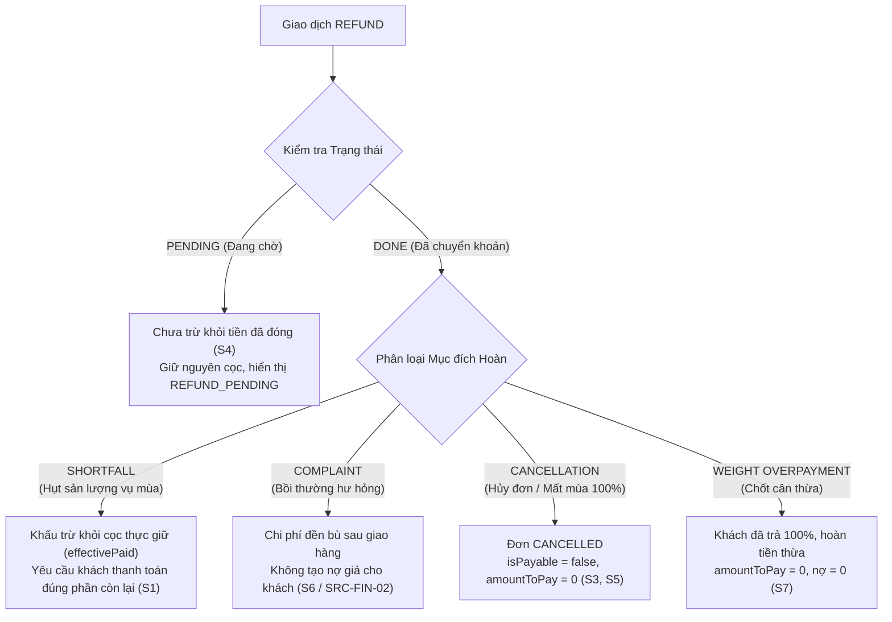

# BÁO CÁO NGHIỆM THU KỸ THUẬT: TARGETED PRE-ORDER SETTLEMENT FIX
## DEV-TASK-20-FIX01 (ISSUE: PH8A-FIN-01 / OBS-01)

**Dự án:** Nông Sản B2B (E-commerce Platform)
**Nhánh Git:** `beta`
**HEAD Commit:** `286df64`
**Trạng thái:** HOÀN THÀNH TẠI LOCAL — CHỜ QA ĐỘC LẬP TÁI KIỂM TRA (ZERO COMMIT)
**Tiêu chí an toàn:** ZERO Neon Remote Mutation (GAP-01) — Không commit, không push, không deploy, không bắt đầu Batch 8B.

---

## 1. NGUYÊN NHÂN GỐC RỄ ĐÃ XÁC MINH (ROOT CAUSE ANALYSIS)

### 1.1. Hiện tượng ghi nhận
- Tại kịch bản đơn hàng đặt trước (Pre-order) thu hoạch thiếu hụt sản lượng:
  - Khách đặt 100kg @ 70.000đ/kg = 7.000.000đ + Phí ship 310.000đ = Tổng 7.310.000đ.
  - Khách đã cọc 30%: `depositAmount` = 2.193.000đ (`PAYMENT DONE`).
  - Vụ mùa chỉ thu hoạch giao 60kg:
    - `shortfallRefund` = 877.200đ (hoàn 40% tiền cọc do giao thiếu 40%).
    - Doanh nghiệp đã chuyển khoản hoàn trả 877.200đ thành công (`REFUND DONE`).
    - Khối lượng thực giao 60kg @ 70k = 4.200.000đ + Phí ship 310.000đ $\implies$ `finalTotal` = 4.510.000đ.
  - **Dòng tiền thực tế:**
    - Khách đóng cọc: 2.193.000đ.
    - Khách thực nhận hoàn: 877.200đ.
    - Doanh nghiệp thực giữ (Net Cash Retained): $2.193.000 - 877.200 = 1.315.800\text{ đ}$.
    - Khách nhận hàng hóa & dịch vụ trị giá: $4.510.000\text{ đ}$.
    - **Nghĩa vụ nợ còn lại đúng (Outstanding Balance):**
      $$4.510.000 - 1.315.800 = 3.194.200\text{ đ}$$
  - **Lỗi thực tế trước khi sửa:**
    - `computePayableAmount()` và `derivePaymentStatus()` tính:
      $$\text{amountToPay} = \text{targetTotal} - \text{grossPaid} = 4.510.000 - 2.193.000 = 2.317.000\text{ đ}$$
    - **Hệ quả tài chính:** Hệ thống chỉ yêu cầu khách thanh toán thêm 2.317.000đ. Doanh nghiệp chỉ thu được tổng ròng $2.193.000 + 2.317.000 - 877.200 = 3.632.800\text{ đ}$ cho đơn hàng 4.510.000đ $\implies$ **Thất thoát đúng 877.200đ** (khoản hoàn cọc bị khấu trừ trùng 2 lần: 1 lần khi hạ `finalTotal`, 1 lần khi coi toàn bộ cọc ban đầu vẫn đang được giữ).

### 1.2. Nguồn gốc lịch sử của lỗi
- Lỗi này **đã tồn tại từ Phase 5 & 6** khi xây dựng logic Pre-order Shortfall Refund (không phải phát sinh mới do Phase 8A).
- Nguyên nhân: Trong Phase 5, để giải quyết vấn đề `SRC-FIN-02` (không cho phép tiền bồi thường khiếu nại sau giao hàng tạo ra nợ giả cho khách), hàm `computePayableAmount` và `derivePaymentStatus` được thiết kế dùng `remaining = Math.max(0, targetTotal - grossPaid)`. Logic này đúng với **Khiếu nại (Complaint Compensation)** vì khách đã trả đủ tiền trước khi khiếu nại, nhưng lại sai với **Hoàn cọc thiếu hụt (Shortfall Refund)** vì khách mới chỉ cọc 30% và tiền cọc đã bị trả lại một phần khi thu hoạch hụt.

---

## 2. DANH MỤC CÁC FILE ĐÃ SỬA ĐỔI VÀ TẠO MỚI

| STT | Đường dẫn file | Thao tác | Mô tả thay đổi |
| :--- | :--- | :--- | :--- |
| 1 | `nong-san-b2b/src/lib/domain/settlement.ts` | Chỉnh sửa | Mở rộng `PaymentTransactionData`, thêm hàm phân loại `isShortfallRefund`, cập nhật `derivePaymentStatus` và `computePayableAmount` tính đúng tiền cọc thực giữ `effectivePaid = grossPaid - totalShortfallRefundDone`. |
| 2 | `nong-san-b2b/src/actions/preorder.ts` | Chỉnh sửa | Bổ sung `reference: 'REFUND_SHORTFALL'` khi tạo giao dịch hoàn cọc do hụt sản lượng trong `adminProcessHarvest`. |
| 3 | `nong-san-b2b/src/app/api/qr/payment/[code]/route.ts` | Chỉnh sửa | Bổ sung `reference: true` và `note: true` vào truy vấn Prisma transactions để API QR nhận diện đúng loại hoàn tiền. |
| 4 | `docs/MASTER_DEFERRED_ISSUES.md` | Chỉnh sửa | Ghi nhận mục `PH8A-FIN-01` (OBS-01) vào Master Backlog, cập nhật tổng số mục lên 31 mục. |
| 5 | `nong-san-b2b/tests/unit/preorder-settlement-fix.test.ts` | **Tạo mới** | Bộ 15 unit tests thực thi logic thật cho 8 kịch bản bắt buộc S1–S8, đạt 100% PASS. |

---

## 3. BẢNG SO SÁNH CÔNG THỨC QUYẾT TOÁN TRƯỚC VÀ SAU KHI SỬA

| Tiêu chí | Trước khi sửa (Old Logic) | Sau khi sửa (Fixed Logic - DEV-TASK-20-FIX01) | Ý nghĩa nghiệp vụ |
| :--- | :--- | :--- | :--- |
| **Tiền khách đã trả được ghi nhận** | `grossPaid = Σ PAYMENT(DONE)` | `effectivePaid = grossPaid - completedShortfallRefund` | Chỉ coi phần cọc **chưa bị hoàn trả** là tiền đang bảo đảm đơn hàng |
| **Tiền hoàn cọc do hụt sản lượng** | Bị bỏ qua khi tính công nợ | `completedShortfallRefund = Σ REFUND(DONE)` (loại SHORTFALL) | Phản ánh chính xác việc doanh nghiệp đã chuyển khoản trả lại tiền cọc thừa |
| **Khoản bồi hoàn khiếu nại (Complaint)** | Không trừ vào công nợ | Tiếp tục **không trừ** vào `effectivePaid` (`isShortfall === false`) | **Bảo toàn tuyệt đối SRC-FIN-02**: Không tạo nợ giả cho khách sau bồi thường |
| **Số tiền còn phải thanh toán (`amountToPay`)** | $\max(0, \text{targetTotal} - \text{grossPaid})$ | $\max(0, \text{targetTotal} - \text{effectivePaid})$ | Khách thanh toán phần còn thiếu thực sự của đơn hàng thu hoạch |
| **Nợ còn lại trên UI (`remainingAmount`)** | $\max(0, \text{targetTotal} - \text{grossPaid})$ | $\max(0, \text{targetTotal} - \text{effectivePaid})$ | Đồng nhất 100% giữa màn hình Admin, Tài khoản khách và Cổng VietQR |
| **Phương trình cân bằng tiền mặt** | Lệch thiếu đúng bằng khoản shortfall refund | **$\text{Net Cash Retained} + \text{amountToPay} = \text{targetTotal}$** | **Cân bằng tuyệt đối 100%** |

---

## 4. PHÂN LOẠI GIAO DỊCH HOÀN TIỀN (REFUND TAXONOMY)

Hệ thống phân định rạch ròi 4 loại hoàn tiền thông qua cấu trúc dữ liệu và logic nhận diện đáng tin cậy:



### Tiêu chí nhận diện kỹ thuật (`isShortfallRefund`):
- `tx.isShortfall === true` (cờ tường minh trong unit test)
- Hoặc `tx.reference === 'REFUND_SHORTFALL'` (mã tham chiếu chuẩn hóa khi tạo giao dịch)
- Hoặc `tx.note` chứa từ khóa `"thiếu hụt"` / `"shortfall"` và **không chứa** từ khóa `"khiếu nại"` (tương thích ngược hoàn toàn với các bản ghi lịch sử)

---

## 5. KẾT QUẢ THỰC THI 8 BÀI TEST BẮT BUỘC (S1 – S8)

Toàn bộ 15 assertions thuộc bộ test [`tests/unit/preorder-settlement-fix.test.ts`](file:///D:/TDTU/TMĐT%20Website/nong-san-b2b/tests/unit/preorder-settlement-fix.test.ts) đều chạy thực thi logic nghiệp vụ thật:

| Mã Test | Kịch bản kiểm thử | Kỳ vọng số học | Kết quả thực thi | Trạng thái |
| :--- | :--- | :--- | :--- | :--- |
| **S1** | Pre-order hụt 40%, hoàn cọc đã hoàn tất | FinalTotal 4.510.000đ; Cọc 2.193.000đ; Hoàn 877.200đ $\implies$ Cần thu: **3.194.200 đ** | `amountToPay: 3194200`, `remainingAmount: 3194200`, sau trả đủ `netPaid: 4510000`, `isSettled: true` | **PASS** |
| **S2** | Pre-order giao đủ 100% | FinalTotal 7.310.000đ; Cọc 2.193.000đ $\implies$ Cần thu: **5.117.000 đ** (không tính trùng phí ship) | `amountToPay: 5117000`, `remainingAmount: 5117000` | **PASS** |
| **S3** | Pre-order hụt 100% (mất mùa) | Đơn CANCELLED, hoàn 100% cọc 2.193.000đ $\implies$ Không phát sinh khoản phải thu | `isPayable: false`, `amountToPay: 0` | **PASS** |
| **S4** | Refund đang PENDING | Cọc 2.193.000đ; Hoàn 877.200đ PENDING $\implies$ Chưa coi là tiền đã trả lại khách | `hasPendingRefund: true`, `status: 'REFUND_PENDING'`, `refundedAmount: 0` | **PASS** |
| **S5** | Khách CANCEL do giá ngoài biên độ | Cọc 2.193.000đ, đã hoàn shortfall 877.200đ $\implies$ Hoàn cọc còn lại: **1.315.800 đ** (không phạt cọc, không hoàn trùng) | `remainingRefund: 1315800`, tổng 2 lần hoàn đúng 2.193.000đ | **PASS** |
| **S6** | Khiếu nại sau giao hàng (Complaint) | Đơn 14.950.125đ đã trả đủ; bồi hoàn khiếu nại 278.996đ $\implies$ Không phát sinh nợ giả | `amountToPay: 0`, `remainingAmount: 0`, `isSettled: true`, `canTransition(COMPLETED): ok` | **PASS** |
| **S7** | Đơn thường FULL và DEPOSIT_30 | Đơn DEPOSIT_30 yêu cầu 70% còn lại khi PROCESSING; Đơn FULL hủy ở PROCESSING phạt cọc 30%, hoàn 70% | `amountToPay: 7000000`, `forfeit: 3000000`, `refund: 7000000` | **PASS** |
| **S8** | Backward Compatibility đơn cũ | Đơn Pre-order cũ `shippingFee = 0`, FinalTotal 4.200.000đ, cọc 2.100.000đ, hoàn 840.000đ $\implies$ Cần thu: **2.940.000 đ** | `amountToPay: 2940000`, `netPaid: 1260000` | **PASS** |

---

## 6. KẾT QUẢ QUALITY GATES TOÀN HỆ THỐNG

1. **`npm test` (Vitest):**
   - **29/29 test files PASS (100%)**
   - **362/362 unit tests PASS (100%)** (tăng 15 tests từ 347 tests của Phase 8A baseline).
   - Thời gian thực thi: 2.86s.
2. **`npm run lint`:**
   - **PASS (0 errors, 1 pre-existing warning trong `scripts/local-db.ts`)**.
3. **`npm run typecheck` (`tsc --noEmit`):**
   - **PASS (0 errors)**.
4. **`npm run build` (`next build` Turbopack):**
   - **PASS (36 routes biên dịch production thành công)**.
5. **`git diff --check`:**
   - **PASS (0 lỗi whitespace hoặc conflict markers)**.

---

## 7. ĐÁNH GIÁ TÁC ĐỘNG HỆ THỐNG

### 7.1. Tác động đến đơn hàng lịch sử (Historical Orders)
- Không làm thay đổi bất kỳ bản ghi database nào đã lưu trước đó.
- Đối với các đơn đặt trước cũ trong database đã từng chốt vụ và hoàn cọc thiếu hụt, hàm `isShortfallRefund` tự động nhận diện thông qua trường `note` (`"Hoàn tiền cọc do sản lượng thu hoạch thiếu hụt..."`), giúp hiển thị chính xác số tiền còn lại nếu đơn đó tiếp tục được thanh toán hoặc xem chi tiết.
- Các đơn hàng thường, đơn đã hoàn tất (`COMPLETED`) hoặc đã hủy (`CANCELLED`) hoàn toàn không bị ảnh hưởng.

### 7.2. Tác động đến Pre-order, Recurring, Khiếu nại (COMPLAINT)
- **Pre-order:** Được vá lỗi triệt để. Khách hàng quét mã VietQR hoặc thanh toán tại trang thanh toán sẽ trả đúng số tiền còn lại sau khi trừ tiền cọc thực giữ.
- **Recurring Orders:** Không bị ảnh hưởng, giữ nguyên công thức tính phí ship và tiền cọc theo chu kỳ.
- **Khiếu nại (COMPLAINT):** Bảo toàn 100% logic `SRC-FIN-02`. Tiền bồi thường hư hỏng nông sản sau giao hàng không bao giờ bị tính ngược thành nợ của khách hàng.

---

## 8. RỦI RO CÒN LẠI VÀ LƯU Ý CHO VẬN HÀNH

1. **Thứ tự xác nhận giao dịch của Admin:**
   Khi chốt vụ mùa thiếu hụt, hệ thống tạo lệnh hoàn tiền ở trạng thái `PENDING`. Admin cần chuyển khoản ngân hàng hoàn cọc cho khách và bấm "Xác nhận hoàn tiền" (`confirmRefundDone` $\to$ `DONE`). Khi lệnh hoàn chuyển sang `DONE`, cổng thanh toán VietQR sẽ tự động cập nhật số tiền khách cần trả tiếp là 3.194.200đ.
2. **Database Cloud Isolation (GAP-01):**
   Toàn bộ thay đổi mã nguồn nằm ở tầng ứng dụng và domain logic thuần túy, không thay đổi cấu trúc bảng, không thực hiện bất kỳ lệnh `prisma db push` hay migration nào lên Cloud Neon.

---

## 9. DANH SÁCH FILE THAY ĐỔI VÀ GIT STATUS

### Git Status (`git status`):
```text
On branch beta
Your branch is up to date with 'origin/beta'.

Changes not staged for commit:
	modified:   docs/MASTER_DEFERRED_ISSUES.md
	modified:   nong-san-b2b/.env.example
	modified:   nong-san-b2b/prisma/schema.prisma
	modified:   nong-san-b2b/src/actions/order.ts
	modified:   nong-san-b2b/src/actions/preorder.ts
	modified:   nong-san-b2b/src/actions/recurring.ts
	modified:   nong-san-b2b/src/app/api/qr/payment/[code]/route.ts
	modified:   nong-san-b2b/src/app/thanh-toan/checkout-view.tsx
	modified:   nong-san-b2b/src/app/thanh-toan/page.tsx
	modified:   nong-san-b2b/src/lib/domain/settlement.ts
	modified:   nong-san-b2b/src/lib/domain/shipping/index.ts
	modified:   nong-san-b2b/src/lib/services/recurring-generator.ts
	modified:   nong-san-b2b/tests/unit/recurring.test.ts

Untracked files:
	docs/PHASE_8A_FINANCIAL_FIX_REPORT.md
	docs/PHASE_8A_IMPLEMENTATION_REPORT.md
	nong-san-b2b/prisma/migrations/20261019193200_phase8_shipping_engine/
	nong-san-b2b/tests/unit/preorder-settlement-fix.test.ts
	nong-san-b2b/tests/unit/shipping.test.ts
```

---

## 10. KẾT LUẬN & DỪNG BƯỚC (SAFETY STOP)

- **DEV-TASK-20-FIX01 ĐÃ HOÀN THÀNH THÀNH CÔNG.** Lỗi tính thiếu tiền quyết toán `OBS-01` (`PH8A-FIN-01`) đã được xử lý triệt để, vượt qua toàn bộ 8 kịch bản S1–S8 và quality gates.
- **TUYỆT ĐỐI TUÂN THỦ CHỈ THỊ AN TOÀN:**
  - Không thực hiện `git commit`.
  - Không push lên GitHub.
  - Không deploy lên Vercel.
  - Không merge sang `main`.
  - Không tự ý bắt đầu Batch 8B.
- **TẠM DỪNG ĐỂ BÀN GIAO CHO QA ĐỘC LẬP TÁI KIỂM ĐỊNH LỖI OBS-01.**
