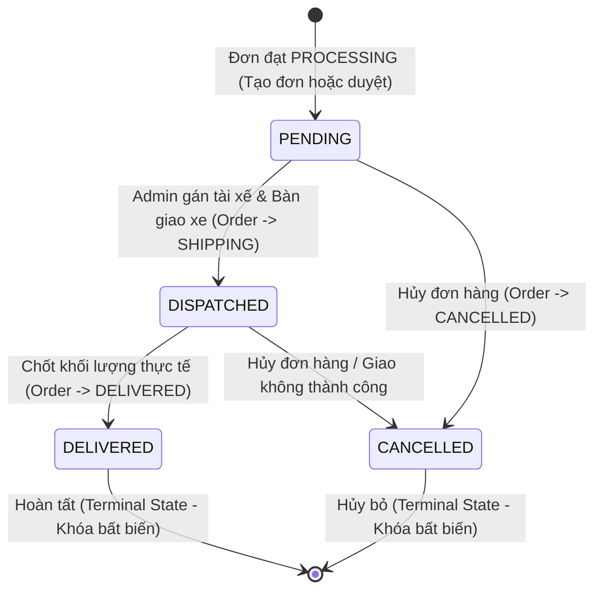

# BÁO CÁO KIỂM TRA THIẾT KẾ & ĐỐI CHIẾU SCHEMA PHASE 8B
## DEV-TASK-22: PHASE 8B KICKOFF & SCHEMA ALIGNMENT AUDIT

**Dự án:** Website Thương mại Điện tử B2B Nông Sản – Trái cây
**Nhánh Git:** `beta`
**HEAD Commit:** `e96986b` (`feat(shipping): complete phase 8A shipping engine and preorder settlement fix`)
**Tính chất nhiệm vụ:** AUDIT & DESIGN ONLY — Tuyệt đối không sửa code, không commit, không push/deploy, không chạm database Neon.

---

## 1. PREFLIGHT KIỂM TRA NHÁNH VÀ MÔI TRƯỜNG

- **Nhánh hiện tại:** `beta`
- **HEAD commit:** `e96986badfcca234231fbed62accc4c79120a2fd` (`e96986b`)
- **Working Tree:** `clean` (0 uncommitted changes, không có file untracked lạ).
- **Trạng thái đồng bộ:** Nhánh local `beta` đang dẫn trước `origin/beta` đúng 1 commit (`e96986b`). Xác nhận toàn bộ mã nguồn Phase 8A và Financial Fix **chưa từng được push** lên remote repository và **chưa từng được deploy** lên Vercel Beta.
- **Ràng buộc an toàn:** `GAP-01` (Neon Database Isolation) vẫn ở trạng thái **`TEST GAP / NOT VERIFIED`**. Tuyệt đối không chạy migration, seed, db push hoặc truy cập database Neon.

---

## 2. ĐỐI CHIẾU SCHEMA THỰC TẾ SAU PHASE 8A

Đối chiếu trực tiếp mã nguồn `nong-san-b2b/prisma/schema.prisma` và file migration offline `20261019193200_phase8_shipping_engine/migration.sql` được tạo ở Phase 8A:

| Thực thể / Trường | Trạng thái thực tế trong Schema | Chi tiết kỹ thuật đã có | Phân định phạm vi |
|---|---|---|---|
| **Model `ShippingRate`** | **ĐÃ TỒN TẠI** | `id`, `vehicleType`, `minGrams`, `baseFee`, `perKm`, `isActive`, `createdAt`, `updatedAt`. Khóa duy nhất: `@@unique([vehicleType, minGrams])`. | Đã định nghĩa ở 8A. Sẽ triển khai giao diện CRUD và truy vấn ở 8B. |
| **Model `Shipment`** | **ĐÃ TỒN TẠI** | `id`, `orderId` (@unique), `code` (@unique), `vehicleType`, `distanceKm`, `shippingFee`, `driverName`, `driverPhone`, `licensePlate`, `status` (@default(PENDING)), `dispatchedAt`, `deliveredAt`, `note`, `createdAt`, `updatedAt`. | Đã định nghĩa ở 8A. Sẽ triển khai tạo chuyến và quản trị điều phối ở 8B. |
| **Model `AppSetting`** | **ĐÃ TỒN TẠI** | `id`, `key` (@unique), `value`, `description`, `updatedAt`. | Đã định nghĩa ở 8A. Sẽ dùng lưu tọa độ kho và bán kính tối đa ở 8B. |
| **Model `Driver`** | **KHÔNG TỒN TẠI** | Không có bảng `Driver` riêng biệt. | Thông tin tài xế được nhúng trực tiếp dạng flat fields trên bảng `Shipment`. |
| **Enum `VehicleType`** | **ĐÃ TỒN TẠI** | Chỉ có 2 giá trị: `NORMAL`, `COLD`. | Không có các giá trị loại xe tải trọng như `MOTORBIKE`, `TRUCK`. |
| **Enum `ShipmentStatus`** | **ĐÃ TỒN TẠI** | Chỉ có 4 giá trị: `PENDING`, `DISPATCHED`, `DELIVERED`, `CANCELLED`. | Không có `ASSIGNED`, `PICKING_UP`, `IN_TRANSIT`, `FAILED`. |
| **Quan hệ `Order` ↔ `Shipment`** | **ĐÃ TỒN TẠI** | 1 - 1 (`Order` có `shipment Shipment?`, `Shipment` có `orderId @unique`, `onDelete: Cascade`). | Chuẩn xác cho mô hình mỗi đơn hàng xuất 1 chuyến giao. |
| **Trường phí trên `Order`** | **ĐÃ TỒN TẠI** | `shippingFee` (Int @default(0)), `shippingDistanceKm` (Float?), `shippingVehicleType` (VehicleType?). | Đã snapshot đầy đủ khi checkout ở Phase 8A. |

---

## 3. CÁC ĐIỂM KHÁC BIỆT GIỮA BÁO CÁO DEV VÀ MÃ NGUỒN THỰC TẾ

Qua rà soát kỹ lưỡng giữa các đoạn mô tả sơ bộ trong báo cáo kết thúc DEV-TASK-20/21 và mã nguồn Prisma thực tế, phát hiện **3 điểm khác biệt quan trọng cần đính chính ngay**:

1. **Về Model `Driver`:**
   - *Báo cáo DEV trước đây từng ghi:* "Quản lý Đội xe & Tài xế (`Driver` CRUD)".
   - *Mã nguồn thực tế:* **Không hề có bảng `Driver`**. Cả schema và migration đều thiết kế thông tin tài xế dạng cột phẳng trên `Shipment` (`driverName`, `driverPhone`, `licensePlate`).
   - *Kết luận:* Thiết kế thực tế bám sát tài liệu gốc `docs/KE_HOACH_TRIEN_KHAI.md` (dòng 644): `Shipment(orderId @unique, vehicleType, distanceKm, fee, driverName, driverPhone, plateNumber...)`. Việc không tách bảng `Driver` giúp kiến trúc gọn nhẹ, linh hoạt cho phép Admin nhập tài xế nội bộ hoặc tài xế thuê ngoài theo từng chuyến mà không phải quản lý quan hệ bảng phức tạp.

2. **Về Phân loại xe (`VehicleType`):**
   - *Báo cáo DEV trước đây từng ghi:* "Phương tiện `MOTORBIKE`, `VAN_500KG`, `TRUCK_1000KG`, `TRUCK_2000KG`".
   - *Mã nguồn thực tế:* `enum VehicleType { NORMAL, COLD }`.
   - *Kết luận:* Thực tế hệ thống B2B nông sản chỉ có 2 điều kiện bảo quản vận chuyển: **Xe thường (`NORMAL`)** và **Xe lạnh (`COLD`)**. Tải trọng xe đã được giải quyết bằng cột `minGrams` trong bảng `ShippingRate` (ví dụ `minGrams = 0` là xe nhỏ, `minGrams = 500000` là xe tải trên nửa tấn). Giữ nguyên enum hiện tại là hoàn toàn chính xác.

3. **Về Trạng thái chuyến giao (`ShipmentStatus`):**
   - *Báo cáo DEV trước đây từng ghi:* "PENDING → ASSIGNED → PICKING_UP → IN_TRANSIT → DELIVERED / FAILED".
   - *Mã nguồn thực tế:* `enum ShipmentStatus { PENDING, DISPATCHED, DELIVERED, CANCELLED }`.
   - *Kết luận:* 4 trạng thái thực tế khớp 1-1 với các mốc vòng đời đơn hàng B2B của đồ án (`PROCESSING` → `SHIPPING` → `DELIVERED`). Không cần thêm 6 trạng thái trung gian của các ứng dụng gọi xe công nghệ.

---

## 4. PHÂN ĐỊNH LOẠI XE VÀ DỊCH VỤ VẬN CHUYỂN

### 4.1. Nguyên tắc cốt lõi: Bảo vệ chính sách cước Phase 8A
Trong Phase 8A, công thức tính cước đã được nghiệm thu và khóa chặt bằng 23 bài test:
$$\text{fee} = \lceil (\text{baseFee} + \lceil \text{distanceKm} \rceil \times \text{perKm}) / 1000 \rceil \times 1000$$

- **Dịch vụ bảo quản (Service Condition):**
  - Giỏ hàng có $\ge 1$ sản phẩm yêu cầu lạnh (`requiresCold = true`) $\implies$ Bắt buộc `vehicleType = COLD`.
  - Khách hàng có thể chủ động nâng cấp từ `NORMAL` lên `COLD` để bảo quản tốt hơn.
  - Khách không thể hạ từ `COLD` xuống `NORMAL` nếu trong giỏ có hàng yêu cầu lạnh.
- **Tải trọng phương tiện (Capacity Tier):**
  - Tải trọng được phân bậc tự động qua trường `minGrams` của `ShippingRate`:
    - Bậc 1: Dưới 500kg (`minGrams = 0`) — phù hợp xe máy / xe van nhỏ.
    - Bậc 2: Từ 500kg trở lên (`minGrams = 500000`) — phù hợp xe tải 1–2 tấn.
- **Phương tiện và Tài xế thực tế:**
  - Khi Admin điều phối chuyến giao (`transitionToShipping`), Admin nhập biển số xe (`licensePlate`, ví dụ: `51D-123.45`), họ tên tài xế (`driverName`) và số điện thoại (`driverPhone`).
  - Ghi chú xe cụ thể có thể ghi vào trường `Shipment.note` (ví dụ: *"Xe tải lạnh Isuzu 1.5 tấn - Giữ nhiệt 4°C"*).
- **Kết luận:** Giữ nguyên `VehicleType { NORMAL, COLD }`. Tuyệt đối không thêm dịch vụ "Hỏa tốc" hay các enum xe rời rạc làm phá vỡ logic tính cước đã nghiệm thu ở 8A.

---

## 5. ĐỐI CHIẾU TRẠNG THÁI SHIPMENT & ĐỀ XUẤT STATE MACHINE

### 5.1. So sánh nhu cầu nghiệp vụ với Enum thực tế

| Nghiệp vụ B2B Đồ án | Enum `ShipmentStatus` thực tế | Trạng thái `Order` tương ứng | Hành vi hệ thống |
|---|---|---|---|
| **Chờ điều phối** | `PENDING` | `PROCESSING` | Đơn đã thanh toán cọc/full, Admin đang gom hàng và đóng gói tại kho. Chuyến giao được tạo ở trạng thái chờ gán xe. |
| **Đã xuất kho / Đang giao** | `DISPATCHED` | `SHIPPING` | Admin bàn giao hàng cho tài xế, nhập thông tin xe/tài xế, gán lô thu hoạch. Cập nhật `dispatchedAt = now()`. |
| **Đã giao hàng & Đồng kiểm** | `DELIVERED` | `DELIVERED` | Tài xế giao đến nơi, hai bên cân lại khối lượng thực (`actualGrams`), chuyển đơn sang DELIVERED. Cập nhật `deliveredAt = now()`. |
| **Hủy chuyến giao** | `CANCELLED` | `CANCELLED` | Đơn hàng bị hủy khi chưa giao thành công. |

### 5.2. Biểu đồ State Machine tối giản & chặt chẽ



### 5.3. Ràng buộc phòng chống lỗi nghiệp vụ
1. **Chống cập nhật trạng thái ngược (No Reverse Transitions):**
   - Đã ở `DELIVERED` hoặc `CANCELLED` thì **không thể** quay ngược lại `DISPATCHED` hay `PENDING`.
2. **Chống giao hàng hai lần (No Double Dispatch / Double Delivery):**
   - Quan hệ `orderId` là `@unique`. Khi chuyển sang `SHIPPING`, Server Action dùng `upsert` hoặc kiểm tra sự tồn tại của `Shipment` để ngăn tạo trùng lặp.
   - Nếu `Shipment.status === 'DELIVERED'`, từ chối mọi yêu cầu giao lại.
3. **Phân định rõ khi nào cập nhật Order vs khi nào chỉ cập nhật Shipment:**
   - Cập nhật cả 2: Khi Admin bấm **"Bàn giao vận chuyển"** (`Order: PROCESSING -> SHIPPING`, `Shipment: PENDING -> DISPATCHED`) và khi **"Chốt khối lượng thực tế"** (`Order: SHIPPING -> DELIVERED`, `Shipment: DISPATCHED -> DELIVERED`).
   - Chỉ cập nhật Shipment: Khi Admin chỉnh sửa thông tin tài xế/biển số xe hoặc ghi chú chuyến giao khi đơn đang trên đường giao (`SHIPPING`).

---

## 6. PHƯƠNG ÁN CRUD SHIPPINGRATE VÀ APPSETTING

### 6.1. Vấn đề phát hiện trong Phase 8A
Hiện tại trong `src/lib/domain/shipping/index.ts`, các hàm tính toán sử dụng `DEFAULT_SHIPPING_RATES` và `DEFAULT_WAREHOUSE` dạng const nội bộ:
```ts
const rates = options?.rates || DEFAULT_SHIPPING_RATES
const warehouse = options?.warehouse || DEFAULT_WAREHOUSE
```
Trong khi đó, bảng `ShippingRate` và `AppSetting` trong database chưa có mã nguồn nào thực hiện truy vấn `findMany()` để truyền vào options. Nếu chỉ làm trang CRUD mà không kết nối, việc Admin thay đổi giá cước sẽ bị hệ thống bỏ qua.

### 6.2. Giải pháp kiến trúc cho Batch 8B

1. **Tạo service nạp cấu hình vận chuyển động (`src/lib/services/shipping-config.ts`):**
   - Hàm `getEffectiveShippingRates()`:
     ```ts
     const dbRates = await db.shippingRate.findMany({
       where: { isActive: true },
       orderBy: [{ vehicleType: 'asc' }, { minGrams: 'asc' }],
     })
     return dbRates.length > 0 ? dbRates : DEFAULT_SHIPPING_RATES
     ```
   - Hàm `getWarehouseConfig()`:
     Đọc các key `warehouseLat`, `warehouseLng`, `warehouseAddress`, `maxRadiusKm` từ `db.appSetting`. Nếu chưa có, trả về `DEFAULT_WAREHOUSE`.
2. **Tự động khởi tạo dữ liệu mẫu nếu bảng rỗng (Lazy Seed):**
   - Khi Admin lần đầu truy cập `/admin/van-chuyen`, nếu bảng `ShippingRate` rỗng, hệ thống hiển thị nút hoặc tự động khởi tạo 4 bản ghi mặc định để Admin dễ dàng chỉnh sửa.
3. **Bảo toàn tính bất biến của đơn hàng lịch sử:**
   - Khi Admin sửa bảng giá `ShippingRate`:
     - **Chỉ áp dụng:** Cho các lượt tính giá báo cước mới tại giỏ hàng / checkout sau thời điểm cập nhật.
     - **Tuyệt đối không:** Chạy lệnh cập nhật vào bảng `Order` hoặc `Shipment` cũ.
     - Phí ship của đơn cũ (`Order.shippingFee`), khoảng cách (`shippingDistanceKm`), số tiền cọc đã thu (`depositAmount`) và tổng tiền (`total`) đều đã được snapshot bất biến từ lúc đặt hàng.

---

## 7. MẪU PHIẾU ĐÓNG GÓI & GIAO HÀNG ĐỒNG KIỂM (PACKING SLIP)

Đồ án B2B nông sản có điểm đặc thù là hàng nông sản tươi sống bị hao hụt tự nhiên khi vận chuyển và bắt buộc phải **đồng kiểm, cân lại khối lượng thực tế tại điểm giao**.

Mẫu in được thiết kế phục vụ in trực tiếp qua trình duyệt (`window.print()`, CSS `@media print`):
- **Phần đầu phiếu:**
  - Tên doanh nghiệp: HỆ THỐNG PHÂN PHỐI NÔNG SẢN B2B
  - Tiêu đề: **PHIẾU XUẤT KHO VẬN CHUYỂN & BIÊN BẢN ĐỒNG KIỂM**
  - Mã đơn hàng: `ORD-XXXXXX` | Mã vận đơn: `SHIP-XXXXXX`
  - Mã QR: Dẫn link tra cứu hành trình hoặc truy xuất nguồn gốc đơn hàng
- **Phần thông tin giao nhận:**
  - Khách hàng / Doanh nghiệp nhận, Mã số thuế, Người liên hệ, Số điện thoại, Địa chỉ nhận hàng
  - Tài xế phụ trách, Số điện thoại tài xế, Biển số xe, Loại phương tiện (`Xe thường` / `Xe lạnh chuyên dụng`)
  - Khoảng cách vận chuyển, Thời gian xuất bến (`dispatchedAt`)
- **Bảng chi tiết hàng hóa đồng kiểm:**
  - Cột 1: STT
  - Cột 2: Tên nông sản & Quy cách đóng gói
  - Cột 3: Mã lô thu hoạch (Batch Code)
  - Cột 4: Khối lượng đặt (kg)
  - Cột 5: **Khối lượng cân thực tế (kg)** *(Để trống cho tài xế và khách ghi tay khi cân)*
  - Cột 6: **Tỷ lệ hao hụt / Đạt chuẩn** *(Ghi chú tình trạng dập nát, độ tươi)*
- **Phần xác nhận hai bên:**
  - Đại diện bên nhận hàng (Ký & ghi rõ họ tên)
  - Tài xế giao hàng (Ký & ghi rõ họ tên)
  - Điều khoản đồng kiểm: *"Bên nhận đã đồng kiểm đủ số lượng, cân khối lượng thực tế và kiểm tra chất lượng quy cách bao bì trước khi ký nhận."*

---

## 8. PHẠM VI TRIỂN KHAI PROPOSED CHO BATCH 8B

### Phân hệ 1: Quản trị Vận chuyển (`/admin/van-chuyen`)
Xây dựng giao diện trung tâm với 3 tabs chuyên biệt:
- **Tab 1 — Danh sách chuyến giao (`Shipments`):**
  - Lọc theo ngày giao (`deliveryDate`), khung giờ (`TimeSlot`), trạng thái chuyến giao (`PENDING`, `DISPATCHED`, `DELIVERED`, `CANCELLED`).
  - Xem nhanh thông tin: Mã đơn, Khách hàng, Địa chỉ, Loại xe, Km, Phí ship, Tài xế, Biển số xe.
  - Nút xem chi tiết & in phiếu đóng gói đồng kiểm (Packing Slip).
  - Nút cập nhật thông tin tài xế/biển số trực tiếp trên danh sách hoặc qua modal.
- **Tab 2 — Quản lý bảng cước (`ShippingRate` CRUD):**
  - Bảng danh sách các mức cước phân theo loại xe (`NORMAL`, `COLD`) và mức gram tối thiểu (`minGrams`).
  - Modal thêm mới / chỉnh sửa cước: `baseFee`, `perKm`, công tắc kích hoạt `isActive`.
  - Validate chặt chẽ: số nguyên không âm, không trùng cặp `(vehicleType, minGrams)`.
- **Tab 3 — Cấu hình Tổng kho & Bán kính (`AppSetting`):**
  - Hiển thị và chỉnh sửa: Tên kho, Địa chỉ kho, Tọa độ GPS (`lat`, `lng`), Bán kính phục vụ tối đa (`maxRadiusKm`).

### Phân hệ 2: Tích hợp Luồng Đơn hàng Admin (`/admin/don-hang/[code]`)
- Nâng cấp Modal **"Bàn giao cho vận chuyển"**:
  - Không chỉ gán lô hàng (`Batch`) như hiện tại, mà bổ sung các trường:
    - Họ tên tài xế (`driverName` — bắt buộc)
    - Số điện thoại tài xế (`driverPhone` — bắt buộc, validate định dạng SĐT Việt Nam)
    - Biển số xe giao hàng (`licensePlate` — bắt buộc)
    - Ghi chú chuyến giao (`note` — tùy chọn)
  - Khi xác nhận: Tự động tạo/cập nhật `Shipment` với mã duy nhất `SHIP-{orderCode}`, set `status = DISPATCHED`, chuyển `Order.status = SHIPPING`.
- Bổ sung Card **"Thông tin Chuyến giao hàng (Shipment)"** trên trang chi tiết đơn hàng:
  - Hiển thị đầy đủ thông tin tài xế, xe, km, mã vận đơn.
  - Nút in phiếu giao hàng đồng kiểm trực tiếp từ chi tiết đơn.

### Phân hệ 3: Trải nghiệm Khách hàng Storefront (`/tai-khoan/don-hang/[code]`)
- Khi đơn hàng ở trạng thái `SHIPPING`:
  - Hiển thị Card thông tin vận chuyển nổi bật: *"Đơn hàng đang được giao bởi tài xế {driverName} - SĐT: {driverPhone} - Biển số xe: {licensePlate}"*.
  - Khách hàng có thể bấm gọi trực tiếp tài xế trên di động (`tel:{driverPhone}`).

### Phân hệ 4: Phân quyền & Bảo mật (RBAC & Server Validation)
- Mọi Server Action trong `shipping-admin.ts` đều bọc `requireAdmin()`.
- Non-admin gọi API/Action bị từ chối fail-closed ngay lập tức.
- Validate đầu vào Zod cho mọi thao tác CRUD và điều phối.

---

## 9. DANH SÁCH FILE CẦN TẠO VÀ SỬA ĐỔI

```
D:\TDTU\TMĐT Website\
├── docs/
│   └── PHASE_8B_KICKOFF_AUDIT.md                                    [NEW - Đã tạo]
└── nong-san-b2b/
    ├── src/
    │   ├── actions/
    │   │   ├── shipping-admin.ts                                    [NEW] Server Actions quản trị vận chuyển
    │   │   ├── order-lifecycle.ts                                   [MODIFY] Nâng cấp transitionToShipping tạo Shipment
    │   │   └── order.ts                                             [MODIFY] Đọc rates động từ DB thay vì hardcode
    │   ├── lib/
    │   │   └── services/
    │   │       └── shipping-config.ts                               [NEW] Helper đọc cước & kho từ DB kèm fallback
    │   ├── app/
    │   │   ├── admin/
    │   │   │   ├── van-chuyen/
    │   │   │   │   ├── page.tsx                                     [MODIFY] Thay placeholder bằng Server Component nạp dữ liệu
    │   │   │   │   └── shipping-management-client.tsx               [NEW] Client component quản trị 3 tabs
    │   │   │   └── don-hang/[code]/
    │   │   │       ├── page.tsx                                     [MODIFY] Query kèm shipment: true
    │   │   │       └── order-detail-client.tsx                      [MODIFY] Modal nhập tài xế & Card hiển thị Shipment
    │   │   └── tai-khoan/don-hang/[code]/
    │   │       ├── page.tsx                                         [MODIFY] Query kèm shipment: true
    │   │       └── customer-order-view.tsx                          [MODIFY] Hiển thị thông tin tài xế khi SHIPPING
    │   └── components/
    │       └── admin/
    │           └── packing-slip-modal.tsx                           [NEW] Mẫu in phiếu đóng gói đồng kiểm
    └── tests/
        └── unit/
            └── shipping-admin.test.ts                               [NEW] Unit tests CRUD cước, điều phối, RBAC
```

---

## 10. ĐÁNH GIÁ MIGRATION VÀ TƯƠNG THÍCH NGƯỢC

### 10.1. Có cần tạo Migration mới không?
- **KẾT LUẬN: KHÔNG CẦN TẠO MIGRATION MỚI.**
- **Căn cứ kỹ thuật:**
  - Tất cả các bảng `ShippingRate`, `Shipment`, `AppSetting` và các trường trên `Order` đã được khai báo hoàn chỉnh trong file migration `20261019193200_phase8_shipping_engine/migration.sql`.
  - Prisma client hiện tại đã nhận diện đầy đủ các model này (`npx prisma validate` và `generate` đều PASS).
  - Không tạo thêm migration giúp bảo đảm an toàn dữ liệu, không làm phát sinh rủi ro lệch cấu trúc với môi trường Neon DB (`GAP-01`).

### 10.2. Rủi ro tương thích ngược (Backward Compatibility) & Cách phòng ngừa
1. **Đơn hàng cũ lịch sử (Phase 1–7):**
   - Các đơn hàng cũ không có bản ghi `Shipment` liên kết (`order.shipment === null`).
   - *Phòng ngừa:* Toàn bộ code hiển thị UI và Server Actions đều sử dụng optional chaining (`order.shipment?.driverName ?? 'Chưa phân công'`), tuyệt đối không được throw null pointer exception.
2. **Khởi tạo khi chưa có cấu hình cước trong DB:**
   - Khi chạy lần đầu hoặc trên DB trắng, bảng `ShippingRate` chưa có dòng nào.
   - *Phòng ngừa:* Domain calculator `calculateShippingQuote` luôn giữ cơ chế fallback về `DEFAULT_SHIPPING_RATES` và `DEFAULT_WAREHOUSE`, bảo đảm luồng checkout của khách hàng không bao giờ bị đứt gãy.
3. **Bảo toàn kết quả kiểm thử Phase 8A:**
   - 23 test cases trong `shipping.test.ts` và 15 test cases trong `preorder-settlement-fix.test.ts` đều dựa trên domain calculator thuần.
   - Việc bổ sung tầng service DB ở Batch 8B không làm thay đổi các hàm thuần trong `src/lib/domain/shipping/index.ts`, bảo đảm 362/362 unit tests tiếp tục PASS.

---

## 11. DANH SÁCH BỘ KIỂM THỬ BẮT BUỘC (MANDATORY TEST MATRIX)

Khi triển khai Batch 8B, bộ kiểm thử mới [`tests/unit/shipping-admin.test.ts`](file:///D:/TDTU/TM%C4%90T%20Website/nong-san-b2b/tests/unit/shipping-admin.test.ts) bắt buộc bao gồm tối thiểu 15–20 test cases bao phủ các nhóm nghiệp vụ sau:

1. **Shipment Dispatch & Lifecycle (6 test cases):**
   - Admin chuyển `PROCESSING` $\rightarrow$ `SHIPPING` thành công khi nhập đủ tên tài xế, SĐT, biển số.
   - Bắt buộc nhập đầy đủ thông tin tài xế/biển số (từ chối nếu để trống).
   - Validate số điện thoại tài xế đúng định dạng Việt Nam.
   - Khi chuyển `SHIPPING`, tạo mới `Shipment` với `code = SHIP-{orderCode}`, trạng thái `DISPATCHED` và `dispatchedAt` được ghi nhận.
   - Khi gọi `settleActualWeights`, `Shipment.status` tự động đồng bộ sang `DELIVERED` và ghi nhận `deliveredAt`.
   - Chặn cập nhật trạng thái ngược: Từ chối chuyển đơn đã `DELIVERED` về `DISPATCHED`.
2. **ShippingRate CRUD & Validation (5 test cases):**
   - Admin tạo mới bậc cước hợp lệ thành công.
   - Admin cập nhật `baseFee`, `perKm` hoặc `isActive` thành công.
   - Chặn tạo cước với số âm (`baseFee < 0` hoặc `perKm < 0`).
   - Chặn tạo trùng cặp `(vehicleType, minGrams)`.
   - Kiểm tra việc sửa cước không làm thay đổi `shippingFee` của đơn hàng cũ đã đặt.
3. **AppSetting Warehouse Config (3 test cases):**
   - Admin cập nhật tọa độ kho và bán kính tối đa thành công.
   - Chặn lưu tọa độ không hợp lệ (ngoài phạm vi -90 đến 90, -180 đến 180 hoặc tọa độ Null Island 0,0).
   - Chặn lưu bán kính tối đa $\le 0$.
4. **Security & RBAC (3 test cases):**
   - Khách hàng thường (Role `CUSTOMER`) gọi Server Action quản trị vận chuyển bị từ chối với lỗi `Forbidden` (403).
   - Người dùng chưa đăng nhập (Unauthenticated) gọi Action bị từ chối với `Unauthorized` (401).
   - Mọi thao tác quản trị ghi nhận audit log an toàn.
5. **Quality Gate Baseline:**
   - Toàn bộ 362 test cases hiện hữu tiếp tục PASS 100%. Tổng test suite sau Batch 8B dự kiến đạt $\ge 380$ tests.

---

## 12. BA QUYẾT ĐỊNH CẦN PRODUCT OWNER PHÊ DUYỆT TRƯỚC KHI IMPLEMENT

> [!IMPORTANT]
> Để đảm bảo tiến độ triển khai nhanh, chuẩn xác và không phát sinh nợ kỹ thuật cho đồ án, DEV xin đề xuất 3 quyết định thiết kế:

### Quyết định 1: Cấu trúc thực thể Tài xế
- **Lựa chọn A (Đề xuất):** Giữ nguyên cấu trúc phẳng trên model `Shipment` (`driverName`, `driverPhone`, `licensePlate`).
  - *Ưu điểm:* Khớp 100% với schema và migration Phase 8A đã có; không cần migration mới; Admin linh hoạt gán tài xế nội bộ hoặc xe đối tác cho từng chuyến; tối giản cho đồ án.
  - *Nhược điểm:* Không có bảng danh bạ tài xế lưu sẵn để chọn từ dropdown.
- **Lựa chọn B:** Tạo bảng `Driver` riêng và migration bổ sung.
  - *Ưu điểm:* Có danh sách tài xế cố định để chọn.
  - *Nhược điểm:* Cần migration mới, tăng độ phức tạp, nguy cơ xung đột schema khi chưa verify Neon DB (`GAP-01`).
- **👉 DEV kiến nghị chọn: PHƯƠNG ÁN A.**

### Quyết định 2: Tập trạng thái chuyến giao (`ShipmentStatus`)
- **Lựa chọn A (Đề xuất):** Giữ nguyên 4 trạng thái: `PENDING`, `DISPATCHED`, `DELIVERED`, `CANCELLED`.
  - *Ưu điểm:* Khớp 100% với schema hiện tại; đồng bộ 1-1 với vòng đời `Order`; logic chuyển trạng thái sạch và tin cậy.
  - *Nhược điểm:* Không có các trạng thái chi tiết vi mô như "Đang đến điểm lấy hàng" (`PICKING_UP`).
- **Lựa chọn B:** Mở rộng thêm enum 6–7 trạng thái.
  - *Nhược điểm:* Cần sửa enum trong PostgreSQL (cực kỳ phức tạp trên môi trường serverless), over-engineering cho mô hình B2B giao hàng bằng xe tải.
- **👉 DEV kiến nghị chọn: PHƯƠNG ÁN A.**

### Quyết định 3: Khởi tạo dữ liệu bảng cước
- **Lựa chọn A (Đề xuất):** Tự động nạp 4 bậc cước mặc định từ `DEFAULT_SHIPPING_RATES` vào database khi Admin mở trang `/admin/van-chuyen` nếu bảng đang rỗng (Lazy Init), kết hợp giữ fallback trong code.
  - *Ưu điểm:* Đảm bảo Admin luôn thấy bảng cước để chỉnh sửa ngay lập tức mà không cần chạy lệnh seed thủ công; hệ thống hoạt động ổn định kể cả khi DB trắng.
- **Lựa chọn B:** Yêu cầu chạy script seed riêng bằng lệnh terminal.
  - *Nhược điểm:* Bất tiện khi demo trên các môi trường khác nhau.
- **👉 DEV kiến nghị chọn: PHƯƠNG ÁN A.**

---

## 13. KẾT LUẬN & TRẠNG THÁI DỪNG

Báo cáo kiểm tra và đối chiếu thiết kế đã hoàn thành toàn diện.
- Không có bất kỳ thay đổi mã nguồn nào được thực hiện trong nhiệm vụ này.
- Working tree hoàn toàn sạch tại commit `e96986b`.
- Không có thao tác ghi dữ liệu từ xa hay vi phạm an toàn `GAP-01`.

**HỆ THỐNG ĐÃ DỪNG LẠI AN TOÀN. SẴN SÀNG CHỜ PRODUCT OWNER XEM XÉT VÀ PHÊ DUYỆT BẮT ĐẦU IMPLEMENTATION BATCH 8B.**
