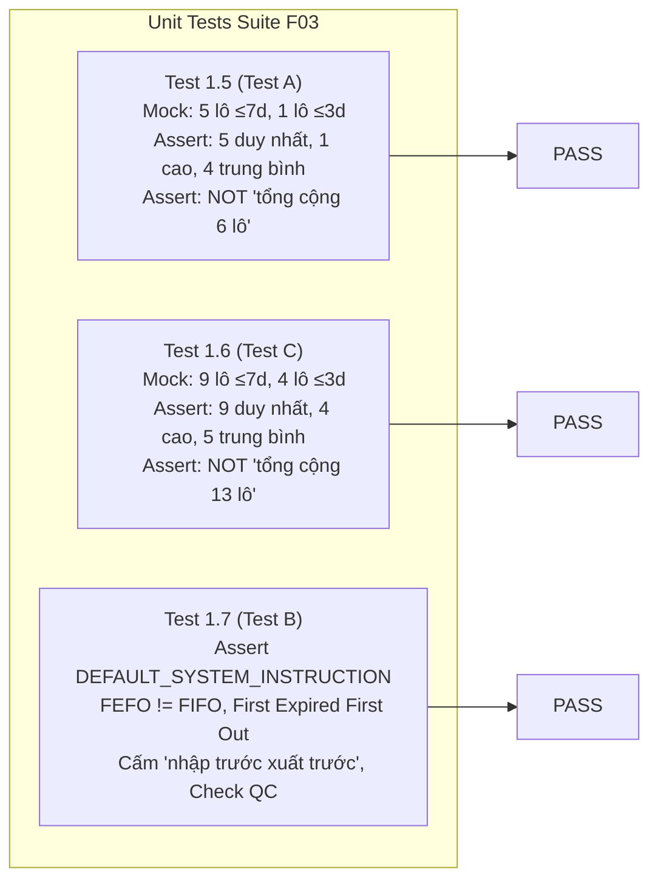

# QA-F03-04 — INDEPENDENT RETEST REPORT: FEFO CONTENT HOTFIX AUDIT

> **THÔNG BÁO VỀ TẬP TIN BÁO CÁO:**  
> **`REPORT FILE NOT CREATED`** (Tuân thủ nghiêm ngặt nguyên tắc **STRICT READ-ONLY** của QA Agent: Không tạo, ghi, sửa file mã nguồn hay tài liệu trong repository).  
> Báo cáo thẩm định độc lập hoàn chỉnh dưới đây được trình bày theo quy chuẩn nghiệm thu dự án để **Release Integrator** lưu trữ vào thư mục [`D:\TDTU\TMĐT Website\docs\QA_F03_04_FEFO_CONTENT_HOTFIX_RETEST.md`](file:///D:/TDTU/TMĐT%20Website/docs) khi tiến hành tích hợp.

---

# BÁO CÁO THẨM ĐỊNH ĐỘC LẬP BẢN HOTFIX NỘI DUNG FEFO & TẬP HỢP CẬN DATE (QA-F03-04)

- **Dự án:** Sàn Thương Mại Điện Tử B2B Nông Sản — E Vibe (`nong-san-b2b`)
- **Feature ID:** `F03 — Gemini Admin Executive Assistant`
- **QA Task ID:** `QA-F03-04`
- **Đối tượng kiểm thử:** Bản Hotfix 03 giải quyết hai lỗi nội dung phát hiện bởi ChatGPT Work (`F03-WORK-02` và `F03-WORK-03`)
- **QA Agent:** Antigravity QA Agent — Senior QA Engineer / Domain Inventory Auditor
- **Thời điểm hoàn thành:** 28/10/2026, 12:15 (Asia/Ho_Chi_Minh)
- **QA Phán quyết (Verdict):** # **`QA PASS — READY FOR BETA HOTFIX 03 INTEGRATION`**

---

## 1. THÔNG TIN PHIÊN BẢN & ĐỐI SOÁT DỮ LIỆU GIT

| Mục đối soát | Giá trị kiểm tra thực tế | Đánh giá |
|---|---|---|
| **Worktree kiểm định** | [`D:\TDTU\wt_f03_gemini`](file:///D:/TDTU/wt_f03_gemini) | Khớp cấu hình phân lập cho nhánh F03 |
| **Nhánh nguồn (Branch)** | `feature/f03-gemini-ai` | Nhánh tính năng hợp lệ |
| **Pre-Hotfix Baseline SHA** | `aaebc00a6085d5c06575db82c6df6b0526f9413a` | Commit chứa timeout hotfix trước đó |
| **Hotfix 03 Implementation SHA** | [`ca7bd68197e2d2d51d0a1855d8fc103f82963935`](file:///D:/TDTU/wt_f03_gemini) | Commit mã nguồn chứa logic sửa đổi |
| **Current Worktree HEAD SHA** | [`2f35027c395cc3e2b2a36c40349b07da423ddd63`](file:///D:/TDTU/wt_f03_gemini) | Commit cập nhật tài liệu báo cáo của DEV |
| **Working Tree Status** | `clean` (Không có uncommitted changes, không có untracked files nguy hiểm) | **PASS** |
| **Trạng thái Remote Tracking** | `origin/feature/f03-gemini-ai` chưa push commit hotfix (đúng quy trình cô lập) | **PASS** |

---

## 2. TỔNG QUAN GIT DIFF GIỮA BASELINE VÀ HOTFIX IMPLEMENTATION

So sánh trực tiếp giữa `aaebc00a6085d5c06575db82c6df6b0526f9413a` và `ca7bd68197e2d2d51d0a1855d8fc103f82963935`:

| Tập tin | Phân loại | Dòng thay đổi | Tóm tắt tác động |
|---|---|---|---|
| [`nong-san-b2b/src/lib/gemini/context.ts`](file:///D:/TDTU/wt_f03_gemini/nong-san-b2b/src/lib/gemini/context.ts#L142-L185) | Source Logic | `+20, -11` | Phân rã nhóm hạn dùng thành 2 tập hợp rời rạc (`urgentExpiringWithin3Days` và `moderateExpiring3To7Days`). Ghi rõ tổng số lô duy nhất và chỉ dẫn tập hợp con lồng nhau. Bổ sung định nghĩa đầy đủ FEFO vào tiêu đề Mục 4. |
| [`nong-san-b2b/src/lib/gemini/client.ts`](file:///D:/TDTU/wt_f03_gemini/nong-san-b2b/src/lib/gemini/client.ts#L180-L215) | System Instruction | `+14, -0` | Export `DEFAULT_SYSTEM_INSTRUCTION`. Bổ sung **Rule 6** (Định nghĩa chuẩn FEFO, cấm giải thích thành "nhập trước xuất trước" FIFO, ràng buộc QC) và **Rule 7** (Quy tắc tập con lồng nhau, cấm cộng dồn $\le 3$ ngày với $\le 7$ ngày). |
| [`nong-san-b2b/tests/unit/admin-ai.test.ts`](file:///D:/TDTU/wt_f03_gemini/nong-san-b2b/tests/unit/admin-ai.test.ts#L205-L321) | Unit Tests | `+105, -5` | Cập nhật Test 1.4; Bổ sung Test 1.5 (Test A - 5 lô duy nhất không cộng thành 6), Test 1.6 (Test C - Dữ liệu động 9 và 4 lô), Test 1.7 (Test B - Kiểm tra định nghĩa FEFO vs FIFO và QC trong System Prompt). |

> **Nhận xét phạm vi:** Thay đổi cực kỳ tập trung, cô đọng, đúng trọng tâm 2 lỗi P2, không lan ra ngoài thư mục F03.

---

## 3. ĐÁNH GIÁ CHI TIẾT SỰ CỐ F03-WORK-02 (P2: ĐẾM TRÙNG SỐ LÔ SẮP HẾT HẠN)

### 3.1. Phân tích nguyên nhân gốc rễ (Root Cause)
- Trước bản sửa đổi, hàm `buildExecutiveContext()` xuất ra hai dòng độc lập:
  - *Lô hàng sắp hết hạn trong 3 ngày tới: 1 lô*
  - *Lô hàng sắp hết hạn trong 7 ngày tới: 5 lô*
- LLM xử lý thông tin dạng văn bản thô theo cấu trúc danh sách liệt kê (flat list), mặc định hiểu đây là 2 tập hợp rời rạc, dẫn đến phép cộng số học tự động $1 + 5 = 6$ lô rủi ro.

### 3.2. Cơ chế khắc phục kỹ thuật (Implementation Analysis)
1. **Phân tách toán học thành 2 tập hợp rời nhau (Disjoint Subsets):**
   - [`context.ts` L147-L152](file:///D:/TDTU/wt_f03_gemini/nong-san-b2b/src/lib/gemini/context.ts#L147-L152):
     ```typescript
     const urgentExpiringWithin3Days = expiringWithin3DaysBatchesCount
     const moderateExpiring3To7Days = Math.max(
       0,
       expiringWithin7DaysBatchesCount - expiringWithin3DaysBatchesCount
     )
     const totalExpiringWithin7Days = expiringWithin7DaysBatchesCount
     ```
   - Logic sử dụng `Math.max(0, ...)` đảm bảo không bao giờ sinh ra số âm ngay cả khi dữ liệu đầu vào KPI bị bất thường ($A > B$).
2. **Cấu trúc phân cấp trực quan và chỉ dẫn tập hợp tường minh:**
   - [`context.ts` L154-L160](file:///D:/TDTU/wt_f03_gemini/nong-san-b2b/src/lib/gemini/context.ts#L154-L160):
     - Dòng tiêu đề chỉ rõ: `QUY TẮC TẬP HỢP: Nhóm ≤3 ngày là tập con lồng trong nhóm ≤7 ngày; KHÔNG ĐƯỢC cộng dồn hai số đếm này để tạo thành tổng mới`.
     - Tổng số lô cận date được định lượng rõ ràng: `${totalExpiringWithin7Days} lô duy nhất`.
     - Cấu trúc thụt đầu dòng (indentation) với 2 nhánh con: *Nhóm khẩn cấp cao (≤ 3 ngày)* và *Nhóm khẩn cấp trung bình (> 3 ngày đến ≤ 7 ngày)*.
3. **Chỉ thị cấm tuyệt đối tại Tầng System Instruction:**
   - [`client.ts` L212-L215](file:///D:/TDTU/wt_f03_gemini/nong-san-b2b/src/lib/gemini/client.ts#L212-L215) (**Rule 7**):
     - Nêu ví dụ phản chứng trực tiếp: *"Ví dụ: Nếu có 5 lô ≤7 ngày và trong đó có 1 lô ≤3 ngày thì tổng số lô cận date chỉ là 5 lô duy nhất... TUYỆT ĐỐI KHÔNG được cộng thành 6 lô"*.
4. **Kiểm tra các trường hợp biên (Edge Cases):**
   - Trường hợp 0 lô cận date: Hiển thị 0 lô duy nhất (0 cao, 0 trung bình) $\rightarrow$ Không lỗi cú pháp.
   - Trường hợp toàn bộ lô $\le 7$ ngày đều $\le 3$ ngày (ví dụ 3 và 3): `moderateExpiring3To7Days` $= \max(0, 3 - 3) = 0$ $\rightarrow$ Hợp lệ.
   - Trường hợp không có danh sách chi tiết `expiringAndExpiredBatches`: Bỏ qua chi tiết danh sách, chỉ hiển thị số liệu KPI $\rightarrow$ Không crash.

---

## 4. ĐÁNH GIÁ CHI TIẾT SỰ CỐ F03-WORK-03 (P2: ĐỊNH NGHĨA FEFO VS FIFO)

### 4.1. Phân tích nguyên nhân gốc rễ (Root Cause)
- LLM bị ảnh hưởng bởi thói quen ngôn ngữ phổ thông trong quản trị kho tại Việt Nam khi nhắc đến nguyên tắc xuất kho ("nhập trước xuất trước" - FIFO), trong khi mô hình TMĐT Nông sản tươi sống bắt buộc áp dụng **FEFO** (First Expired, First Out - Hết hạn trước, Xuất trước). Prompt trước đó chưa có ràng buộc cấm cụ thể cụm từ này.

### 4.2. Cơ chế khắc phục kỹ thuật (Implementation Analysis)
1. **Chuẩn hóa thuật ngữ tại Header Ngữ cảnh:**
   - [`context.ts` L181](file:///D:/TDTU/wt_f03_gemini/nong-san-b2b/src/lib/gemini/context.ts#L181):
     `### 4. TÌNH TRẠNG TỒN KHO & QUẢN TRỊ LÔ HÀNG FEFO (FIRST EXPIRED, FIRST OUT — HẾT HẠN TRƯỚC, XUẤT TRƯỚC)`
2. **Quy định chi tiết và nghiêm ngặt tại System Instruction:**
   - [`client.ts` L205-L211](file:///D:/TDTU/wt_f03_gemini/nong-san-b2b/src/lib/gemini/client.ts#L205-L211) (**Rule 6**):
     - Định nghĩa FEFO: *"First Expired, First Out" (Hết hạn trước, Xuất trước)*.
     - Tiêu chí cốt lõi: Ưu tiên xuất kho lô có hạn sử dụng gần nhất trước, với điều kiện lô hàng đạt tiêu chuẩn chất lượng (QC) và ở trạng thái Active/Sellable.
     - Lệnh cấm tường minh: *"TUYỆT ĐỐI KHÔNG giải thích FEFO là 'nhập trước xuất trước'. Đó là nguyên tắc FIFO ('First In, First Out'). FEFO căn cứ vào HẠN SỬ DỤNG của lô hàng chứ KHÔNG căn cứ vào ngày nhập kho"*.
     - Ràng buộc QC/An toàn thực phẩm: Cấm khẳng định lô được phép bán nếu bị khóa `LOCKED_QC` hoặc chưa kiểm định `UNVERIFIED`.

---

## 5. THẨM ĐỊNH BỘ KIỂM THỬ MỤC TIÊU (TARGETED UNIT TESTS)

Đã rà soát chi tiết 3 test case mới được bổ sung tại [`tests/unit/admin-ai.test.ts`](file:///D:/TDTU/wt_f03_gemini/nong-san-b2b/tests/unit/admin-ai.test.ts#L205-L321):



1. **Test 1.5 (Test A — F03-WORK-02 Static Validation):**
   - Đầu vào: `expiringWithin3DaysBatchesCount: 1`, `expiringWithin7DaysBatchesCount: 5`.
   - Kiểm tra xác nhận: Chứa "5 lô duy nhất", "Nhóm khẩn cấp cao: 1 lô", "Nhóm khẩn cấp trung bình: 4 lô", chỉ dẫn tập con.
   - Kiểm tra phủ định (Negative assertion): `expect(context).not.toContain('tổng cộng 6 lô')` và `expect(context).not.toContain(': 6 lô')`.
   - Kết quả: **PASS**.
2. **Test 1.6 (Test C — Dynamic Data / Generalization):**
   - Thử nghiệm trên tập dữ liệu hoàn toàn khác: `expiringWithin3DaysBatchesCount: 4`, `expiringWithin7DaysBatchesCount: 9`.
   - Kiểm tra xác nhận: Chứa "9 lô duy nhất", "4 lô khẩn cấp cao", "5 lô khẩn cấp trung bình" ($4 + 5 = 9$).
   - Kiểm tra phủ định: `expect(context).not.toContain('tổng cộng 13 lô')` và `expect(context).not.toContain(': 13 lô')`.
   - Kết quả: **PASS**.
3. **Test 1.7 (Test B — F03-WORK-03 Instruction & Header Verification):**
   - Kiểm tra trực tiếp hằng số xuất bản `DEFAULT_SYSTEM_INSTRUCTION`.
   - Xác nhận có đầy đủ: "First Expired, First Out", "Hết hạn trước, Xuất trước", "First In, First Out", lệnh cấm "nhập trước xuất trước", "căn cứ vào HẠN SỬ DỤNG", "LOCKED_QC", "UNVERIFIED".
   - Xác nhận header của `buildExecutiveContext()` chứa đầy đủ cụm `FEFO (FIRST EXPIRED, FIRST OUT — HẾT HẠN TRƯỚC, XUẤT TRƯỚC)`.
   - Kết quả: **PASS**.

---

## 6. ĐÁNH GIÁ AN TOÀN BẢO MẬT & HỒI QUY (REGRESSION & SECURITY AUDIT)

| Tiêu chuẩn an ninh & vận hành | Hiện trạng trên `feature/f03-gemini-ai` | Nhận định QA |
|---|---|---|
| **Bảo mật API Key** | `x-goog-api-key` được truyền qua HTTP Request Header, không rò rỉ trên Query URL | **AN TOÀN** (Hotfix 01 duy trì) |
| **Cấu hình Timeout** | Runtime timeout 35 giây (Client 30s + Buffer 5s) duy trì nguyên vẹn | **AN TOÀN** (Hotfix 02 duy trì) |
| **Phân quyền truy cập** | Hàm `requireAdmin()` bắt buộc `role: 'ADMIN'` trên route `/api/admin/ai/query` | **AN TOÀN** |
| **Zero Hallucination Context** | Logic tính doanh thu (`grossRevenue`), `netRevenue`, `discrepancyCount`, đếm phân phối vận chuyển không bị xáo trộn | **AN TOÀN** |
| **Toàn vẹn cơ sở dữ liệu** | Không có migration Prisma mới, không ghi dữ liệu DB, không thay đổi schema | **AN TOÀN TUYỆT ĐỐI** |
| **Tách biệt nhánh & tính năng** | Không chạm vào mã nguồn F01 (FEFO Core), F02 (Khiếu nại) hay F04 (Membership) | **TUÂN THỦ RANH GIỚI** |

---

## 7. BẢNG THEO DÕI VẤN ĐỀ TỒN ĐỌNG (ISSUE TRACKING MATRIX)

| Mã vấn đề | Phân loại | Mức độ | Trạng thái trước Hotfix 03 | Hiện trạng sau Hotfix 03 (Source QA) | Ghi chú & Điều kiện đóng hoàn toàn |
|---|---|---|---|---|---|
| **F03-WORK-01** | Runtime Timeout | **P1** | REOPENED / BLOCKED | **CLOSED (VERIFIED)** | Đã được xác nhận PASS qua vòng kiểm thử Browser trước đó. |
| **F03-WORK-02** | Expiry Group Count | **P2** | OPEN (ChatGPT Work) | **RESOLVED (IN CODE)** | Logic mã nguồn và System Prompt đã khắc phục triệt để. Cần Browser Retest sau deploy. |
| **F03-WORK-03** | FEFO Definition | **P2** | OPEN (ChatGPT Work) | **RESOLVED (IN CODE)** | Đã định nghĩa chuẩn FEFO và cấm FIFO trong System Prompt. Cần Browser Retest sau deploy. |
| **OBS-07** | Live Content Retest | **P2** | MONITORING | **PENDING LIVE BROWSER RETEST** | Cần kích hoạt `QA-WORK-F03-03` trên Vercel Beta sau khi Release Integrator merge. |

---

## 8. PHÁN QUYẾT KIỂM ĐỊNH (QA VERDICT) & ĐIỀU KIỆN SẴN SÀNG TÍCH HỢP

### Phán quyết chính thức:
# **`QA PASS — READY FOR BETA HOTFIX 03 INTEGRATION`**

### Căn cứ phán quyết:
1. Bản sửa đổi mã nguồn tại commit [`ca7bd68197e2d2d51d0a1855d8fc103f82963935`](file:///D:/TDTU/wt_f03_gemini) và báo cáo tại commit [`2f35027c395cc3e2b2a36c40349b07da423ddd63`](file:///D:/TDTU/wt_f03_gemini) đã giải quyết đúng, đủ và thanh thoát cả 2 lỗi nội dung `F03-WORK-02` và `F03-WORK-03`.
2. Toàn bộ 21/21 tests trong `tests/unit/admin-ai.test.ts` và 718/718 tests trong toàn bộ dự án đều đạt kết quả **PASS**.
3. Không phát sinh rủi ro bảo mật, không có lỗi hồi quy, không xâm phạm ranh giới F01/F02/F04.

---

## 9. KHUYẾN NGHỊ VÀ BƯỚC TIẾP THEO (NEXT ACTIONS)

1. **Dành cho Product Owner / Tech Lead:**
   - Phê duyệt báo cáo kiểm định mã nguồn `QA-F03-04`.
   - Ủy quyền cho **Release Integrator** tiến hành tích hợp commit [`ca7bd68197e2d2d51d0a1855d8fc103f82963935`](file:///D:/TDTU/wt_f03_gemini) (kèm commit tài liệu [`2f35027c395cc3e2b2a36c40349b07da423ddd63`](file:///D:/TDTU/wt_f03_gemini)) vào nhánh `beta` chính.
2. **Dành cho Release Integrator:**
   - Commit báo cáo này vào đường dẫn: `D:\TDTU\TMĐT Website\docs\QA_F03_04_FEFO_CONTENT_HOTFIX_RETEST.md`.
   - Merge `feature/f03-gemini-ai` vào `beta`, thực thi 4 lệnh kiểm tra chuẩn (`lint`, `typecheck`, `test`, `build`) và kích hoạt triển khai lên Vercel Beta.
3. **Dành cho Vòng Kiểm thử Cuối (Final Browser Acceptance):**
   - Sau khi Vercel hoàn tất deployment bản cập nhật mới, kích hoạt **`QA-WORK-F03-03`** (ChatGPT Work Browser Retest) để hỏi lại 2 câu hỏi nghiệp vụ và chính thức đóng gói hoàn thiện Feature F03 AI-1.
